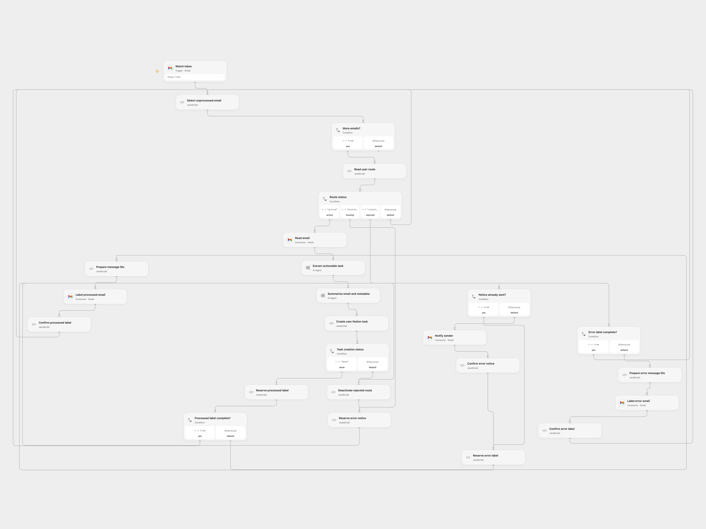

# Route Aliased Emails to Notion Tasks

Route inbox messages to each user’s Notion database and create an AI task and summary.

<!-- template-actions:start -->
 
<!-- template-actions:end -->

<picture>
  <source media="(prefers-color-scheme: dark)" srcset="preview-dark.png">
  
</picture>

## Setup and use

Connect Gmail and configure processed and error label IDs. Configure an Airtable routes table and a Secret Variable AIRTABLE_TOKEN with access to it. Set the base and table IDs. Each route record ID is used as a Gmail plus alias and needs Active, Token and NotionDatabase fields. Each Notion integration must have access to its target database, which needs a Name title property. Connect Gemini and enable persistent State.

## Behavior

For each unprocessed inbox message addressed to a route alias, the workflow creates an actionable task and a detailed summary, adds a page to that route's Notion database, and labels the email. Missing routes are reported to the sender. A rejected Notion authorization deactivates the route and reports it; uncertain external writes remain pending. Email content is sent to the AI provider.

Inspect the destination before reconciling a pending checkpoint. Mark an effect complete only after verifying it happened, or remove the pending state only after verifying it did not. Avoid overlapping runs. Route tokens are read privately for the request and must be protected in Airtable.

In n8n

In n8n use a self-hosted runtime with AIRTABLE_TOKEN available to Code nodes (set N8N_BLOCK_ENV_ACCESS_IN_NODE=false), configure Gmail and Gemini, select a Data Table with item_key and status text columns, and set the base and table IDs in the three route Code nodes.

Inspiration &amp; credits

Use Gemini, explicit status checks, per-message checkpoints, and private dynamic routing to preserve each user’s destination.

Adapted from [mails2notion V2](https://github.com/Zie619/n8n-workflows/blob/ae8cf6dc5b873cbb4f74587aa9180ed3a9f70682/workflows/Code/1921_Code_Filter_Automation_Webhook.json) in [Zie619/n8n-workflows](https://github.com/Zie619/n8n-workflows). Attribution: Zie619 / n8n-workflows.

The collection’s [MIT notice](https://github.com/Zie619/n8n-workflows/blob/94007c1445d9258a7da116646b79473e7c7c3282/LICENSE) is pinned at a later revision. This is the collection notice at that revision; it does not establish a separate original template author's license. Our changes are listed above; see [repository licensing](../../README.md#licensing).

> MIT License
>
> Copyright (c) 2025 Zie619
>
> Permission is hereby granted, free of charge, to any person obtaining a copy
> of this software and associated documentation files (the "Software"), to deal
> in the Software without restriction, including without limitation the rights
> to use, copy, modify, merge, publish, distribute, sublicense, and/or sell
> copies of the Software, and to permit persons to whom the Software is
> furnished to do so, subject to the following conditions:
>
> The above copyright notice and this permission notice shall be included in all
> copies or substantial portions of the Software.
>
> THE SOFTWARE IS PROVIDED "AS IS", WITHOUT WARRANTY OF ANY KIND, EXPRESS OR
> IMPLIED, INCLUDING BUT NOT LIMITED TO THE WARRANTIES OF MERCHANTABILITY,
> FITNESS FOR A PARTICULAR PURPOSE AND NONINFRINGEMENT. IN NO EVENT SHALL THE
> AUTHORS OR COPYRIGHT HOLDERS BE LIABLE FOR ANY CLAIM, DAMAGES OR OTHER
> LIABILITY, WHETHER IN AN ACTION OF CONTRACT, TORT OR OTHERWISE, ARISING FROM,
> OUT OF OR IN CONNECTION WITH THE SOFTWARE OR THE USE OR OTHER DEALINGS IN THE
> SOFTWARE.

