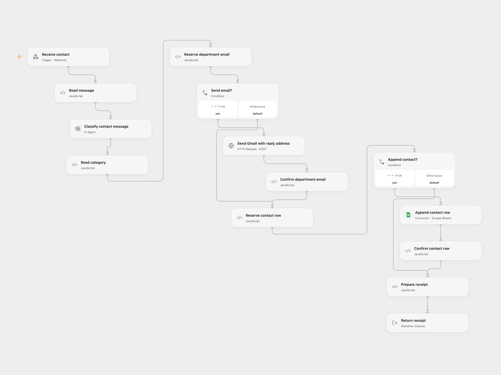

# Route and Log eCommerce Inquiries

Classify contact messages, email the right department, and log each request.

<picture>
  <source media="(prefers-color-scheme: dark)" srcset="preview-dark.png">
  
</picture>

[Open Flow JSON](templates/route-and-log-ecommerce-inquiries.openflow.json) · [n8n JSON](templates/route-and-log-ecommerce-inquiries.n8n.json)

## Setup

Import the n8n workflow, connect OpenAI, SMTP and Google Sheets, and configure the sender and five department addresses in **Prepare routing**. Set a Data Table with item_key and status text columns. Configure a Sheet with columns DATA, NOME, EMAIL, RICHIESTA, CATEGORIA, TO in that order. Prevent overlapping executions.

For Open Flow select relay mode in **Prepare contact**, enter the deployed webhook URL, configure the five recipients in **Reserve department email**, set the spreadsheet and range in **Reserve contact row**, connect Google Sheets, and bind a Gmail OAuth access token with permission to send as GMAIL_ACCESS_TOKEN. Enable persistent State and restrict webhook access to trusted n8n. Direct mode uses SMTP in n8n. Use one mode.

## Behavior

The message is classified as Request Quote, Product info, General problem, Order or Other, then emailed to the corresponding department with the customer's address as Reply-To. After successful delivery, the request, category and recipient are appended to the sheet. AI classification may be wrong; review messages. Personal data is sent to the model and may appear in execution history; protect access and retention. Open Flow Code inputs and outputs must fit 1 MiB each.

If email delivery or sheet append is uncertain, inspect Gmail/SMTP or the sheet before retrying. In Open Flow enter the pending key and confirmed or absent in the corresponding reserve node, replay the same submission, then clear the fields. In n8n inspect pending Data Table rows, complete missing work manually and mark done after confirmation; delete a row only if its write did not occur.

Inspiration &amp; credits

Fix the product and quote routing and record the actual category; add a relay and separate write checkpoints.

Adapted from [Contact Form Text Classifier for eCommerce](https://github.com/Zie619/n8n-workflows/blob/ae8cf6dc5b873cbb4f74587aa9180ed3a9f70682/workflows/Form/1554_Form_GoogleSheets_Automation_Triggered.json) in [Zie619/n8n-workflows](https://github.com/Zie619/n8n-workflows). The source export does not identify a separate template author or license.

The collection’s [MIT notice](https://github.com/Zie619/n8n-workflows/blob/94007c1445d9258a7da116646b79473e7c7c3282/LICENSE) is pinned at a later revision. This is the collection notice at that revision; it does not establish a separate original template author's license. Our changes are listed above; see [repository licensing](../../README.md#licensing).

> MIT License
>
> Copyright (c) 2025 Zie619
>
> Permission is hereby granted, free of charge, to any person obtaining a copy
> of this software and associated documentation files (the "Software"), to deal
> in the Software without restriction, including without limitation the rights
> to use, copy, modify, merge, publish, distribute, sublicense, and/or sell
> copies of the Software, and to permit persons to whom the Software is
> furnished to do so, subject to the following conditions:
>
> The above copyright notice and this permission notice shall be included in all
> copies or substantial portions of the Software.
>
> THE SOFTWARE IS PROVIDED "AS IS", WITHOUT WARRANTY OF ANY KIND, EXPRESS OR
> IMPLIED, INCLUDING BUT NOT LIMITED TO THE WARRANTIES OF MERCHANTABILITY,
> FITNESS FOR A PARTICULAR PURPOSE AND NONINFRINGEMENT. IN NO EVENT SHALL THE
> AUTHORS OR COPYRIGHT HOLDERS BE LIABLE FOR ANY CLAIM, DAMAGES OR OTHER
> LIABILITY, WHETHER IN AN ACTION OF CONTRACT, TORT OR OTHERWISE, ARISING FROM,
> OUT OF OR IN CONNECTION WITH THE SOFTWARE OR THE USE OR OTHER DEALINGS IN THE
> SOFTWARE.

