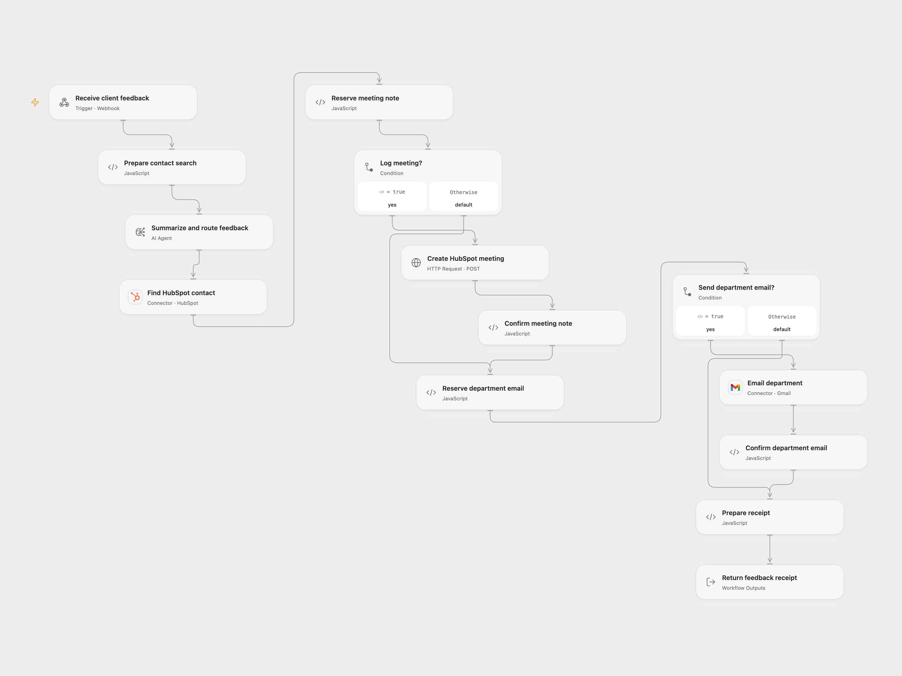

# Route Client Feedback and Log HubSpot Meeting

Summarize client feedback, log it against a HubSpot contact and email the relevant department.

<!-- template-actions:start -->
 
<!-- template-actions:end -->

<picture>
  <source media="(prefers-color-scheme: dark)" srcset="preview-dark.png">
  
</picture>

## Setup

Configure four recipient addresses for product, administrative, support and commercial feedback. Connect HubSpot and Gmail, and configure an AI model. In n8n connect HubSpot OAuth and Gmail, configure **Prepare feedback** and select a Data Table with item_key and status text columns.

For Open Flow set **Prepare feedback** to relay, configure the webhook URL and recipients in **Reserve department email**, connect HubSpot and Gmail, bind HUBSPOT_ACCESS_TOKEN as a secret for the same HubSpot account, and enable persistent State. Restrict the webhook to trusted n8n. Direct mode runs in n8n; use one mode.

## Behavior

The form collects a client's email and conversation. The model summarizes it in the original language and chooses one department. An exact HubSpot email match receives a meeting engagement with the summary; when no contact matches, the department still receives the conversation. Multiple matches stop the run for review. The department email includes the client address and original conversation. The selected recipient and summary can be wrong; review them. Client information is sent to the model and may appear in execution history. Code ports must each fit 1 MiB.

If a meeting write or email delivery is uncertain, inspect HubSpot or Gmail before retrying. Open Flow stores separate pending keys in **Reserve meeting note** and **Reserve department email**; enter the key and confirmed or absent, replay the same submission and clear the fields. In n8n inspect the pending Data Table rows and complete any missing action manually; mark done only after confirming the result, or delete only when it did not occur.

Inspiration &amp; credits

Restrict routing to configured recipients and checkpoint meeting and email writes.

Adapted from [Automate Client issue](https://github.com/Zie619/n8n-workflows/blob/ae8cf6dc5b873cbb4f74587aa9180ed3a9f70682/workflows/Form/0890_Form_Stickynote_Send_Triggered.json) in [Zie619/n8n-workflows](https://github.com/Zie619/n8n-workflows). The source export does not identify a separate template author or license.

The collection’s [MIT notice](https://github.com/Zie619/n8n-workflows/blob/94007c1445d9258a7da116646b79473e7c7c3282/LICENSE) is pinned at a later revision. This is the collection notice at that revision; it does not establish a separate original template author's license. Our changes are listed above; see [repository licensing](../../README.md#licensing).

> MIT License
>
> Copyright (c) 2025 Zie619
>
> Permission is hereby granted, free of charge, to any person obtaining a copy
> of this software and associated documentation files (the "Software"), to deal
> in the Software without restriction, including without limitation the rights
> to use, copy, modify, merge, publish, distribute, sublicense, and/or sell
> copies of the Software, and to permit persons to whom the Software is
> furnished to do so, subject to the following conditions:
>
> The above copyright notice and this permission notice shall be included in all
> copies or substantial portions of the Software.
>
> THE SOFTWARE IS PROVIDED "AS IS", WITHOUT WARRANTY OF ANY KIND, EXPRESS OR
> IMPLIED, INCLUDING BUT NOT LIMITED TO THE WARRANTIES OF MERCHANTABILITY,
> FITNESS FOR A PARTICULAR PURPOSE AND NONINFRINGEMENT. IN NO EVENT SHALL THE
> AUTHORS OR COPYRIGHT HOLDERS BE LIABLE FOR ANY CLAIM, DAMAGES OR OTHER
> LIABILITY, WHETHER IN AN ACTION OF CONTRACT, TORT OR OTHERWISE, ARISING FROM,
> OUT OF OR IN CONNECTION WITH THE SOFTWARE OR THE USE OR OTHER DEALINGS IN THE
> SOFTWARE.

