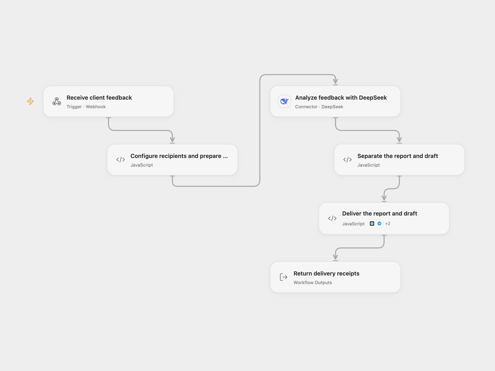

# Route Client Feedback Reports

Analyze submitted client feedback, deliver an email summary, and send a social draft to a private Telegram chat for review.

<!-- template-actions:start -->
 
<!-- template-actions:end -->

<picture>
  <source media="(prefers-color-scheme: dark)" srcset="preview-dark.png">
  
</picture>

## Setup

1. In **Receive client feedback**, configure **Header** authentication with `X-Client-Feedback-Secret` and a secret variable. Keep processing disabled in **Configure recipients and prepare feedback** while testing that missing or incorrect secrets return HTTP 401.
2. In **Configure recipients and prepare feedback**, enter the fixed report email address and numeric Telegram chat ID. Connect DeepSeek in **Analyze feedback with DeepSeek**. In **Deliver the report and draft**, connect an IMAP Mailbox with SMTP sending enabled and a Telegram bot that can send to your review chat.
3. Enable processing and publish. Configure your trusted sender to POST `{"feedback":"Example feedback"}` as JSON to the webhook URL with the shared header. Submit only feedback you are authorized to process through DeepSeek and share with the selected recipients.

## Behavior

The webhook returns HTTP 200 when it accepts the request. Check the run for delivery results. DeepSeek summarizes the positives, suggests improvements, and writes one draft for human review. An incomplete analysis produces no notifications.

SMTP receives the report and Telegram receives only the draft. The recipients come from workflow settings. Each delivery runs independently, so one provider's failure does not prevent the other attempt. A receipt indicates that the provider accepted the message. If either outcome is unconfirmed, check the destination before replaying the webhook.

In n8n

Bind a **Header Auth** credential for `X-Client-Feedback-Secret` to **Receive client feedback**. Use your instance's production URL for the `client-feedback` path. In **Configure recipients and prepare feedback**, enter the same fixed recipients and enable processing after testing authentication.

Bind a **Bearer Auth** credential with a DeepSeek API key to **Analyze feedback with DeepSeek**. Bind your SMTP credential and set the sender address in **Email the feedback report**. Bind your Telegram bot credential to **Send the draft for Telegram review**. The import disables execution history because incoming data can include your header secret and feedback. Check the SMTP and Telegram destinations for delivery. You can inspect both delivery nodes during a manual test with synthetic feedback.

Inspiration &amp; credits

Adapted from [Client feedback analysis and social draft](https://github.com/Zie619/n8n-workflows/blob/ae8cf6dc5b873cbb4f74587aa9180ed3a9f70682/workflows/Http/1920_HTTP_Telegram_Automate_Webhook.json) in [Zie619/n8n-workflows](https://github.com/Zie619/n8n-workflows). Attribution: Zie619 / n8n-workflows.

The collection’s [MIT notice](https://github.com/Zie619/n8n-workflows/blob/94007c1445d9258a7da116646b79473e7c7c3282/LICENSE) is pinned at a later revision. This is the collection notice at that revision; it does not establish a separate original template author's license. Our changes are listed above; see [repository licensing](../../README.md#licensing).

> MIT License
>
> Copyright (c) 2025 Zie619
>
> Permission is hereby granted, free of charge, to any person obtaining a copy
> of this software and associated documentation files (the "Software"), to deal
> in the Software without restriction, including without limitation the rights
> to use, copy, modify, merge, publish, distribute, sublicense, and/or sell
> copies of the Software, and to permit persons to whom the Software is
> furnished to do so, subject to the following conditions:
>
> The above copyright notice and this permission notice shall be included in all
> copies or substantial portions of the Software.
>
> THE SOFTWARE IS PROVIDED "AS IS", WITHOUT WARRANTY OF ANY KIND, EXPRESS OR
> IMPLIED, INCLUDING BUT NOT LIMITED TO THE WARRANTIES OF MERCHANTABILITY,
> FITNESS FOR A PARTICULAR PURPOSE AND NONINFRINGEMENT. IN NO EVENT SHALL THE
> AUTHORS OR COPYRIGHT HOLDERS BE LIABLE FOR ANY CLAIM, DAMAGES OR OTHER
> LIABILITY, WHETHER IN AN ACTION OF CONTRACT, TORT OR OTHERWISE, ARISING FROM,
> OUT OF OR IN CONNECTION WITH THE SOFTWARE OR THE USE OR OTHER DEALINGS IN THE
> SOFTWARE.

