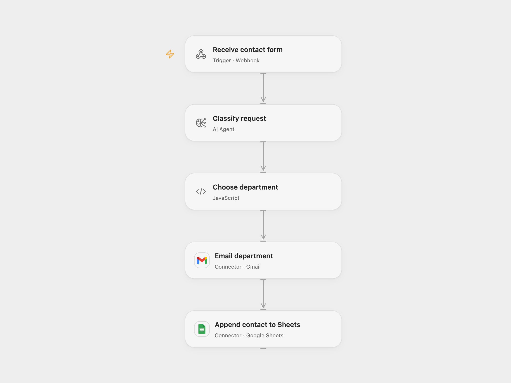

# Route Contact Forms by Topic

Classify a contact request, email the matching department and log it to Google Sheets.

<!-- template-actions:start -->
 
<!-- template-actions:end -->

<picture>
  <source media="(prefers-color-scheme: dark)" srcset="preview-dark.png">
  
</picture>

## Setup

Connect Gmail and Google Sheets, and select an AI model. Configure the five department email addresses in **Choose department**, and set the spreadsheet ID and A:F worksheet range in **Append contact to Sheets**. Publish the workflow and open the hosted Webhook form URL (or POST JSON `{"name": "...", "email": "...", "message": "..."}`).

## Behavior

The hosted form collects a name, email, and message. The model classifies the inquiry into quote, product information, general problem, order, or other. The matching department receives the request via Gmail, and the workflow appends its details and recipient to Google Sheets. Messages are shared with the configured model. A lost email or sheet response can mean the write succeeded; inspect the destination before retrying.

In n8n

Import the n8n workflow and configure the form, SMTP credentials, sender and department recipients, and Google Sheets credentials, spreadsheet, and sheet in each database node.

Inspiration &amp; credits

## Changes to the source

Corrected the classifier's quote and product output wiring, replaced private spreadsheet IDs and recipient addresses with placeholders, added hosted form intake, and logged the actual category.

Adapted from [Modular & Customizable AI-Powered Email Routing: Text Classifier for eCommerce](https://github.com/enescingoz/awesome-n8n-templates/blob/827110332c21cbe000ab13f6d292d5adb1f1f8db/Gmail_and_Email_Automation/Modular%20%26%20Customizable%20AI-Powered%20Email%20Routing_%20Text%20Classifier%20for%20eCommerce.json) in [enescingoz/awesome-n8n-templates](https://github.com/enescingoz/awesome-n8n-templates).

Source collection notice: © 2024–2026 Enes Cingoz, [CC BY 4.0](https://github.com/enescingoz/awesome-n8n-templates/blob/827110332c21cbe000ab13f6d292d5adb1f1f8db/LICENSE). The source export does not identify a separate template author or license. See [repository licensing](../../README.md#licensing) for the scope of OOMOL contributions and third-party material.

