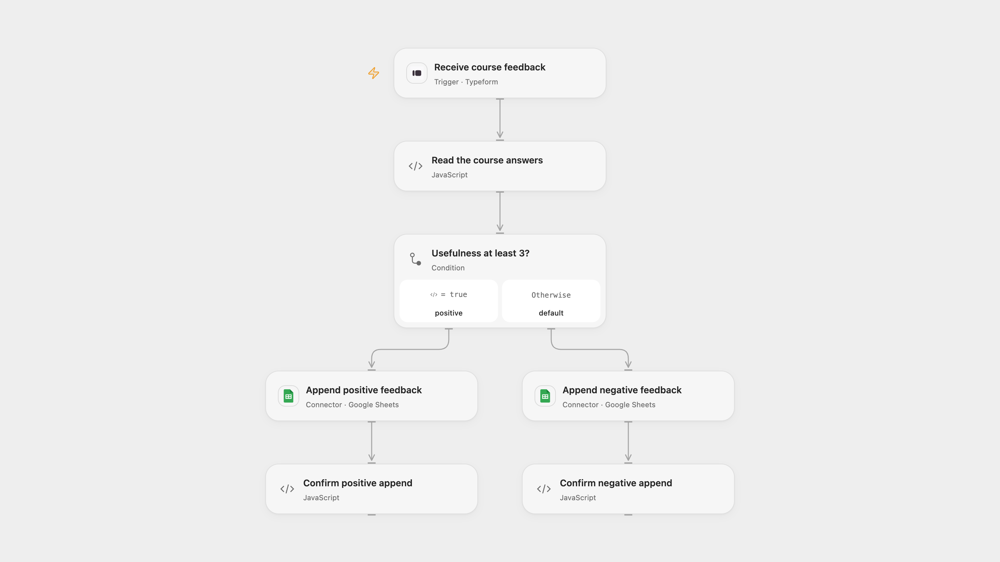

# Route Course Feedback to Google Sheets

Route course feedback into positive or negative Google Sheets based on the usefulness answer.

<picture>
  <source media="(prefers-color-scheme: dark)" srcset="preview-dark.png">
  
</picture>

[Open Flow JSON](templates/route-course-feedback-to-google-sheets.openflow.json) · [n8n JSON](templates/route-course-feedback-to-google-sheets.n8n.json)

## Setup

Create a Typeform with a required numeric, rating or opinion-scale question titled **How useful was the course?** and a text question titled **Your opinion on the course:**. Titles must be unique. Connect Typeform and select the form. Connect Google Sheets to both append nodes and set each spreadsheet ID and sheet range. Prepare columns A and B in this order: **usefulness**, **opinion**. In n8n connect a Typeform personal access token and Google Sheets, select the same form and configure each destination spreadsheet and sheet with those headers. Activate one format.

## Behavior

Each submitted form with usefulness at least 3 is appended to the positive sheet; a lower value goes to the negative sheet. The usefulness number and opinion text are stored. A missing opinion becomes blank. Missing or ambiguous questions or an invalid usefulness answer stop before writing. Values are written as RAW, so text is not evaluated as a spreadsheet formula. Restrict access to feedback and execution history.

A failed or uncertain append may already have succeeded. Inspect the destination sheet before retrying; webhook delivery and manual replay do not guarantee exactly-once rows. Open Flow uses the response token for webhook admission deduplication; n8n does not keep the same submission history.

Inspiration &amp; credits

## Changes to the source

- Replace placeholder form and spreadsheet IDs with configuration, validate question identity and use RAW cell values. Both formats read the full Typeform answer payload instead of relying on simplified field-name keys.

Adapted from [typeform feedback workflow](https://github.com/Zie619/n8n-workflows/blob/ae8cf6dc5b873cbb4f74587aa9180ed3a9f70682/workflows/Googlesheets/0004_GoogleSheets_Typeform_Automate_Triggered.json) in [Zie619/n8n-workflows](https://github.com/Zie619/n8n-workflows). The source export does not identify a separate template author or license.

The collection’s [MIT notice](https://github.com/Zie619/n8n-workflows/blob/94007c1445d9258a7da116646b79473e7c7c3282/LICENSE) is pinned at a later revision. This is the collection notice at that revision; it does not establish a separate original template author's license. Our changes are listed above; see [repository licensing](../../README.md#licensing).

> MIT License
>
> Copyright (c) 2025 Zie619
>
> Permission is hereby granted, free of charge, to any person obtaining a copy
> of this software and associated documentation files (the "Software"), to deal
> in the Software without restriction, including without limitation the rights
> to use, copy, modify, merge, publish, distribute, sublicense, and/or sell
> copies of the Software, and to permit persons to whom the Software is
> furnished to do so, subject to the following conditions:
>
> The above copyright notice and this permission notice shall be included in all
> copies or substantial portions of the Software.
>
> THE SOFTWARE IS PROVIDED "AS IS", WITHOUT WARRANTY OF ANY KIND, EXPRESS OR
> IMPLIED, INCLUDING BUT NOT LIMITED TO THE WARRANTIES OF MERCHANTABILITY,
> FITNESS FOR A PARTICULAR PURPOSE AND NONINFRINGEMENT. IN NO EVENT SHALL THE
> AUTHORS OR COPYRIGHT HOLDERS BE LIABLE FOR ANY CLAIM, DAMAGES OR OTHER
> LIABILITY, WHETHER IN AN ACTION OF CONTRACT, TORT OR OTHERWISE, ARISING FROM,
> OUT OF OR IN CONNECTION WITH THE SOFTWARE OR THE USE OR OTHER DEALINGS IN THE
> SOFTWARE.

