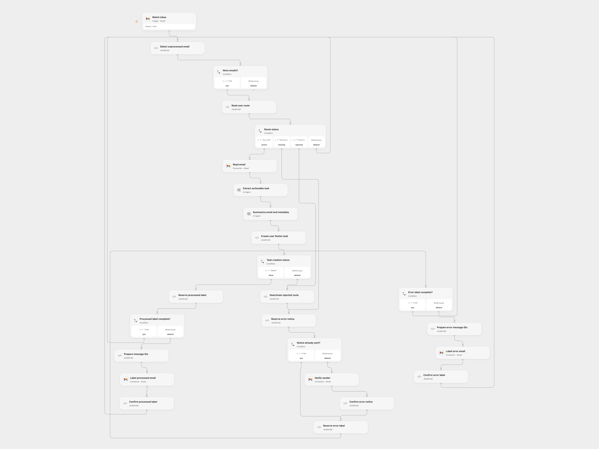

# Route Email Tasks to Notion

Route emails through user-specific Notion connections and create tasks and summaries.

<!-- template-actions:start -->
[](https://openflow.run/templates/route-email-tasks-to-notion/) [](templates/route-email-tasks-to-notion.n8n.json)
<!-- template-actions:end -->

<picture>
  <source media="(prefers-color-scheme: dark)" srcset="preview-dark.png">
  
</picture>

## Setup and use

Configure Gmail, processed and error label IDs, an Airtable routes table, and a Secret Variable AIRTABLE_TOKEN with access to that table. Set base and table IDs. Each route record ID is used as the Gmail plus alias and needs Active, Token and NotionDatabase fields. Each user must grant their Notion integration access to the target database, which needs a Name title property. Configure a model and persistent State. In n8n use a self-hosted runtime with AIRTABLE_TOKEN available to Code nodes (set N8N_BLOCK_ENV_ACCESS_IN_NODE=false), configure Gmail and a Data Table with item_key and status text columns, and set the base and table IDs inside the three route Code nodes.

## Behavior

New inbox messages addressed to an active route are turned into a task and email summary in that user's Notion database, then labeled processed. Missing routes trigger a sender notice and error label. A Notion authorization rejection deactivates the route and notifies the sender; transient or uncertain writes stop for inspection. Inspect the destination before clearing pending checkpoints. Avoid overlapping runs. Email and generated content are sent to the configured AI provider. Protect the route table because it contains Notion tokens, and restrict access to execution history and user data.

<details>
<summary>Inspiration &amp; credits</summary>

Adapted from [Turn Emails into AI-Enhanced Tasks in Notion (Multi-User Support) with Gmail, Airtable and Softr](https://github.com/enescingoz/awesome-n8n-templates/blob/827110332c21cbe000ab13f6d292d5adb1f1f8db/Notion/Turn%20Emails%20into%20AI-Enhanced%20Tasks%20in%20Notion%20(Multi-User%20Support)%20with%20Gmail%2C%20Airtable%20and%20Softr.json) in [enescingoz/awesome-n8n-templates](https://github.com/enescingoz/awesome-n8n-templates).

Source collection notice: © 2024–2026 Enes Cingoz, [CC BY 4.0](https://github.com/enescingoz/awesome-n8n-templates/blob/827110332c21cbe000ab13f6d292d5adb1f1f8db/LICENSE). The source export does not identify a separate template author or license. See [repository licensing](../../README.md#licensing) for the scope of OOMOL contributions and third-party material.


Changes from source: Update the model, keep per-user Notion tokens inside request handling, use explicit user routes and checkpoints, and deactivate routes on confirmed authorization rejection rather than uncertain failures.

Collection license notice:

```text
Creative Commons Attribution 4.0 International License

Copyright (c) 2024-2026 Enes Cingoz

You are free to:

  Share - copy and redistribute the material in any medium or format
  Adapt - remix, transform, and build upon the material for any purpose,
  even commercially.

Under the following terms:

  Attribution - You must give appropriate credit, provide a link to the
  license, and indicate if changes were made. You may do so in any
  reasonable manner, but not in any way that suggests the licensor
  endorses you or your use.

  No additional restrictions - You may not apply legal terms or
  technological measures that legally restrict others from doing
  anything the license permits.

Notices:

  You do not have to comply with the license for elements of the
  material in the public domain or where your use is permitted by an
  applicable exception or limitation.

  No warranties are given. The license may not give you all of the
  permissions necessary for your intended use. For example, other rights
  such as publicity, privacy, or moral rights may limit how you use the
  material.

For the full license text, see:
https://creativecommons.org/licenses/by/4.0/legalcode

```

</details>
