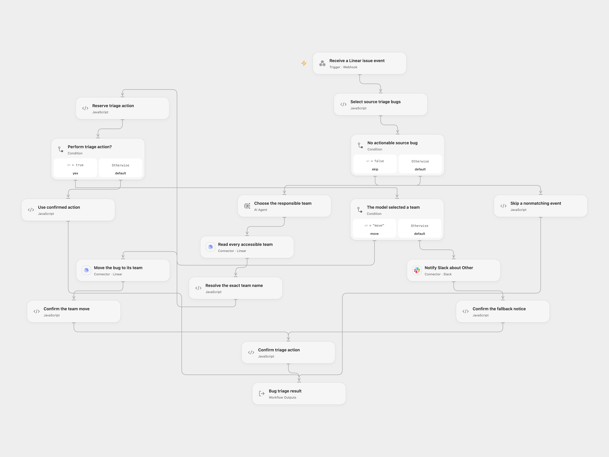

# Route Linear Bugs to Teams

Classify selected Linear bugs, move them to a matching team, or notify Slack when no team fits.

<picture>
  <source media="(prefers-color-scheme: dark)" srcset="preview-dark.png">
  
</picture>

[Open Flow JSON](templates/route-linear-bugs-to-teams.openflow.json) · [n8n JSON](templates/route-linear-bugs-to-teams.n8n.json)

## Setup

Configure Linear source team, triage state and bug label IDs, team responsibilities and a Slack channel. Connect Linear and Slack and configure an AI model. In n8n configure the Linear Trigger and use one Data Table with item_key and status text columns. Enable persistent State in Open Flow. Prevent overlapping runs.

Register a Linear Issue webhook for the configured source team at the Open Flow POST URL. Protect this endpoint at the deployment boundary: this workflow does not verify Linear's optional signing secret. In n8n select Linear OAuth credentials on the trigger and team query, a Linear API credential on the update, and Slack and OpenAI credentials. Configure the same source team and other IDs in **Set me up**. Choose one format.

## Behavior

Issues with a description other than the placeholder, the configured state and bug label are classified against the configured team descriptions. An exact matching team moves the issue; Other sends a Slack notification. Review model decisions and maintain the team list. Open Flow requires the issue ID and webhook timestamp as event identity; the timestamp must be within one minute of receipt.

For unknown moves or messages, inspect Linear or Slack before replay. In Open Flow enter the pending key in **Reserve triage action** and set confirmed if applied or absent if not. Also enter that key in **Select source triage bugs** as recoveryKey to allow the original timestamp, replay the same event, then clear all recovery fields. In n8n reconcile the pending Data Table row, mark it done if the action happened or delete it only if no action happened. Event data may appear in execution history.

Inspiration &amp; credits

Resolve exact team names and checkpoint the selected external action.

Adapted from [Classify new bugs in Linear and move them to a team](https://github.com/Zie619/n8n-workflows/blob/ae8cf6dc5b873cbb4f74587aa9180ed3a9f70682/workflows/Filter/0451_Filter_Slack_Update_Webhook.json) in [Zie619/n8n-workflows](https://github.com/Zie619/n8n-workflows). The source export does not identify a separate template author or license.

The collection’s [MIT notice](https://github.com/Zie619/n8n-workflows/blob/94007c1445d9258a7da116646b79473e7c7c3282/LICENSE) is pinned at a later revision. This is the collection notice at that revision; it does not establish a separate original template author's license. Our changes are listed above; see [repository licensing](../../README.md#licensing).

> MIT License
>
> Copyright (c) 2025 Zie619
>
> Permission is hereby granted, free of charge, to any person obtaining a copy
> of this software and associated documentation files (the "Software"), to deal
> in the Software without restriction, including without limitation the rights
> to use, copy, modify, merge, publish, distribute, sublicense, and/or sell
> copies of the Software, and to permit persons to whom the Software is
> furnished to do so, subject to the following conditions:
>
> The above copyright notice and this permission notice shall be included in all
> copies or substantial portions of the Software.
>
> THE SOFTWARE IS PROVIDED "AS IS", WITHOUT WARRANTY OF ANY KIND, EXPRESS OR
> IMPLIED, INCLUDING BUT NOT LIMITED TO THE WARRANTIES OF MERCHANTABILITY,
> FITNESS FOR A PARTICULAR PURPOSE AND NONINFRINGEMENT. IN NO EVENT SHALL THE
> AUTHORS OR COPYRIGHT HOLDERS BE LIABLE FOR ANY CLAIM, DAMAGES OR OTHER
> LIABILITY, WHETHER IN AN ACTION OF CONTRACT, TORT OR OTHERWISE, ARISING FROM,
> OUT OF OR IN CONNECTION WITH THE SOFTWARE OR THE USE OR OTHER DEALINGS IN THE
> SOFTWARE.

