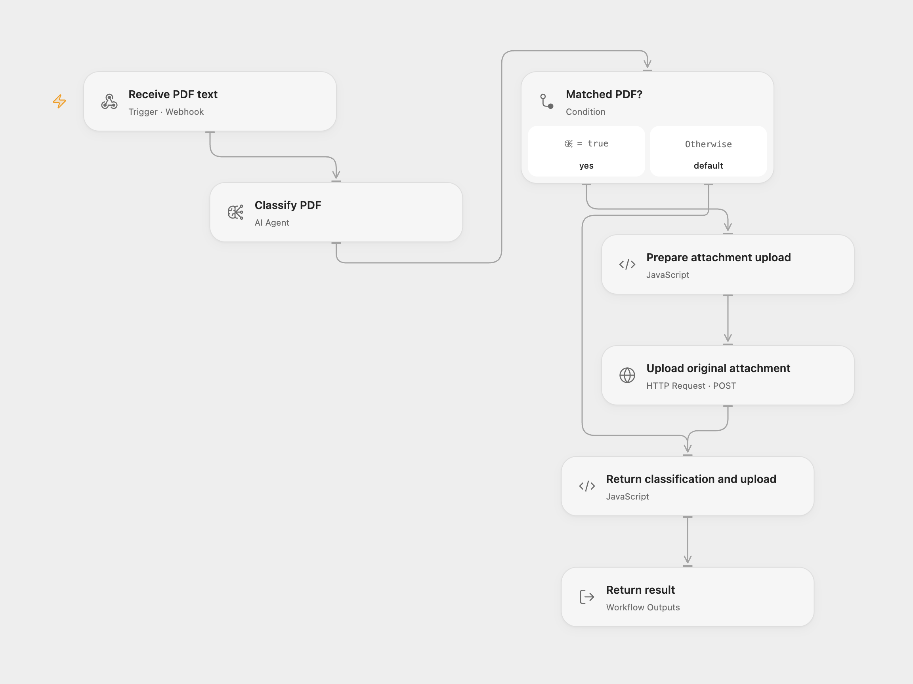

# Route Matching Gmail PDFs to Drive

Classify PDF attachments from Gmail by their content and upload matching files to Google Drive.

<picture>
  <source media="(prefers-color-scheme: dark)" srcset="preview-dark.png">
  
</picture>

[Open Flow JSON](templates/route-matching-gmail-pdfs-to-drive.openflow.json) · [n8n JSON](templates/route-matching-gmail-pdfs-to-drive.n8n.json)

## Setup and use

Import the n8n workflow, connect Gmail and Google Drive, set the matching term and Drive folder ID in **Configure**, and configure an available OpenAI model for direct mode. Set **Choose mode** to direct for n8n-only execution or relay for Open Flow classification. In relay mode deploy Open Flow, configure its model and set its webhook URL in **Classify PDF with Open Flow**, and set the n8n upload relay webhook URL in **Upload original attachment**. Activate one mode.

## Behavior

The workflow polls Gmail every minute, iterates attachments, extracts PDF text, and classifies it using the configured term, filename and text. Matching original PDFs are uploaded to the configured Drive folder; non-PDF and nonmatching files are skipped. PDFs above the source's text-length limit are skipped. The supplied n8n workflow performs the Gmail trigger, PDF extraction and binary upload in both modes. In Open Flow mode a matching classification invokes the n8n upload relay, which refetches the original Gmail message by ID and uploads the same indexed attachment. Set the Gmail credentials on the relay as well. PDF contents are shared with the model. Neither webhook authenticates callers; restrict access to trusted senders. A lost Drive response may represent a completed upload; inspect the destination before retrying.

Inspiration &amp; credits

## Changes to the source

- Add an Open Flow classification mode, preserve attachment item pairing, use the current n8n PDF extraction node, and replace the private Drive folder.

Adapted from [Send specific PDF attachments from Gmail to Google Drive using OpenAI](https://github.com/enescingoz/awesome-n8n-templates/blob/827110332c21cbe000ab13f6d292d5adb1f1f8db/Gmail_and_Email_Automation/Send%20specific%20PDF%20attachments%20from%20Gmail%20to%20Google%20Drive%20using%20OpenAI.json) in [enescingoz/awesome-n8n-templates](https://github.com/enescingoz/awesome-n8n-templates).

Source collection notice: © 2024–2026 Enes Cingoz, [CC BY 4.0](https://github.com/enescingoz/awesome-n8n-templates/blob/827110332c21cbe000ab13f6d292d5adb1f1f8db/LICENSE). The source credits [David Sha](https://davidsha.me). See [repository licensing](../../README.md#licensing) for the scope of OOMOL contributions and third-party material.

