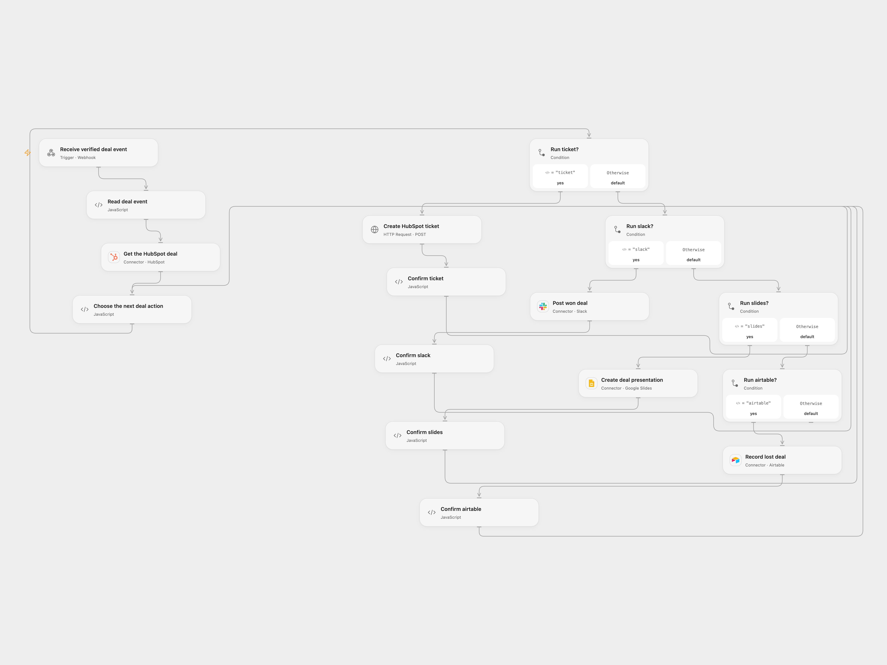

# Route New HubSpot Deals to Sales Tools

Create a HubSpot ticket for each new deal and route its stage to Slack, Google Slides or Airtable.

<!-- template-actions:start -->
 
<!-- template-actions:end -->

<picture>
  <source media="(prefers-color-scheme: dark)" srcset="preview-dark.png">
  
</picture>

## Setup

Configure a HubSpot legacy app subscription for deal.creation and send it to the n8n raw webhook. Set HUBSPOT_CLIENT_SECRET in the n8n environment. The relay validates the v1 signature over the original bytes. Connect HubSpot, Google Slides, Airtable and Slack; bind HUBSPOT_PRIVATE_APP_TOKEN to the ticket HTTP step. Configure the pipeline, stage, high-priority owner, channel, Airtable base and table in **Choose the next deal action**. The Airtable table needs deal_name, deal_id and deal_type fields. Enable persistent State and prevent overlapping runs.

For Open Flow enable **Forward to Open Flow**, set its webhook URL and disconnect the direct n8n business branch. Restrict access to the Open Flow webhook. For direct n8n use its branch alone and set the same credentials, pipeline, stage, owner and destinations. Configure one Data Table with item_key and status text columns for its checkpoint nodes.

## Behavior

For each verified creation event, retrieve the deal, create a ticket and route won deals to Slack, presentation-scheduled deals to Google Slides, and lost deals to Airtable. Other stages create only a ticket. A deal over 500 with type newbusiness receives HIGH priority unless its stage is exactly the literal closedlost|closedwon; all other tickets receive MEDIUM. This preserves the source comparison.

If a write outcome is unknown, inspect its destination. In **Choose the next deal action**, enter the pending key and resolution confirmed or absent, then replay the event and clear the fields. In direct n8n inspect the pending event row and all destinations; complete any remaining actions manually and mark the row done, or delete it only if no writes occurred. Execution history contains deal data.

Inspiration &amp; credits

Verify raw HubSpot events in an n8n relay, replace private destinations and checkpoint external writes.

Adapted from [Route new HubSpot deals](https://github.com/Zie619/n8n-workflows/blob/ae8cf6dc5b873cbb4f74587aa9180ed3a9f70682/workflows/Googleslides/0095_Googleslides_Slack_Automate_Triggered.json) in [Zie619/n8n-workflows](https://github.com/Zie619/n8n-workflows). The source export does not identify a separate template author or license.

The collection’s [MIT notice](https://github.com/Zie619/n8n-workflows/blob/94007c1445d9258a7da116646b79473e7c7c3282/LICENSE) is pinned at a later revision. This is the collection notice at that revision; it does not establish a separate original template author's license. Our changes are listed above; see [repository licensing](../../README.md#licensing).

> MIT License
>
> Copyright (c) 2025 Zie619
>
> Permission is hereby granted, free of charge, to any person obtaining a copy
> of this software and associated documentation files (the "Software"), to deal
> in the Software without restriction, including without limitation the rights
> to use, copy, modify, merge, publish, distribute, sublicense, and/or sell
> copies of the Software, and to permit persons to whom the Software is
> furnished to do so, subject to the following conditions:
>
> The above copyright notice and this permission notice shall be included in all
> copies or substantial portions of the Software.
>
> THE SOFTWARE IS PROVIDED "AS IS", WITHOUT WARRANTY OF ANY KIND, EXPRESS OR
> IMPLIED, INCLUDING BUT NOT LIMITED TO THE WARRANTIES OF MERCHANTABILITY,
> FITNESS FOR A PARTICULAR PURPOSE AND NONINFRINGEMENT. IN NO EVENT SHALL THE
> AUTHORS OR COPYRIGHT HOLDERS BE LIABLE FOR ANY CLAIM, DAMAGES OR OTHER
> LIABILITY, WHETHER IN AN ACTION OF CONTRACT, TORT OR OTHERWISE, ARISING FROM,
> OUT OF OR IN CONNECTION WITH THE SOFTWARE OR THE USE OR OTHER DEALINGS IN THE
> SOFTWARE.

