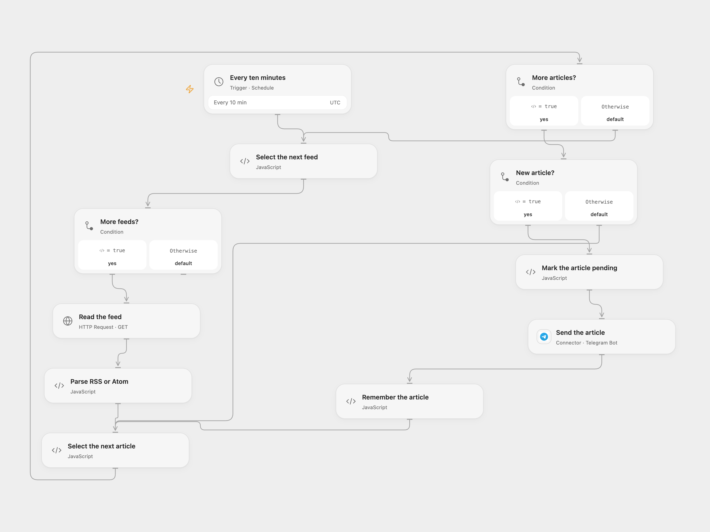

# Route RSS Articles to Telegram Chats

Read multiple feeds and route new links to Telegram chats.

<picture>
  <source media="(prefers-color-scheme: dark)" srcset="preview-dark.png">
  
</picture>

[Open Flow JSON](templates/route-rss-articles-to-telegram-chats.openflow.json) · [n8n JSON](templates/route-rss-articles-to-telegram-chats.n8n.json)

## Setup

Configure the feed URLs in **Select the next feed**, connect Telegram, and set the three chat IDs in **Select the next article**. Enable persistent State and prevent overlapping runs. Replace HTTP feeds with HTTPS endpoints where available; HTTP feeds can be modified in transit. In n8n configure the RSS Source list, Telegram credentials and chat IDs, and a Data Table with text columns item_key and status selected in all four checkpoint nodes. Activate one format.

## Behavior

Every ten minutes, each feed is read in order. Links containing techcommunity.microsoft.com go to M365. Other titles matching the source security keywords go to Security; the rest go to IT. Each message contains the title and link. The first run sends every entry returned. A feed URL and article link identify an item, avoiding the source's timestamp collisions. Feed contents and accumulated State must fit runtime limits.

A feed or send error stops the run; earlier sends remain. Inspect Telegram before resolving a pending article. In Open Flow enter the exact pending key shown in the error in **Select the next article → acknowledgeKey**, run once, then clear it. This treats it as handled. In n8n inspect pending Data Table rows and the destination, then mark a row sent if delivered or remove it only when a resend is safe. No uncertain send is automatically replayed.

Inspiration &amp; credits

## Changes to the source

- Use feed URL and link for deduplication instead of timestamps. Reserve each item before sending and record confirmation afterward.
- Preserve the source's feed order, ten-minute schedule and destination rules.

Adapted from [RSS feeds routed to Telegram chats](https://github.com/Zie619/n8n-workflows/blob/ae8cf6dc5b873cbb4f74587aa9180ed3a9f70682/workflows/Rssfeedread/0188_Rssfeedread_Telegram_Create_Scheduled.json) in [Zie619/n8n-workflows](https://github.com/Zie619/n8n-workflows). The source export does not identify a separate template author or license.

The collection’s [MIT notice](https://github.com/Zie619/n8n-workflows/blob/94007c1445d9258a7da116646b79473e7c7c3282/LICENSE) is pinned at a later revision. This is the collection notice at that revision; it does not establish a separate original template author's license. Our changes are listed above; see [repository licensing](../../README.md#licensing).

> MIT License
>
> Copyright (c) 2025 Zie619
>
> Permission is hereby granted, free of charge, to any person obtaining a copy
> of this software and associated documentation files (the "Software"), to deal
> in the Software without restriction, including without limitation the rights
> to use, copy, modify, merge, publish, distribute, sublicense, and/or sell
> copies of the Software, and to permit persons to whom the Software is
> furnished to do so, subject to the following conditions:
>
> The above copyright notice and this permission notice shall be included in all
> copies or substantial portions of the Software.
>
> THE SOFTWARE IS PROVIDED "AS IS", WITHOUT WARRANTY OF ANY KIND, EXPRESS OR
> IMPLIED, INCLUDING BUT NOT LIMITED TO THE WARRANTIES OF MERCHANTABILITY,
> FITNESS FOR A PARTICULAR PURPOSE AND NONINFRINGEMENT. IN NO EVENT SHALL THE
> AUTHORS OR COPYRIGHT HOLDERS BE LIABLE FOR ANY CLAIM, DAMAGES OR OTHER
> LIABILITY, WHETHER IN AN ACTION OF CONTRACT, TORT OR OTHERWISE, ARISING FROM,
> OUT OF OR IN CONNECTION WITH THE SOFTWARE OR THE USE OR OTHER DEALINGS IN THE
> SOFTWARE.

Open Flow bundles [fast-xml-parser](https://github.com/NaturalIntelligence/fast-xml-parser) and its dependencies under MIT; their notices are included in the workflow code.

