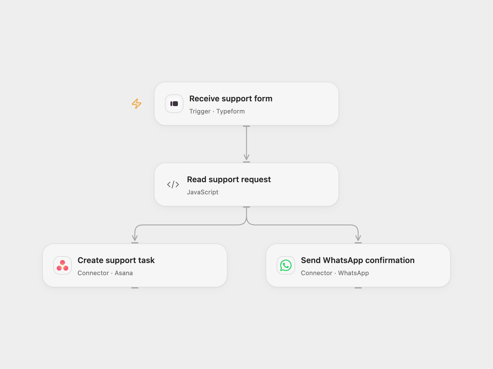

# Route Support Form to Asana and WhatsApp

Create an Asana support task and send a WhatsApp confirmation for each form submission.

<picture>
  <source media="(prefers-color-scheme: dark)" srcset="preview-dark.png">
  
</picture>

[Open Flow JSON](templates/route-support-form-to-asana-and-whatsapp.openflow.json) · [n8n JSON](templates/route-support-form-to-asana-and-whatsapp.n8n.json)

## Setup

Create a Typeform with required questions titled **What is your name?**, **What is your phone number?** and **What is your problem?**. Use a phone number field with international numbers. Connect Typeform and set its form ID in **Receive support form**. Connect WhatsApp Business Cloud and Asana, and set the WhatsApp phone number ID and Asana workspace ID. In n8n use the included form, connect WhatsApp and Asana, and set the same identifiers.

## Behavior

Each submission sends the named customer a WhatsApp confirmation and creates an Asana task containing the problem. WhatsApp free-text messaging requires an eligible customer-service conversation under Meta's rules. A failure in one branch does not undo a completed action in the other. Check both services before retrying an uncertain result; repeated submissions can create duplicate messages or tasks. Open Flow uses Typeform instead of the n8n form.

Inspiration &amp; credits

## Changes to the source

- Use Typeform for Open Flow and configure the form fields explicitly.

Adapted from [Customer service with WhatsApp Business Cloud and Asana](https://github.com/Zie619/n8n-workflows/blob/ae8cf6dc5b873cbb4f74587aa9180ed3a9f70682/workflows/Form/1908_Form_Asana_Automate_Triggered.json) in [Zie619/n8n-workflows](https://github.com/Zie619/n8n-workflows). The source export does not identify a separate template author or license.

The collection’s [MIT notice](https://github.com/Zie619/n8n-workflows/blob/94007c1445d9258a7da116646b79473e7c7c3282/LICENSE) is pinned at a later revision. This is the collection notice at that revision; it does not establish a separate original template author's license. Our changes are listed above; see [repository licensing](../../README.md#licensing).

> MIT License
>
> Copyright (c) 2025 Zie619
>
> Permission is hereby granted, free of charge, to any person obtaining a copy
> of this software and associated documentation files (the "Software"), to deal
> in the Software without restriction, including without limitation the rights
> to use, copy, modify, merge, publish, distribute, sublicense, and/or sell
> copies of the Software, and to permit persons to whom the Software is
> furnished to do so, subject to the following conditions:
>
> The above copyright notice and this permission notice shall be included in all
> copies or substantial portions of the Software.
>
> THE SOFTWARE IS PROVIDED "AS IS", WITHOUT WARRANTY OF ANY KIND, EXPRESS OR
> IMPLIED, INCLUDING BUT NOT LIMITED TO THE WARRANTIES OF MERCHANTABILITY,
> FITNESS FOR A PARTICULAR PURPOSE AND NONINFRINGEMENT. IN NO EVENT SHALL THE
> AUTHORS OR COPYRIGHT HOLDERS BE LIABLE FOR ANY CLAIM, DAMAGES OR OTHER
> LIABILITY, WHETHER IN AN ACTION OF CONTRACT, TORT OR OTHERWISE, ARISING FROM,
> OUT OF OR IN CONNECTION WITH THE SOFTWARE OR THE USE OR OTHER DEALINGS IN THE
> SOFTWARE.

