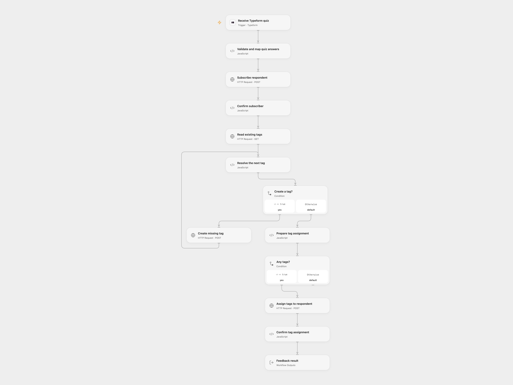

# Route Typeform Quiz to KlickTipp

Subscribe Typeform quiz respondents and assign tags from their answers.

<picture>
  <source media="(prefers-color-scheme: dark)" srcset="preview-dark.png">
  
</picture>

[Open Flow JSON](templates/route-typeform-quiz-to-klicktipp.openflow.json) · [n8n JSON](templates/route-typeform-quiz-to-klicktipp.n8n.json)

## Setup

Connect Typeform in **Receive Typeform quiz**, select your form and activate the flow. The form needs uniquely titled questions: **Vorname**, **Nachname**, **E-Mail Adresse**, **Mobilrufnummer**, **Geburtstag**, **LinkedIn URL**, **Wofür wird KlickTipp genutzt?**, **Wo ist der Firmensitz der Klick-Tipp Limited?** and **Wie viele Mitarbeiter hat das KlickTipp Customer Happiness Team?**. Use multiple choice for the first quiz question, a single choice for the second and a number for the third. Birthday is a date and email is an email question.

Set the opt-in process ID and four distinct KlickTipp custom field IDs in **Validate and map quiz answers**. Obtain a Management API session cookie for a dedicated KlickTipp API user and store the complete name=value pair in secret Variable **KLICKTIPP_SESSION_COOKIE**; renew it when the session expires. This is separate from the Listbuilding API key.

In n8n, install KlickTipp community node 1.0.48, connect Typeform and KlickTipp credentials, choose the form and configure the opt-in process and custom field IDs. Activate one format.

## Behavior

Each response creates or updates the subscriber with the contact details and quiz answers. Birthday is converted to a UTC Unix timestamp, the phone is normalized to digits with 00 for a leading plus, multiple choices are joined with commas, and the numeric answer is multiplied by 100. The three quiz answers become tags, with each selected choice treated as a tag. Open Flow deduplicates tag names, creates missing tags sequentially and assigns them together. n8n processes existing and newly created tags in separate branches.

A failed or uncertain write may already have changed KlickTipp. Inspect the contact and tags before retrying. Open Flow uses Typeform's managed signed webhook and a manually renewed session cookie; n8n manages Typeform registration and refreshes its KlickTipp session and retries a request after HTTP 403. Open Flow stops on that response.

Inspiration &amp; credits

## Changes to the source

- Replace private IDs with user configuration, match Typeform answers by unique question title, and interpret birthdays in UTC.
- Use a manually renewed Management API session in Open Flow. Deduplicate repeated tag names there and preserve empty tag lists in n8n.

Adapted from [Typeform quiz to KlickTipp](https://github.com/Zie619/n8n-workflows/blob/ae8cf6dc5b873cbb4f74587aa9180ed3a9f70682/workflows/Aggregate/0697_Aggregate_Typeform_Create_Triggered.json) in [Zie619/n8n-workflows](https://github.com/Zie619/n8n-workflows). The source export does not identify a separate template author or license.

The collection’s [MIT notice](https://github.com/Zie619/n8n-workflows/blob/94007c1445d9258a7da116646b79473e7c7c3282/LICENSE) is pinned at a later revision. This is the collection notice at that revision; it does not establish a separate original template author's license. Our changes are listed above; see [repository licensing](../../README.md#licensing).

> MIT License
>
> Copyright (c) 2025 Zie619
>
> Permission is hereby granted, free of charge, to any person obtaining a copy
> of this software and associated documentation files (the "Software"), to deal
> in the Software without restriction, including without limitation the rights
> to use, copy, modify, merge, publish, distribute, sublicense, and/or sell
> copies of the Software, and to permit persons to whom the Software is
> furnished to do so, subject to the following conditions:
>
> The above copyright notice and this permission notice shall be included in all
> copies or substantial portions of the Software.
>
> THE SOFTWARE IS PROVIDED "AS IS", WITHOUT WARRANTY OF ANY KIND, EXPRESS OR
> IMPLIED, INCLUDING BUT NOT LIMITED TO THE WARRANTIES OF MERCHANTABILITY,
> FITNESS FOR A PARTICULAR PURPOSE AND NONINFRINGEMENT. IN NO EVENT SHALL THE
> AUTHORS OR COPYRIGHT HOLDERS BE LIABLE FOR ANY CLAIM, DAMAGES OR OTHER
> LIABILITY, WHETHER IN AN ACTION OF CONTRACT, TORT OR OTHERWISE, ARISING FROM,
> OUT OF OR IN CONNECTION WITH THE SOFTWARE OR THE USE OR OTHER DEALINGS IN THE
> SOFTWARE.

