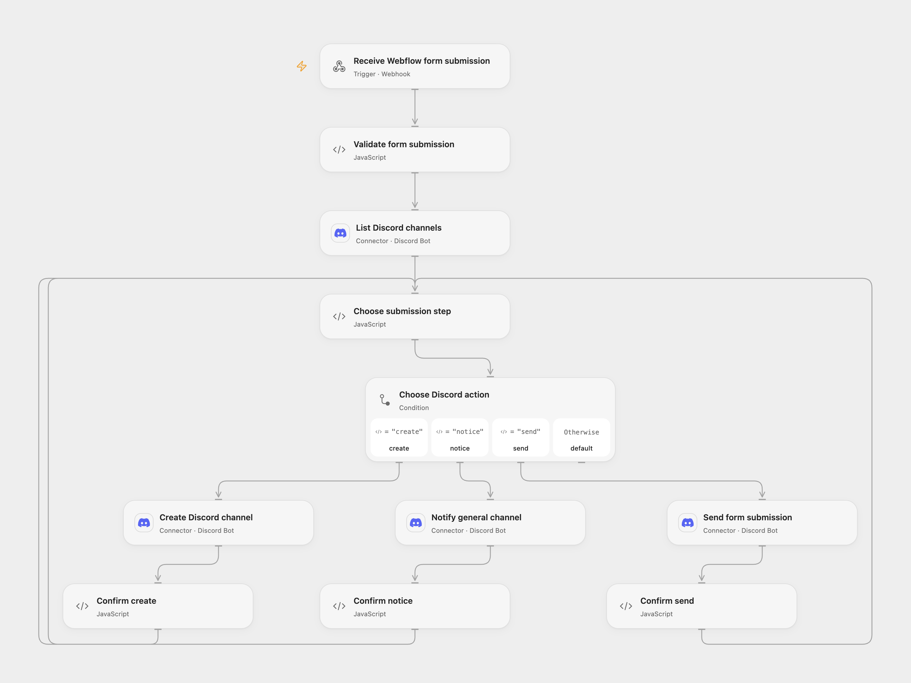

# Route Webflow Forms to Discord Channels

Send each Webflow form submission to a matching Discord channel.

<picture>
  <source media="(prefers-color-scheme: dark)" srcset="preview-dark.png">
  
</picture>

[Open Flow JSON](templates/route-webflow-forms-to-discord-channels.openflow.json) · [n8n JSON](templates/route-webflow-forms-to-discord-channels.n8n.json)

## Setup

Connect a Discord bot with permission to list and create channels and send messages. Set the guild ID in both Discord nodes and the general channel ID in **Notify general channel**. Set the Webflow site ID in **Validate form submission**, enable persistent State, and register the workflow webhook as a Webflow form_submission webhook. In n8n select the Discord credentials, IDs, Webflow site ID and a Data Table with item_key and status text columns. Activate one format.

## Use

A submission finds a text channel named from its form name, or creates one and announces it in general. The submission is sent to that channel. Use form names that form valid Discord channel names and keep messages under 2,000 characters. Do not overlap submissions for the same form.

The webhook does not verify Webflow signatures; restrict access at your deployment boundary. On uncertain channel creation or message delivery inspect Discord before retrying. In Open Flow enter the pending key and confirmed or absent in **Choose submission step**, plus the channel ID for a confirmed channel creation, and replay the same submission; clear recovery fields afterward. In n8n a failed Discord write stops on its error output or at the following error guard, with the checkpoint still pending. Inspect Discord and repair partial work before deleting that Data Table row. Protect form data in execution history.

Inspiration &amp; credits

Use Webflow v2 webhook and Discord bot actions; add checkpoints for uncertain writes.

Adapted from [Manage Webflow form submissions in Discord](https://github.com/Zie619/n8n-workflows/blob/ae8cf6dc5b873cbb4f74587aa9180ed3a9f70682/workflows/Code/1819_Code_Discord_Send_Triggered.json) in [Zie619/n8n-workflows](https://github.com/Zie619/n8n-workflows). Attribution: Zie619 / n8n-workflows.

The collection’s [MIT notice](https://github.com/Zie619/n8n-workflows/blob/94007c1445d9258a7da116646b79473e7c7c3282/LICENSE) is pinned at a later revision. This is the collection notice at that revision; it does not establish a separate original template author's license. Our changes are listed above; see [repository licensing](../../README.md#licensing).

> MIT License
>
> Copyright (c) 2025 Zie619
>
> Permission is hereby granted, free of charge, to any person obtaining a copy
> of this software and associated documentation files (the "Software"), to deal
> in the Software without restriction, including without limitation the rights
> to use, copy, modify, merge, publish, distribute, sublicense, and/or sell
> copies of the Software, and to permit persons to whom the Software is
> furnished to do so, subject to the following conditions:
>
> The above copyright notice and this permission notice shall be included in all
> copies or substantial portions of the Software.
>
> THE SOFTWARE IS PROVIDED "AS IS", WITHOUT WARRANTY OF ANY KIND, EXPRESS OR
> IMPLIED, INCLUDING BUT NOT LIMITED TO THE WARRANTIES OF MERCHANTABILITY,
> FITNESS FOR A PARTICULAR PURPOSE AND NONINFRINGEMENT. IN NO EVENT SHALL THE
> AUTHORS OR COPYRIGHT HOLDERS BE LIABLE FOR ANY CLAIM, DAMAGES OR OTHER
> LIABILITY, WHETHER IN AN ACTION OF CONTRACT, TORT OR OTHERWISE, ARISING FROM,
> OUT OF OR IN CONNECTION WITH THE SOFTWARE OR THE USE OR OTHER DEALINGS IN THE
> SOFTWARE.

