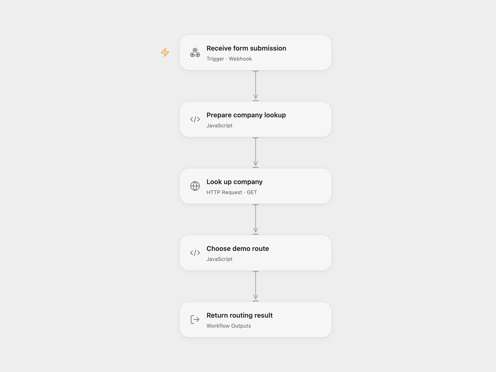

# Route Webflow Leads by Company Size

Return a demo routing result using the company size associated with a submitted email.

<picture>
  <source media="(prefers-color-scheme: dark)" srcset="preview-dark.png">
  
</picture>

[Open Flow JSON](templates/route-webflow-leads-by-company-size.openflow.json) · [n8n JSON](templates/route-webflow-leads-by-company-size.n8n.json)

## Setup and use

Bind the secret Variable DATAGMA_API_KEY to **Look up company** and deploy the webhook. Send a POST JSON object containing an email field. In n8n configure **Enrich with Datagma** with HTTP Query Auth named apiId, using the Datagma key as its value, and activate the webhook. Configure the form client to use one endpoint. The Open Flow webhook is public; restrict access to its URL. Datagma receives the API key in the HTTPS query, so protect access to network logs.

## Behavior

The workflow looks up the email domain with Datagma and returns {"result":1} for more than 100 employees or {"result":2} otherwise. The calling form selects the corresponding one-to-one or group demo link. A missing employee count stops the run. Datagma may charge for lookups. The source uses a Webflow form; the form and scheduling links are not included. The Open Flow endpoint allows cross-origin browser requests, matching the source's wildcard origin policy.

Inspiration &amp; credits

## Changes to the source

- Use secret query authentication and remove unused free-email and enrichment fields; only employee count affects the returned route.

Adapted from [Real-time lead routing](https://github.com/Zie619/n8n-workflows/blob/ae8cf6dc5b873cbb4f74587aa9180ed3a9f70682/workflows/Webhook/0375_Webhook_Code_Send_Webhook.json) in [Zie619/n8n-workflows](https://github.com/Zie619/n8n-workflows). The source export does not identify a separate template author or license.

The collection’s [MIT notice](https://github.com/Zie619/n8n-workflows/blob/94007c1445d9258a7da116646b79473e7c7c3282/LICENSE) is pinned at a later revision. This is the collection notice at that revision; it does not establish a separate original template author's license. Our changes are listed above; see [repository licensing](../../README.md#licensing).

> MIT License
>
> Copyright (c) 2025 Zie619
>
> Permission is hereby granted, free of charge, to any person obtaining a copy
> of this software and associated documentation files (the "Software"), to deal
> in the Software without restriction, including without limitation the rights
> to use, copy, modify, merge, publish, distribute, sublicense, and/or sell
> copies of the Software, and to permit persons to whom the Software is
> furnished to do so, subject to the following conditions:
>
> The above copyright notice and this permission notice shall be included in all
> copies or substantial portions of the Software.
>
> THE SOFTWARE IS PROVIDED "AS IS", WITHOUT WARRANTY OF ANY KIND, EXPRESS OR
> IMPLIED, INCLUDING BUT NOT LIMITED TO THE WARRANTIES OF MERCHANTABILITY,
> FITNESS FOR A PARTICULAR PURPOSE AND NONINFRINGEMENT. IN NO EVENT SHALL THE
> AUTHORS OR COPYRIGHT HOLDERS BE LIABLE FOR ANY CLAIM, DAMAGES OR OTHER
> LIABILITY, WHETHER IN AN ACTION OF CONTRACT, TORT OR OTHERWISE, ARISING FROM,
> OUT OF OR IN CONNECTION WITH THE SOFTWARE OR THE USE OR OTHER DEALINGS IN THE
> SOFTWARE.

