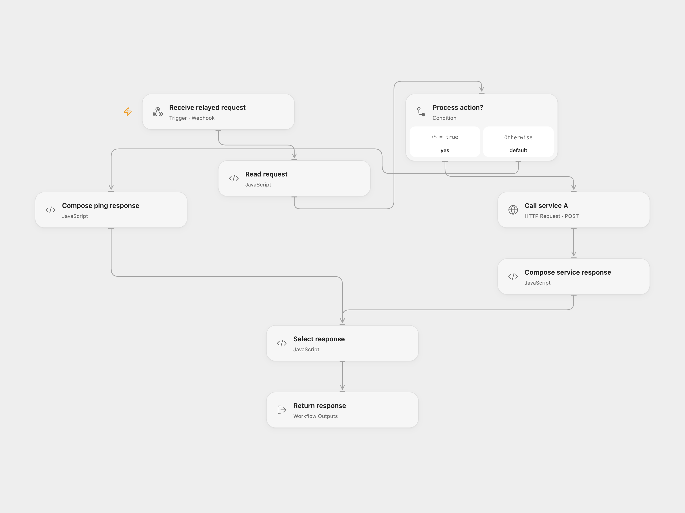

# Route Webhook Ping or Process

Route a webhook ping or send its payload to an HTTP service and return a JSON response.

<picture>
  <source media="(prefers-color-scheme: dark)" srcset="preview-dark.png">
  
</picture>

[Open Flow JSON](templates/route-webhook-ping-or-process.openflow.json) · [n8n JSON](templates/route-webhook-ping-or-process.n8n.json)

## Setup and use

Import the supplied n8n workflow. For n8n mode enable **Webhook** and disable **Open Flow relay webhook**. For Open Flow mode disable **Webhook**, enable the relay, set the deployed Open Flow webhook URL in **Forward complete request**, and activate n8n. Send your JSON POST to the selected n8n production webhook. Configure the service URL in **HTTP Service A** or **Call service A**. The default httpbin endpoint echoes the request and does not process it. Neither endpoint verifies the caller; restrict access as needed.

## Behavior

Missing action defaults to ping and returns ok and pong. Action process sends payload to the service and returns ok, source and the service's json field. Missing payload defaults to an example object. The n8n relay forwards the complete request body as JSON text and waits for the Open Flow response. Unsupported actions do not produce a successful response. If the service response is lost, the request may already have been processed; inspect the service before retrying. The Open Flow webhook waits up to 60 seconds for its response.

Inspiration &amp; credits

## Changes to the source

- Fix the default payload expression and add an n8n relay for complete arbitrary JSON requests and synchronous Open Flow responses.

Adapted from [Scalable webhook orchestrator](https://github.com/Zie619/n8n-workflows/blob/94007c1445d9258a7da116646b79473e7c7c3282/workflows/Templates/9001_Scalable_Webhook_Orchestrator_Webhook.json) in [Zie619/n8n-workflows](https://github.com/Zie619/n8n-workflows). The source export does not identify a separate template author or license.

The collection’s [MIT notice](https://github.com/Zie619/n8n-workflows/blob/94007c1445d9258a7da116646b79473e7c7c3282/LICENSE) is pinned at a later revision. This is the collection notice at that revision; it does not establish a separate original template author's license. Our changes are listed above; see [repository licensing](../../README.md#licensing).

> MIT License
>
> Copyright (c) 2025 Zie619
>
> Permission is hereby granted, free of charge, to any person obtaining a copy
> of this software and associated documentation files (the "Software"), to deal
> in the Software without restriction, including without limitation the rights
> to use, copy, modify, merge, publish, distribute, sublicense, and/or sell
> copies of the Software, and to permit persons to whom the Software is
> furnished to do so, subject to the following conditions:
>
> The above copyright notice and this permission notice shall be included in all
> copies or substantial portions of the Software.
>
> THE SOFTWARE IS PROVIDED "AS IS", WITHOUT WARRANTY OF ANY KIND, EXPRESS OR
> IMPLIED, INCLUDING BUT NOT LIMITED TO THE WARRANTIES OF MERCHANTABILITY,
> FITNESS FOR A PARTICULAR PURPOSE AND NONINFRINGEMENT. IN NO EVENT SHALL THE
> AUTHORS OR COPYRIGHT HOLDERS BE LIABLE FOR ANY CLAIM, DAMAGES OR OTHER
> LIABILITY, WHETHER IN AN ACTION OF CONTRACT, TORT OR OTHERWISE, ARISING FROM,
> OUT OF OR IN CONNECTION WITH THE SOFTWARE OR THE USE OR OTHER DEALINGS IN THE
> SOFTWARE.

