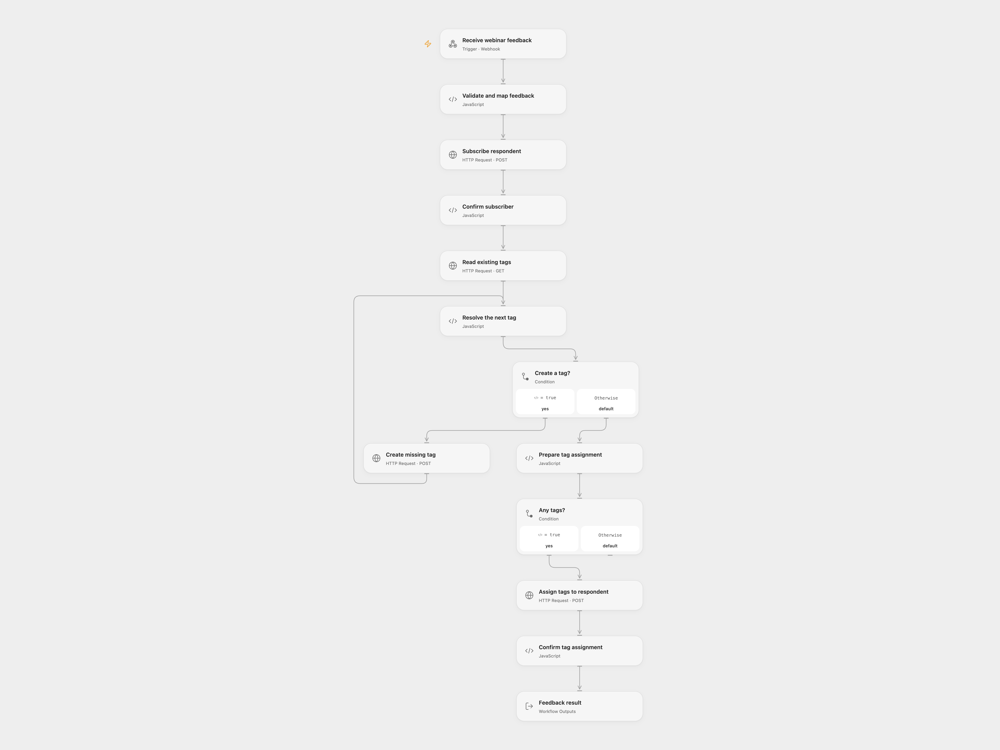

# Route Webinar Feedback to KlickTipp

Subscribe webinar feedback respondents and assign tags from their form answers.

<picture>
  <source media="(prefers-color-scheme: dark)" srcset="preview-dark.png">
  
</picture>

[Open Flow JSON](templates/route-webinar-feedback-to-klicktipp.openflow.json) · [n8n JSON](templates/route-webinar-feedback-to-klicktipp.n8n.json)

## Setup

Configure Gravity Forms Webhooks Add-On to POST JSON with fields `1`, `3`, `4`, `5`, `6`, `7`, `8`, `9`, `11`, `12.1` and `13`. In **Validate and map feedback**, set the opt-in process ID and five distinct KlickTipp custom field IDs for feedback, rating, comments, choice and webinar time. Use matching field types. The original account-specific IDs are examples and have been removed.

Obtain a Management API session cookie for a dedicated KlickTipp API user and store the complete `name=value` pair in secret Variable **KLICKTIPP_SESSION_COOKIE**. Renew it when the session expires. This differs from the Listbuilding API key. In n8n, install the KlickTipp community node version 1.0.48, connect its Management API credential, configure the opt-in and custom field IDs, and configure the Gravity Forms feed URL.

## Behavior

The form supplies first name (1), last name (3), email (4), phone (5), birthday YYYY-MM-DD (6), feedback (7), numeric rating (8), comments (9), a JSON array of additional tags (11), choice (12.1), and webinar date DD.MM.YYYY HH:mm (13). Dates are interpreted as UTC. Rating is multiplied by 100. A leading plus on the phone becomes 00 and non-digits are removed. Fields 8, 13, and each value in 11 become tag names. Invalid JSON in field 11 yields no extra tags.

The workflow subscribes or updates the contact, lists tags, creates missing names and assigns the corresponding IDs. Open Flow creates missing tags sequentially and assigns all IDs together; n8n processes existing and new tags in separate branches. Open Flow removes repeated tag names. Failed or uncertain writes may already have changed KlickTipp. Check the contact and tags before retrying. The webhook is unauthenticated and acknowledges receipt before processing completes. You can restrict access at deployment. The n8n community node refreshes its session and retries a request after HTTP 403; Open Flow stops on that response.

Inspiration &amp; credits

## Changes to the source

- Replace private list and custom-field IDs with setup values and interpret dates in UTC.
- Use a manually renewed Management API session in Open Flow.
- Deduplicate repeated tag names and group assignment in Open Flow; n8n keeps tag matching active when no tags exist.

Adapted from [Gravity Forms webinar feedback to KlickTipp](https://github.com/Zie619/n8n-workflows/blob/ae8cf6dc5b873cbb4f74587aa9180ed3a9f70682/workflows/Aggregate/0695_Aggregate_Stickynote_Create_Webhook.json) in [Zie619/n8n-workflows](https://github.com/Zie619/n8n-workflows). The source export does not identify a separate template author or license.

The collection’s [MIT notice](https://github.com/Zie619/n8n-workflows/blob/94007c1445d9258a7da116646b79473e7c7c3282/LICENSE) is pinned at a later revision. This is the collection notice at that revision; it does not establish a separate original template author's license. Our changes are listed above; see [repository licensing](../../README.md#licensing).

> MIT License
>
> Copyright (c) 2025 Zie619
>
> Permission is hereby granted, free of charge, to any person obtaining a copy
> of this software and associated documentation files (the "Software"), to deal
> in the Software without restriction, including without limitation the rights
> to use, copy, modify, merge, publish, distribute, sublicense, and/or sell
> copies of the Software, and to permit persons to whom the Software is
> furnished to do so, subject to the following conditions:
>
> The above copyright notice and this permission notice shall be included in all
> copies or substantial portions of the Software.
>
> THE SOFTWARE IS PROVIDED "AS IS", WITHOUT WARRANTY OF ANY KIND, EXPRESS OR
> IMPLIED, INCLUDING BUT NOT LIMITED TO THE WARRANTIES OF MERCHANTABILITY,
> FITNESS FOR A PARTICULAR PURPOSE AND NONINFRINGEMENT. IN NO EVENT SHALL THE
> AUTHORS OR COPYRIGHT HOLDERS BE LIABLE FOR ANY CLAIM, DAMAGES OR OTHER
> LIABILITY, WHETHER IN AN ACTION OF CONTRACT, TORT OR OTHERWISE, ARISING FROM,
> OUT OF OR IN CONNECTION WITH THE SOFTWARE OR THE USE OR OTHER DEALINGS IN THE
> SOFTWARE.

