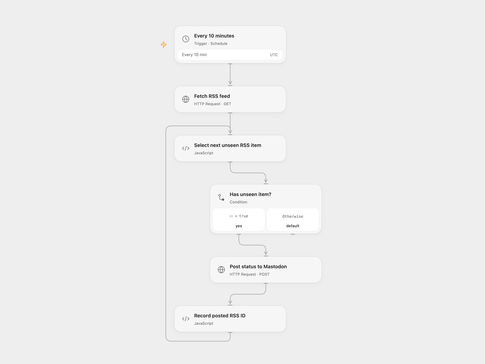

# RSS to Mastodon Poster

Poll an RSS or Atom feed every 10 minutes and publish new items to Mastodon while tracking the last posted entry ID.

<!-- template-actions:start -->
 
<!-- template-actions:end -->

<picture>
  <source media="(prefers-color-scheme: dark)" srcset="preview-dark.png">
  
</picture>

## Setup

1. Replace `https://YOUR_RSS_FEED_URL` in **Fetch RSS feed** with your RSS or Atom feed URL.
2. Replace `https://YOUR_MASTODON_INSTANCE/api/v1/statuses` in **Post status to Mastodon** with your Mastodon server endpoint and bind `MASTODON_ACCESS_TOKEN` to a secret variable containing your Mastodon access token (`write:statuses` scope).
3. Enable persistent State in Open Flow so `rss-to-mastodon:last-id` is preserved across runs.
4. For the n8n template, configure the feed URL in **RSS Feed Read** and your Mastodon instance URL and access token in **HTTP Request**.

## Behavior

- Runs every 10 minutes (UTC), fetches the feed XML, and extracts each entry's short ID (trailing path segment of `guid`/`id`/`link`), title, and URL.
- Collects entries newer than the stored `rss-to-mastodon:last-id` checkpoint and posts them in chronological order to `POST /api/v1/statuses`.
- Updates `rss-to-mastodon:last-id` only after each Mastodon post succeeds so failed posts can be retried on the next scheduled run.

Inspiration &amp; credits

## Changes to the source

- Renamed workflow from the mislabeled `post to mattermost v2` to `RSS to Mastodon Poster` to match its actual Mastodon `/api/v1/statuses` endpoint.
- Fixed the n8n `HTTP Request` status expression to reference each filtered item (`$json.title` and `$json.url`) instead of always reading the first item of `RSS Feed Read`.
- Moved the Mastodon token from a URL query parameter to a Bearer `MASTODON_ACCESS_TOKEN` secret variable in Open Flow and updated the checkpoint only after each status post succeeds.

Adapted from [post to mattermost v2](https://github.com/Zie619/n8n-workflows/blob/ae8cf6dc5b873cbb4f74587aa9180ed3a9f70682/workflows/Http/0752_HTTP_Rssfeedread_Automation_Scheduled.json) in [Zie619/n8n-workflows](https://github.com/Zie619/n8n-workflows). Attribution: Zie619 / n8n-workflows.

The collection’s [MIT notice](https://github.com/Zie619/n8n-workflows/blob/94007c1445d9258a7da116646b79473e7c7c3282/LICENSE) is pinned at a later revision. This is the collection notice at that revision; it does not establish a separate original template author's license. Our changes are listed above; see [repository licensing](../../README.md#licensing).

> MIT License
>
> Copyright (c) 2025 Zie619
>
> Permission is hereby granted, free of charge, to any person obtaining a copy
> of this software and associated documentation files (the "Software"), to deal
> in the Software without restriction, including without limitation the rights
> to use, copy, modify, merge, publish, distribute, sublicense, and/or sell
> copies of the Software, and to permit persons to whom the Software is
> furnished to do so, subject to the following conditions:
>
> The above copyright notice and this permission notice shall be included in all
> copies or substantial portions of the Software.
>
> THE SOFTWARE IS PROVIDED "AS IS", WITHOUT WARRANTY OF ANY KIND, EXPRESS OR
> IMPLIED, INCLUDING BUT NOT LIMITED TO THE WARRANTIES OF MERCHANTABILITY,
> FITNESS FOR A PARTICULAR PURPOSE AND NONINFRINGEMENT. IN NO EVENT SHALL THE
> AUTHORS OR COPYRIGHT HOLDERS BE LIABLE FOR ANY CLAIM, DAMAGES OR OTHER
> LIABILITY, WHETHER IN AN ACTION OF CONTRACT, TORT OR OTHERWISE, ARISING FROM,
> OUT OF OR IN CONNECTION WITH THE SOFTWARE OR THE USE OR OTHER DEALINGS IN THE
> SOFTWARE.

