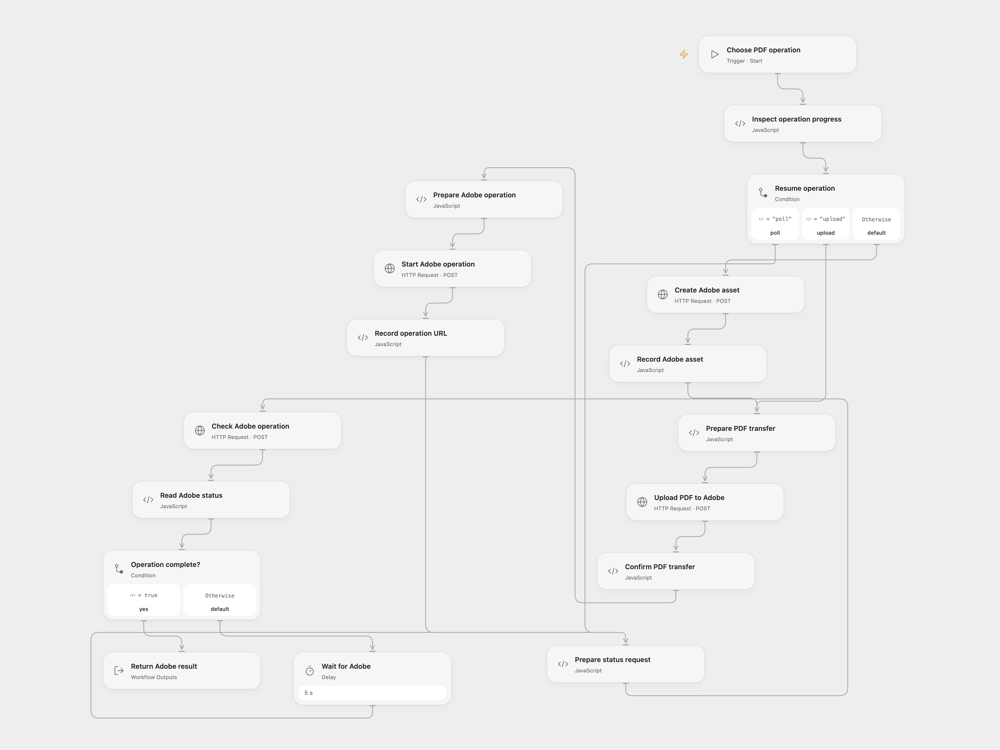

# Run Adobe PDF Operations

Run an Adobe PDF Services operation and return its completed result.

<!-- template-actions:start -->
[](https://openflow.run/templates/run-adobe-pdf-operations/) [](templates/run-adobe-pdf-operations.n8n.json)
<!-- template-actions:end -->

<picture>
  <source media="(prefers-color-scheme: dark)" srcset="preview-dark.png">
  
</picture>

## Setup and use

A prior request ID cannot be reused; inspect Adobe before clearing a pending row. Avoid overlapping runs. If asset creation or operation submission has an unknown result, inspect Adobe before clearing the pending checkpoint. Output URLs can expire.

<details>
<summary>In n8n</summary>

In n8n configure HTTP Custom Auth for the token requests with form body client_id and client_secret, and HTTP Header Auth with X-API-Key set to the client ID for Adobe API requests. Protect all four adapter webhooks with an authenticated gateway or private network. Adobe access tokens can appear in n8n execution records; restrict access to those records and set a suitable retention period. Bind ADOBE_RELAY_AUTHORIZATION to the gateway credential in Open Flow and configure all four adapter URLs. The relay reads the PDF URL; it must be reachable by n8n. Provide an HTTPS PDF URL, a unique request ID, the Adobe operation name such as extractpdf or splitpdf, and its JSON options without assetID. Open Flow creates an asset, transfers the PDF via n8n, starts the requested operation and polls every five seconds until completion; the result contains Adobe's download reference. The n8n callable entry accepts the original PDF binary as data with endpoint, json_payload and a unique requestId. Select a Data Table with item_key and status columns.

</details>

<details>
<summary>Inspiration &amp; credits</summary>

Adapted from [Manipulate PDF with Adobe developer API](https://github.com/enescingoz/awesome-n8n-templates/blob/827110332c21cbe000ab13f6d292d5adb1f1f8db/PDF_and_Document_Processing/Manipulate%20PDF%20with%20Adobe%20developer%20API.json) in [enescingoz/awesome-n8n-templates](https://github.com/enescingoz/awesome-n8n-templates).

Source collection notice: © 2024–2026 Enes Cingoz, [CC BY 4.0](https://github.com/enescingoz/awesome-n8n-templates/blob/827110332c21cbe000ab13f6d292d5adb1f1f8db/LICENSE). The source export does not identify a separate template author or license. See [repository licensing](../../README.md#licensing) for the scope of OOMOL contributions and third-party material.

Changes: use a protected stepwise adapter for credentials and binary transfer, and guard uncertain asset and operation requests.

```text
Creative Commons Attribution 4.0 International License

Copyright (c) 2024-2026 Enes Cingoz

You are free to:

  Share - copy and redistribute the material in any medium or format
  Adapt - remix, transform, and build upon the material for any purpose,
  even commercially.

Under the following terms:

  Attribution - You must give appropriate credit, provide a link to the
  license, and indicate if changes were made. You may do so in any
  reasonable manner, but not in any way that suggests the licensor
  endorses you or your use.

  No additional restrictions - You may not apply legal terms or
  technological measures that legally restrict others from doing
  anything the license permits.

Notices:

  You do not have to comply with the license for elements of the
  material in the public domain or where your use is permitted by an
  applicable exception or limitation.

  No warranties are given. The license may not give you all of the
  permissions necessary for your intended use. For example, other rights
  such as publicity, privacy, or moral rights may limit how you use the
  material.

For the full license text, see:
https://creativecommons.org/licenses/by/4.0/legalcode
```

</details>
