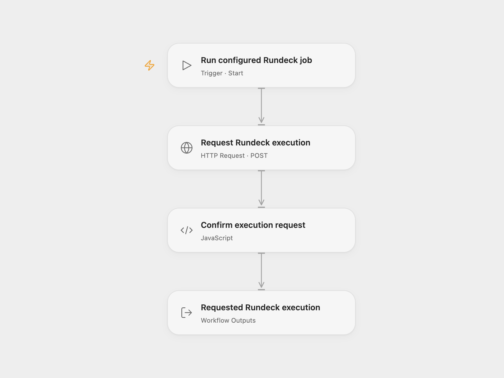

# Rundeck Job Runner

Request a run of an existing Rundeck job and return its execution ID and complete execution record.

<picture>
  <source media="(prefers-color-scheme: dark)" srcset="preview-dark.png">
  
</picture>

[Open Flow JSON](templates/rundeck-job-runner.openflow.json) · [n8n JSON](templates/rundeck-job-runner.n8n.json)

## Setup

In **Request Rundeck execution**, replace the example URL with your HTTPS Rundeck server URL and job ID, retaining `/api/17/job/JOB_ID/run`. Keep any server context path before `/api/17`. The server must support API 17, have a valid TLS certificate, and be reachable by the execution platform. The token’s account needs permission to run the job and its target nodes. Required job options must already have defaults; this template supplies no option values or node filter.

In Open Flow, store your Rundeck API token in a secret Variable and bind **Auth Token** (`auth.token`) to it. The HTTP step sends `X-Rundeck-Auth-Token`. Shared files contain no token or Variable binding. In n8n, select **HTTP Header Auth** credentials with header name `X-Rundeck-Auth-Token` and the API token as its value. Edit the same server URL and job ID.

Each manual run makes one request with an empty argument string and returns the full execution record. An execution ID confirms that Rundeck accepted the request. The returned status may already reflect a fast job’s outcome; the workflow does not wait for completion, collect logs, cancel jobs or confirm success.

The Open Flow HTTP step has a 30-second execution budget. A rejected request or missing execution ID stops the run. No duplicate check or automatic retry is configured. The job can change remote systems; check Rundeck before repeating a request whose result is uncertain. Rundeck Open Source supports this API use without a service subscription, while hosting and job operations can have their own costs.

## Changes to the source

- Replace the example server and job with user configuration.
- Use API 17 through formal HTTP authentication in both formats. The source node calls API 14, below the current documented minimum.
- Validate HTTPS certificates instead of the source V1 node’s default certificate-validation bypass.
- Check the execution ID and retain the full response without waiting for job success.

## Source and license

Adapted from [Execute a Rundeck job](https://github.com/Zie619/n8n-workflows/blob/ae8cf6dc5b873cbb4f74587aa9180ed3a9f70682/workflows/Manual/1008_Manual_Rundeck_Automate_Triggered.json) in [Zie619/n8n-workflows](https://github.com/Zie619/n8n-workflows). The source export does not identify a separate template author or license.

The collection’s [MIT notice](https://github.com/Zie619/n8n-workflows/blob/94007c1445d9258a7da116646b79473e7c7c3282/LICENSE) is pinned at a later revision. This is the collection notice at that revision; it does not establish a separate original template author's license. Our changes are listed above; see [repository licensing](../../README.md#licensing).

> MIT License
>
> Copyright (c) 2025 Zie619
>
> Permission is hereby granted, free of charge, to any person obtaining a copy
> of this software and associated documentation files (the "Software"), to deal
> in the Software without restriction, including without limitation the rights
> to use, copy, modify, merge, publish, distribute, sublicense, and/or sell
> copies of the Software, and to permit persons to whom the Software is
> furnished to do so, subject to the following conditions:
>
> The above copyright notice and this permission notice shall be included in all
> copies or substantial portions of the Software.
>
> THE SOFTWARE IS PROVIDED "AS IS", WITHOUT WARRANTY OF ANY KIND, EXPRESS OR
> IMPLIED, INCLUDING BUT NOT LIMITED TO THE WARRANTIES OF MERCHANTABILITY,
> FITNESS FOR A PARTICULAR PURPOSE AND NONINFRINGEMENT. IN NO EVENT SHALL THE
> AUTHORS OR COPYRIGHT HOLDERS BE LIABLE FOR ANY CLAIM, DAMAGES OR OTHER
> LIABILITY, WHETHER IN AN ACTION OF CONTRACT, TORT OR OTHERWISE, ARISING FROM,
> OUT OF OR IN CONNECTION WITH THE SOFTWARE OR THE USE OR OTHER DEALINGS IN THE
> SOFTWARE.
