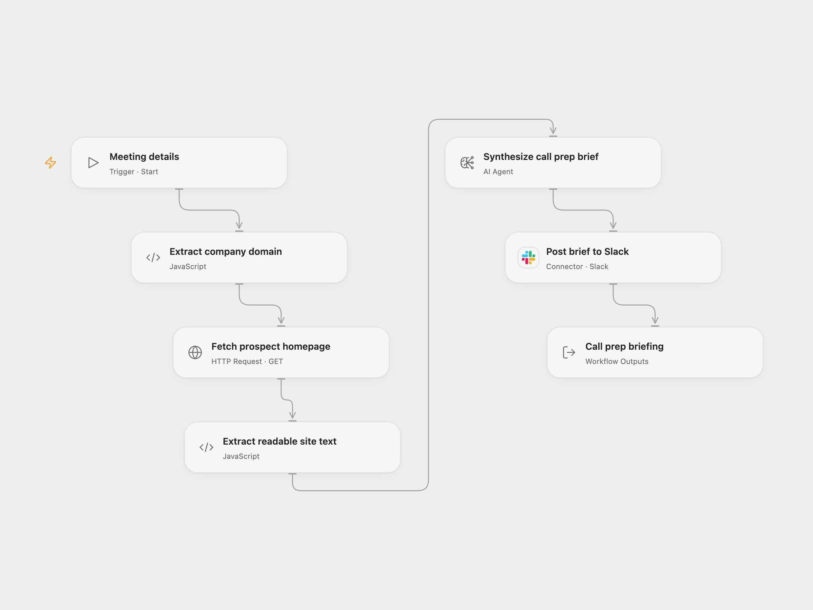

# Sales Call Prep Briefing

Research an external meeting prospect from their company domain, generate a structured call prep brief, and post it to Slack.

<!-- template-actions:start -->

<!-- template-actions:end -->

<picture>
  <source media="(prefers-color-scheme: dark)" srcset="preview-dark.png">
  
</picture>

## Requirements

- Slack connection with chat:write permission and access to the target channel
- Configured AI model on the Open Flow AI Agent node
- Publicly reachable prospect company website URL derived from attendee email domain

## Setup

1. Import `templates/sales-call-prep-briefing.openflow.json` into Open Flow.
2. Replace any placeholder values (such as `YOUR_SLACK_CHANNEL_ID` or `YOUR_GATEWAY_MODEL_ID`) with your own configuration.
3. Connect your required integrations (for example, Slack) and run or activate the workflow trigger.
