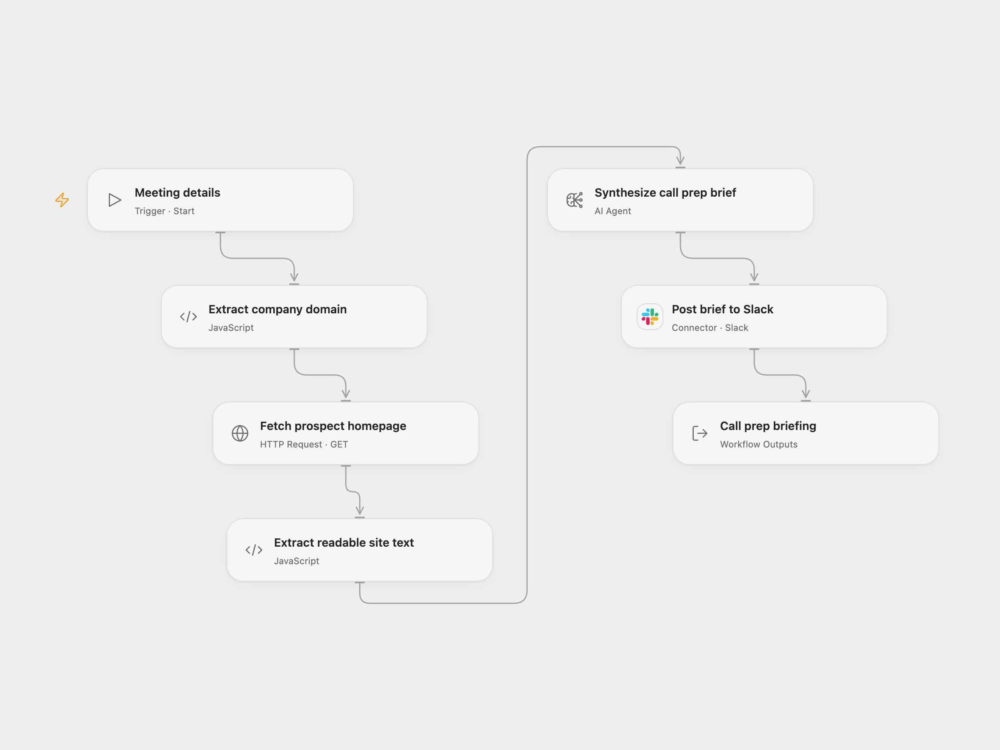

# 商談準備ブリーフィング

社外ミーティングの見込み客を会社ドメインから調査し、構造化された商談準備ブリーフを作成して Slack に投稿します。

<picture>
  <source media="(prefers-color-scheme: dark)" srcset="../../preview-dark.png">
  
</picture>

## 前提条件

- chat:write 権限を持ち、対象チャンネルにアクセスできる Slack 接続
- Open Flow AI Agent ノードに設定済みの AI モデル
- 参加者のメールドメインから導出した、公開アクセス可能な見込み客の企業サイト URL

## テンプレート

- Open Flow: [templates/sales-call-prep-briefing.openflow.json](../../templates/sales-call-prep-briefing.openflow.json)

## セットアップ

1. `templates/sales-call-prep-briefing.openflow.json` を Open Flow にインポートします。
2. プレースホルダー値（`YOUR_SLACK_CHANNEL_ID` や `YOUR_GATEWAY_MODEL_ID` など）をご自身の設定に置き換えます。
3. 必要な連携（Slack など）を接続し、ワークフローのトリガーを実行または有効化します。
