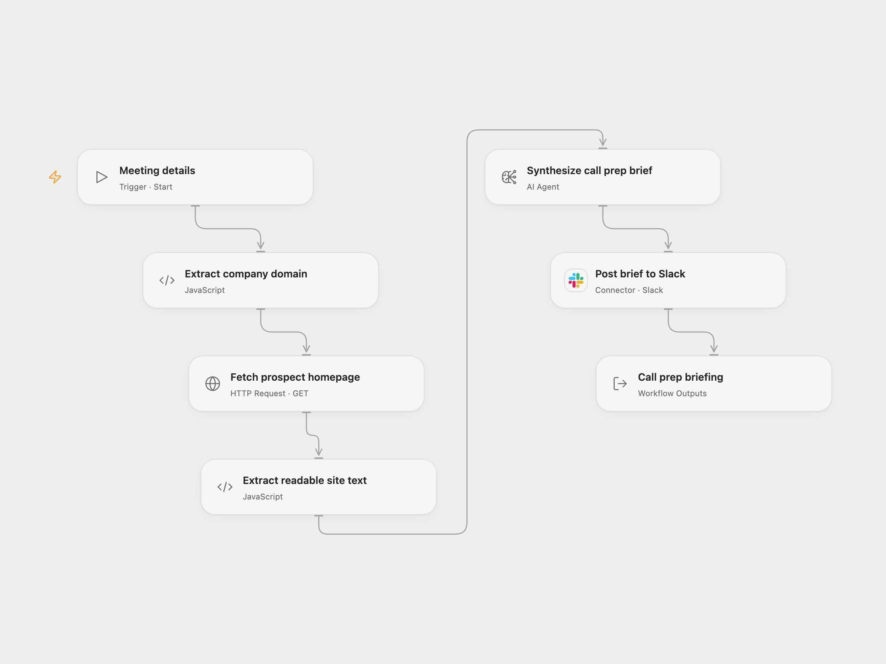

# 销售通话准备简报

根据公司域名调研外部会议的潜在客户，生成结构化的通话准备简报，并发送到 Slack。

<!-- template-actions:start -->

<!-- template-actions:end -->

<picture>
  <source media="(prefers-color-scheme: dark)" srcset="../../preview-dark.png">
  
</picture>

## 前提条件

- 具有 chat:write 权限并可访问目标频道的 Slack 连接
- 已在 Open Flow AI Agent 节点上配置 AI 模型
- 可公开访问的潜在客户公司网站 URL（根据参会人邮箱域名推导）

## 配置步骤

1. 将 `templates/sales-call-prep-briefing.openflow.json` 导入 Open Flow。
2. 将占位值（如 `YOUR_SLACK_CHANNEL_ID` 或 `YOUR_GATEWAY_MODEL_ID`）替换为你自己的配置。
3. 连接所需的集成（例如 Slack），然后运行或启用工作流触发器。
