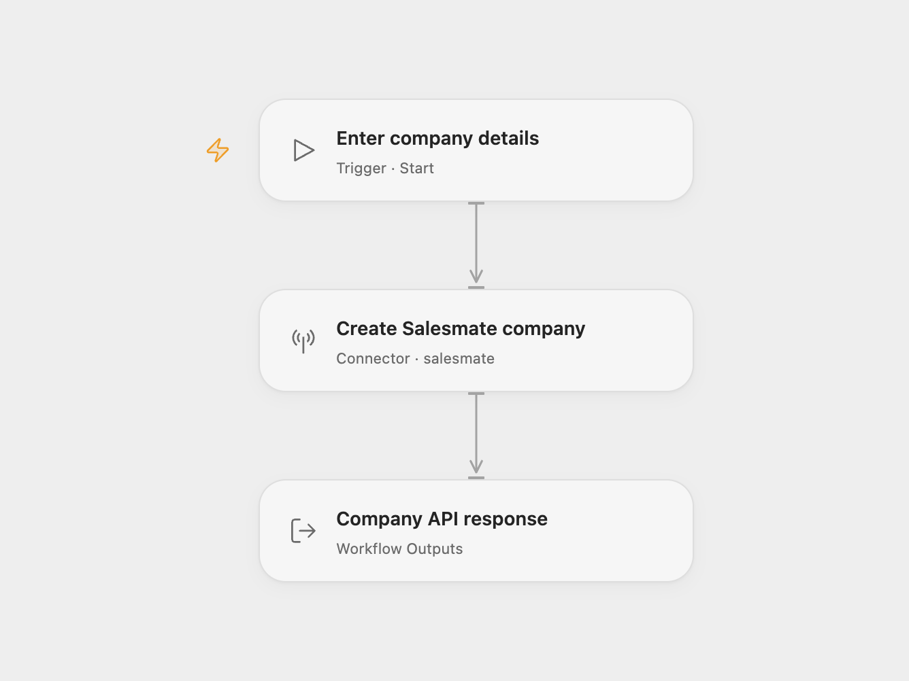

# Salesmate Company Creator

Create one Salesmate company with a name and an existing owner.

<picture>
  <source media="(prefers-color-scheme: dark)" srcset="preview-dark.png">
  
</picture>

[Open Flow JSON](templates/salesmate-company-creator.openflow.json) · [n8n JSON](templates/salesmate-company-creator.n8n.json)

## Setup

Select your Salesmate account in **Create Salesmate company**. Run the workflow with the company **Name** and **Owner**, the numeric ID of an existing Salesmate user. The connected account must be allowed to create companies and assign that owner. The name must contain 1–255 characters.

For n8n, edit **Create Salesmate company**:

- Replace `your-link-name.salesmate.io` in both the URL and `x-linkname` header with your tenant link name.
- Set the JSON body’s `name` and replace `owner: null` with the owner’s numeric user ID.
- Select a **Header Auth** credential whose name is `accessToken` and whose value is your Salesmate access token. Keep the token in the credential.

Run manually after setup. Each run sends one company creation request and returns the complete API response. Other company fields use your account’s defaults; use a tenant where any additional required fields have defaults or configure those fields before use. Salesmate automations configured for new companies may also run.

There is no lookup, upsert or duplicate detection. A failed request stops the run without an automatic retry. If a request times out, check Salesmate before running it again.

## Changes to the source

- Require the company name and owner as Open Flow run inputs.
- Replace n8n’s deprecated v1 company request with the documented tenant v4 endpoint and managed Header Auth.
- Expose the full API response in both formats.

## Source and license

Adapted from [Create a company in Salesmate](https://github.com/Zie619/n8n-workflows/blob/ae8cf6dc5b873cbb4f74587aa9180ed3a9f70682/workflows/Manual/0114_Manual_Salesmate_Create_Triggered.json) in [Zie619/n8n-workflows](https://github.com/Zie619/n8n-workflows). The source export does not identify a separate template author or license.

The collection’s [MIT notice](https://github.com/Zie619/n8n-workflows/blob/94007c1445d9258a7da116646b79473e7c7c3282/LICENSE) is pinned at a later revision. This is the collection notice at that revision; it does not establish a separate original template author's license. Our changes are listed above; see [repository licensing](../../README.md#licensing).

> MIT License
>
> Copyright (c) 2025 Zie619
>
> Permission is hereby granted, free of charge, to any person obtaining a copy
> of this software and associated documentation files (the "Software"), to deal
> in the Software without restriction, including without limitation the rights
> to use, copy, modify, merge, publish, distribute, sublicense, and/or sell
> copies of the Software, and to permit persons to whom the Software is
> furnished to do so, subject to the following conditions:
>
> The above copyright notice and this permission notice shall be included in all
> copies or substantial portions of the Software.
>
> THE SOFTWARE IS PROVIDED "AS IS", WITHOUT WARRANTY OF ANY KIND, EXPRESS OR
> IMPLIED, INCLUDING BUT NOT LIMITED TO THE WARRANTIES OF MERCHANTABILITY,
> FITNESS FOR A PARTICULAR PURPOSE AND NONINFRINGEMENT. IN NO EVENT SHALL THE
> AUTHORS OR COPYRIGHT HOLDERS BE LIABLE FOR ANY CLAIM, DAMAGES OR OTHER
> LIABILITY, WHETHER IN AN ACTION OF CONTRACT, TORT OR OTHERWISE, ARISING FROM,
> OUT OF OR IN CONNECTION WITH THE SOFTWARE OR THE USE OR OTHER DEALINGS IN THE
> SOFTWARE.
