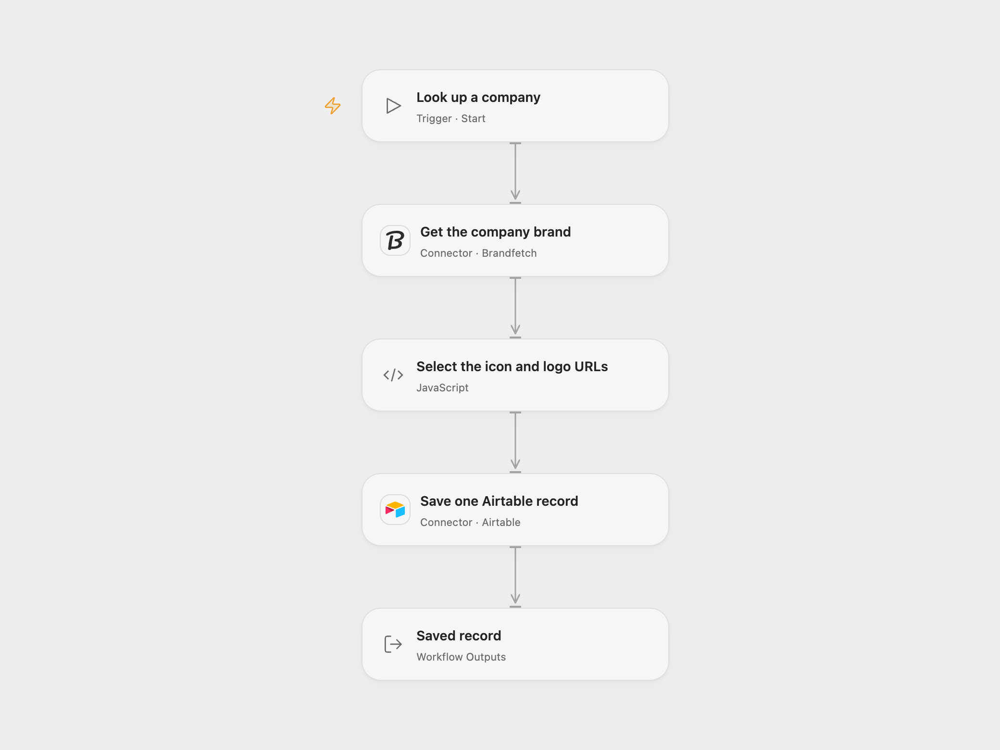

# Save Company Brand Assets to Airtable

Look up a company by domain and save its name, icon URL and logo URL in Airtable.

<picture>
  <source media="(prefers-color-scheme: dark)" srcset="preview-dark.png">
  
</picture>

[Open Flow JSON](templates/save-company-brand-assets-to-airtable.openflow.json) · [n8n JSON](templates/save-company-brand-assets-to-airtable.n8n.json)

## Setup

Connect Brandfetch using an API key with brand lookup access. Set the company domain in **Get the company brand**. Connect Airtable with permission to create records, and set its base and table in **Save one Airtable record**. Create writable text or URL fields named `Name`, `Icon URL` and `Logo URL`.

In n8n, configure a Header Auth credential named `Authorization` with value `Bearer YOUR_BRANDFETCH_API_KEY` on **Get the company brand**, and set the domain in its URL. Select an Airtable Personal Access Token credential and set the base and table on **Save one Airtable record**. Run one format for each intended record.

## Behavior

A manual run retrieves a brand profile and selects the first HTTP(S) format URL for its first usable icon and logo. It creates one Airtable record containing those URLs and the brand name. Missing names or either asset, invalid URLs, and lookup errors stop before creation. URLs are links to Brandfetch assets; this workflow does not upload image files.

A failed or uncertain Airtable write can have created a record. Check the table before running again; the workflow does not retry or deduplicate.

## Changes to the source

- Replace the original two obsolete Brandfetch lookups with one current brand profile request and select icon and logo formats explicitly. Both formats validate the required fields before writing.
- Replace the original private base ID and legacy Airtable API-key setup with configurable values and a Personal Access Token.

Source and license

Adapted from [Get the logo, icon, and information of a company and store it in Airtable](https://github.com/Zie619/n8n-workflows/blob/ae8cf6dc5b873cbb4f74587aa9180ed3a9f70682/workflows/Manual/0242_Manual_Brandfetch_Import_Triggered.json) in [Zie619/n8n-workflows](https://github.com/Zie619/n8n-workflows). The source export does not identify a separate template author or license.

The collection’s [MIT notice](https://github.com/Zie619/n8n-workflows/blob/94007c1445d9258a7da116646b79473e7c7c3282/LICENSE) is pinned at a later revision. This is the collection notice at that revision; it does not establish a separate original template author's license. Our changes are listed above; see [repository licensing](../../README.md#licensing).

> MIT License
>
> Copyright (c) 2025 Zie619
>
> Permission is hereby granted, free of charge, to any person obtaining a copy
> of this software and associated documentation files (the "Software"), to deal
> in the Software without restriction, including without limitation the rights
> to use, copy, modify, merge, publish, distribute, sublicense, and/or sell
> copies of the Software, and to permit persons to whom the Software is
> furnished to do so, subject to the following conditions:
>
> The above copyright notice and this permission notice shall be included in all
> copies or substantial portions of the Software.
>
> THE SOFTWARE IS PROVIDED "AS IS", WITHOUT WARRANTY OF ANY KIND, EXPRESS OR
> IMPLIED, INCLUDING BUT NOT LIMITED TO THE WARRANTIES OF MERCHANTABILITY,
> FITNESS FOR A PARTICULAR PURPOSE AND NONINFRINGEMENT. IN NO EVENT SHALL THE
> AUTHORS OR COPYRIGHT HOLDERS BE LIABLE FOR ANY CLAIM, DAMAGES OR OTHER
> LIABILITY, WHETHER IN AN ACTION OF CONTRACT, TORT OR OTHERWISE, ARISING FROM,
> OUT OF OR IN CONNECTION WITH THE SOFTWARE OR THE USE OR OTHER DEALINGS IN THE
> SOFTWARE.

