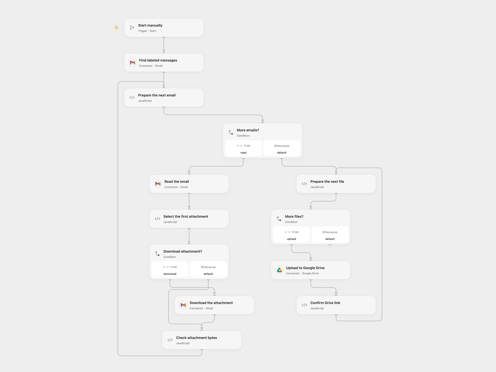

# Save First Gmail Attachments to Drive

Save the first attachment from each of up to ten Gmail messages in a chosen label to Google Drive.

<picture>
  <source media="(prefers-color-scheme: dark)" srcset="preview-dark.png">
  
</picture>

[Open Flow JSON](templates/save-first-gmail-attachments-to-drive.openflow.json) · [n8n JSON](templates/save-first-gmail-attachments-to-drive.n8n.json)

## Setup

Connect Gmail in **Find labeled messages**, **Read the email** and **Download the attachment**. Set the Gmail label ID in **Find labeled messages**. Connect Google Drive in **Upload to Google Drive**, and set a writable folder ID in **Prepare the next file**. In **Check attachment bytes**, replace the example HTTP allowlist hostname with your Connector file transit hostname. The Gmail download Action must have file transit configured.

In n8n connect Gmail and Google Drive, select the Gmail label in **Gmail1** and set the Drive folder in **Upload File1**. Run either format manually.

## Behavior

The workflow reads up to the first 10 messages in the label, including read and unread messages, and uploads only the first attachment of each message. It reads the batch before creating Drive files. Open Flow uses attachment as the filename if the first attachment has no filename. No matching messages creates no files. If a message has no attachment, processing stops at that message and earlier Drive files remain. Drive view links appear in the execution when returned by Drive.

Open Flow uses Gmail's normalized attachment order and stages complete attachment contents before upload; all staged data must fit its 1 MiB Code limits. Downloaded bytes and metadata are checked. n8n uses its own binary storage limits and MIME parser. Restrict access to execution history, transit links and files. A run can create duplicate Drive files when repeated. A failed or uncertain upload may already have created a file; check Drive before retrying. The n8n Drive node uploads content before applying the filename and destination folder, so a later failure can leave a file outside the intended folder.

## Changes to the source

- Replace private label and folder IDs and add a manual start.
- Upgrade n8n Gmail to V2 and enable attachment download. The source Gmail V1 does not populate the attachment binary required by the Drive node under its default settings.
- Use Gmail attachment transit in Open Flow and verify bytes before uploading.

Source and license

Adapted from [Gmail attachment to Google Drive](https://github.com/Zie619/n8n-workflows/blob/ae8cf6dc5b873cbb4f74587aa9180ed3a9f70682/workflows/Gmail/0036_Gmail_GoogleDrive_Import.json) in [Zie619/n8n-workflows](https://github.com/Zie619/n8n-workflows). The source export does not identify a separate template author or license.

The collection’s [MIT notice](https://github.com/Zie619/n8n-workflows/blob/94007c1445d9258a7da116646b79473e7c7c3282/LICENSE) is pinned at a later revision. This is the collection notice at that revision; it does not establish a separate original template author's license. Our changes are listed above; see [repository licensing](../../README.md#licensing).

> MIT License
>
> Copyright (c) 2025 Zie619
>
> Permission is hereby granted, free of charge, to any person obtaining a copy
> of this software and associated documentation files (the "Software"), to deal
> in the Software without restriction, including without limitation the rights
> to use, copy, modify, merge, publish, distribute, sublicense, and/or sell
> copies of the Software, and to permit persons to whom the Software is
> furnished to do so, subject to the following conditions:
>
> The above copyright notice and this permission notice shall be included in all
> copies or substantial portions of the Software.
>
> THE SOFTWARE IS PROVIDED "AS IS", WITHOUT WARRANTY OF ANY KIND, EXPRESS OR
> IMPLIED, INCLUDING BUT NOT LIMITED TO THE WARRANTIES OF MERCHANTABILITY,
> FITNESS FOR A PARTICULAR PURPOSE AND NONINFRINGEMENT. IN NO EVENT SHALL THE
> AUTHORS OR COPYRIGHT HOLDERS BE LIABLE FOR ANY CLAIM, DAMAGES OR OTHER
> LIABILITY, WHETHER IN AN ACTION OF CONTRACT, TORT OR OTHERWISE, ARISING FROM,
> OUT OF OR IN CONNECTION WITH THE SOFTWARE OR THE USE OR OTHER DEALINGS IN THE
> SOFTWARE.

