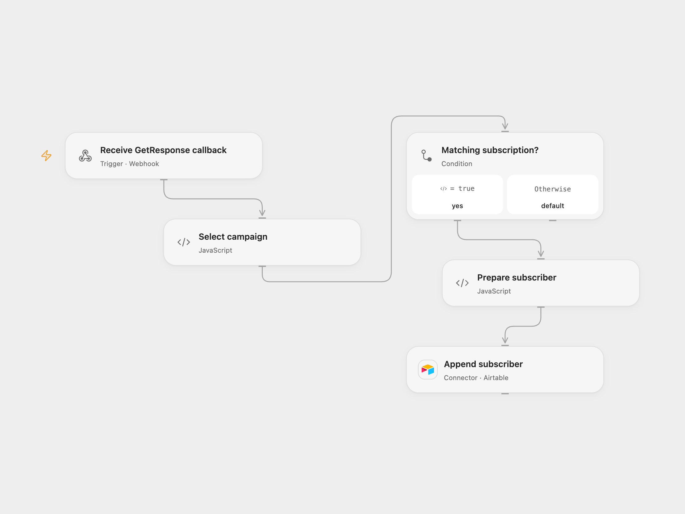

# Save GetResponse Subscribers to Airtable

Append subscribers from a GetResponse campaign to an Airtable table.

<picture>
  <source media="(prefers-color-scheme: dark)" srcset="preview-dark.png">
  
</picture>

[Open Flow JSON](templates/save-getresponse-subscribers-to-airtable.openflow.json) · [n8n JSON](templates/save-getresponse-subscribers-to-airtable.n8n.json)

## Setup

Connect Airtable and select a base and table with Name and Email fields in **Append subscriber**. Set the GetResponse campaign ID in **Select campaign**, deploy the webhook, and configure the account callback URL for subscription events in GetResponse. In n8n connect GetResponse and Airtable and select the campaign, base and table. GetResponse callbacks are configured at the account level; check an existing callback before replacing it.

## Behavior

The endpoint accepts GetResponse GET callbacks and appends the subscriber's name and email when the action is subscribe and the campaign ID matches. A missing name becomes empty. Other actions and campaigns do not create a record. The endpoint does not authenticate the caller. Its acknowledgment confirms receipt rather than Airtable completion; GetResponse callbacks have a four-second timeout and are not retried. Repeated events can create duplicate rows.

Inspiration &amp; credits

## Changes to the source

- Configure the callback manually in Open Flow; n8n manages it through its GetResponse trigger.

Adapted from [Add GetResponse subscribers to Airtable](https://github.com/Zie619/n8n-workflows/blob/ae8cf6dc5b873cbb4f74587aa9180ed3a9f70682/workflows/Getresponse/1202_Getresponse_Airtable_Import_Triggered.json) in [Zie619/n8n-workflows](https://github.com/Zie619/n8n-workflows). The source export does not identify a separate template author or license.

The collection’s [MIT notice](https://github.com/Zie619/n8n-workflows/blob/94007c1445d9258a7da116646b79473e7c7c3282/LICENSE) is pinned at a later revision. This is the collection notice at that revision; it does not establish a separate original template author's license. Our changes are listed above; see [repository licensing](../../README.md#licensing).

> MIT License
>
> Copyright (c) 2025 Zie619
>
> Permission is hereby granted, free of charge, to any person obtaining a copy
> of this software and associated documentation files (the "Software"), to deal
> in the Software without restriction, including without limitation the rights
> to use, copy, modify, merge, publish, distribute, sublicense, and/or sell
> copies of the Software, and to permit persons to whom the Software is
> furnished to do so, subject to the following conditions:
>
> The above copyright notice and this permission notice shall be included in all
> copies or substantial portions of the Software.
>
> THE SOFTWARE IS PROVIDED "AS IS", WITHOUT WARRANTY OF ANY KIND, EXPRESS OR
> IMPLIED, INCLUDING BUT NOT LIMITED TO THE WARRANTIES OF MERCHANTABILITY,
> FITNESS FOR A PARTICULAR PURPOSE AND NONINFRINGEMENT. IN NO EVENT SHALL THE
> AUTHORS OR COPYRIGHT HOLDERS BE LIABLE FOR ANY CLAIM, DAMAGES OR OTHER
> LIABILITY, WHETHER IN AN ACTION OF CONTRACT, TORT OR OTHERWISE, ARISING FROM,
> OUT OF OR IN CONNECTION WITH THE SOFTWARE OR THE USE OR OTHER DEALINGS IN THE
> SOFTWARE.

