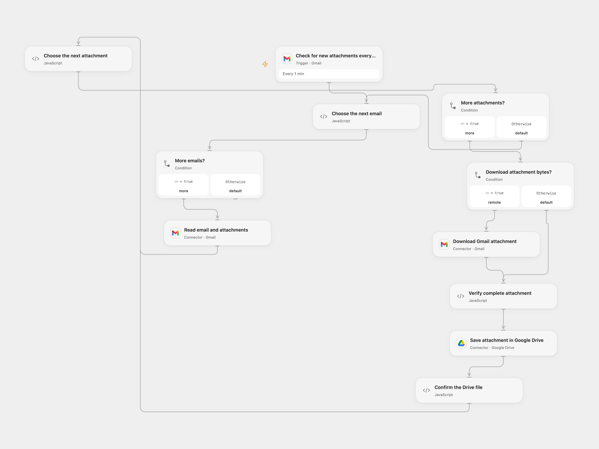

# Save Gmail Attachments to Google Drive

Save incoming Gmail attachments to Drive with the sender address in each filename.

<picture>
  <source media="(prefers-color-scheme: dark)" srcset="preview-dark.png">
  
</picture>

[Open Flow JSON](templates/save-gmail-attachments-to-google-drive.openflow.json) · [n8n JSON](templates/save-gmail-attachments-to-google-drive.n8n.json)

## Setup

Connect Gmail in **Check for new attachments every minute**, **Read email and attachments** and **Download Gmail attachment**. Connect Google Drive in **Save attachment in Google Drive** and set a writable folder ID in **Choose the next attachment**. In **Verify complete attachment**, replace the example HTTP allowlist entry with the hostname of your Connector file transit storage. The Gmail download Action must have file transit configured.

In n8n, connect Gmail and Google Drive and choose the destination folder in **upload files to google drive**. Enable one format after setup.

## Behavior

The workflow checks for new incoming messages matching Gmail’s has:attachment search every minute. It processes each message and attachment in order, saving each file with the sender address added before its final filename extension. Attachments without a filename use attachment. Inline attachment data and separately downloaded attachment bytes are both handled. Messages without attachments do not create files.

Open Flow processes at most 50 messages per poll page and checks the byte count before creating each file. Connector transit downloads and Code execution must fit the host’s 1 MiB fetch and execution limits; larger attachments fail rather than being truncated. n8n has its own poll queue and binary storage limits. Restrict access to mailbox data, file transit links, Drive files and execution history.

An error stops the run; earlier Drive files remain. A failed or uncertain upload may already have created a file. Inspect Drive before retrying. There is no exactly-once guarantee or automatic retry after a write.

## Changes to the source

- Replace the original Drive destination with configuration and preserve the complete filename when adding the sender address, including filenames with multiple dots.
- Update n8n Gmail Trigger to 1.4 and preserve the sender association when splitting attachments from a batch of messages. Open Flow uses Gmail attachment transit for separately stored bytes.

Source and license

Adapted from [Save Gmail attachments to Google Drive](https://github.com/Zie619/n8n-workflows/blob/ae8cf6dc5b873cbb4f74587aa9180ed3a9f70682/workflows/Gmail/0544_Gmail_GoogleDrive_Create_Triggered.json) in [Zie619/n8n-workflows](https://github.com/Zie619/n8n-workflows). The source export does not identify a separate template author or license.

The collection’s [MIT notice](https://github.com/Zie619/n8n-workflows/blob/94007c1445d9258a7da116646b79473e7c7c3282/LICENSE) is pinned at a later revision. This is the collection notice at that revision; it does not establish a separate original template author's license. Our changes are listed above; see [repository licensing](../../README.md#licensing).

> MIT License
>
> Copyright (c) 2025 Zie619
>
> Permission is hereby granted, free of charge, to any person obtaining a copy
> of this software and associated documentation files (the "Software"), to deal
> in the Software without restriction, including without limitation the rights
> to use, copy, modify, merge, publish, distribute, sublicense, and/or sell
> copies of the Software, and to permit persons to whom the Software is
> furnished to do so, subject to the following conditions:
>
> The above copyright notice and this permission notice shall be included in all
> copies or substantial portions of the Software.
>
> THE SOFTWARE IS PROVIDED "AS IS", WITHOUT WARRANTY OF ANY KIND, EXPRESS OR
> IMPLIED, INCLUDING BUT NOT LIMITED TO THE WARRANTIES OF MERCHANTABILITY,
> FITNESS FOR A PARTICULAR PURPOSE AND NONINFRINGEMENT. IN NO EVENT SHALL THE
> AUTHORS OR COPYRIGHT HOLDERS BE LIABLE FOR ANY CLAIM, DAMAGES OR OTHER
> LIABILITY, WHETHER IN AN ACTION OF CONTRACT, TORT OR OTHERWISE, ARISING FROM,
> OUT OF OR IN CONNECTION WITH THE SOFTWARE OR THE USE OR OTHER DEALINGS IN THE
> SOFTWARE.

