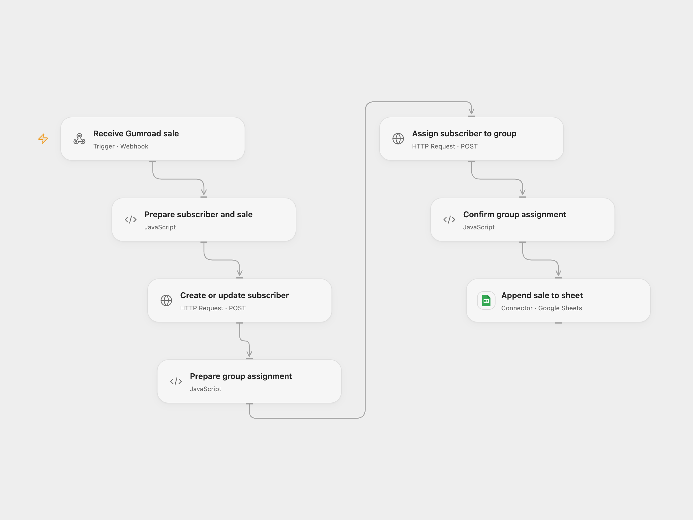

# Save Gumroad Sales to MailerLite and Sheets

Add Gumroad buyers to a MailerLite group and record their sales in Google Sheets.

<picture>
  <source media="(prefers-color-scheme: dark)" srcset="preview-dark.png">
  
</picture>

[Open Flow JSON](templates/save-gumroad-sales-to-mailerlite-and-sheets.openflow.json) · [n8n JSON](templates/save-gumroad-sales-to-mailerlite-and-sheets.n8n.json)

## Setup

Create a MailerLite group and a Google Sheet with columns `date`, `product name`, `email`, and `country` in that order. Bind a secret Variable MAILERLITE_API_KEY to both HTTP nodes, set the group ID in **Prepare group assignment**, and connect Google Sheets with its spreadsheet ID and range in **Append sale to sheet**. In the bundled n8n workflow connect Gumroad, set **Choose delivery mode** to `relay`, and set the Open Flow webhook URL in **Forward sale to Open Flow**.

For n8n-only operation choose `direct`, connect the current MailerLite and Google Sheets credentials, set the MailerLite group ID in **Assign to group**, and set the spreadsheet and sheet in **append row in CRM**. Use one mode. Only add buyers who consent to receive messages; MailerLite may trigger a group automation and its account settings control opt-in.

## Behavior

A sale upserts the buyer by email with the country, assigns that subscriber to the group, and appends the sale date, product, email and country. The webhook acknowledges before these operations finish. If a write fails or its response is lost, inspect MailerLite and the sheet before replaying; an earlier write may already have succeeded. The webhook does not authenticate callers and can create subscribers and rows, so restrict access to trusted callers.

Inspiration &amp; credits

## Changes to the source

- Replace private group and sheet IDs with configuration and add an optional n8n relay.

Adapted from [Gumroad sale trigger](https://github.com/Zie619/n8n-workflows/blob/ae8cf6dc5b873cbb4f74587aa9180ed3a9f70682/workflows/Mailerlite/1874_Mailerlite_Gumroad_Automation_Webhook.json) in [Zie619/n8n-workflows](https://github.com/Zie619/n8n-workflows). The source export does not identify a separate template author or license.

The collection’s [MIT notice](https://github.com/Zie619/n8n-workflows/blob/94007c1445d9258a7da116646b79473e7c7c3282/LICENSE) is pinned at a later revision. This is the collection notice at that revision; it does not establish a separate original template author's license. Our changes are listed above; see [repository licensing](../../README.md#licensing).

> MIT License
>
> Copyright (c) 2025 Zie619
>
> Permission is hereby granted, free of charge, to any person obtaining a copy
> of this software and associated documentation files (the "Software"), to deal
> in the Software without restriction, including without limitation the rights
> to use, copy, modify, merge, publish, distribute, sublicense, and/or sell
> copies of the Software, and to permit persons to whom the Software is
> furnished to do so, subject to the following conditions:
>
> The above copyright notice and this permission notice shall be included in all
> copies or substantial portions of the Software.
>
> THE SOFTWARE IS PROVIDED "AS IS", WITHOUT WARRANTY OF ANY KIND, EXPRESS OR
> IMPLIED, INCLUDING BUT NOT LIMITED TO THE WARRANTIES OF MERCHANTABILITY,
> FITNESS FOR A PARTICULAR PURPOSE AND NONINFRINGEMENT. IN NO EVENT SHALL THE
> AUTHORS OR COPYRIGHT HOLDERS BE LIABLE FOR ANY CLAIM, DAMAGES OR OTHER
> LIABILITY, WHETHER IN AN ACTION OF CONTRACT, TORT OR OTHERWISE, ARISING FROM,
> OUT OF OR IN CONNECTION WITH THE SOFTWARE OR THE USE OR OTHER DEALINGS IN THE
> SOFTWARE.

