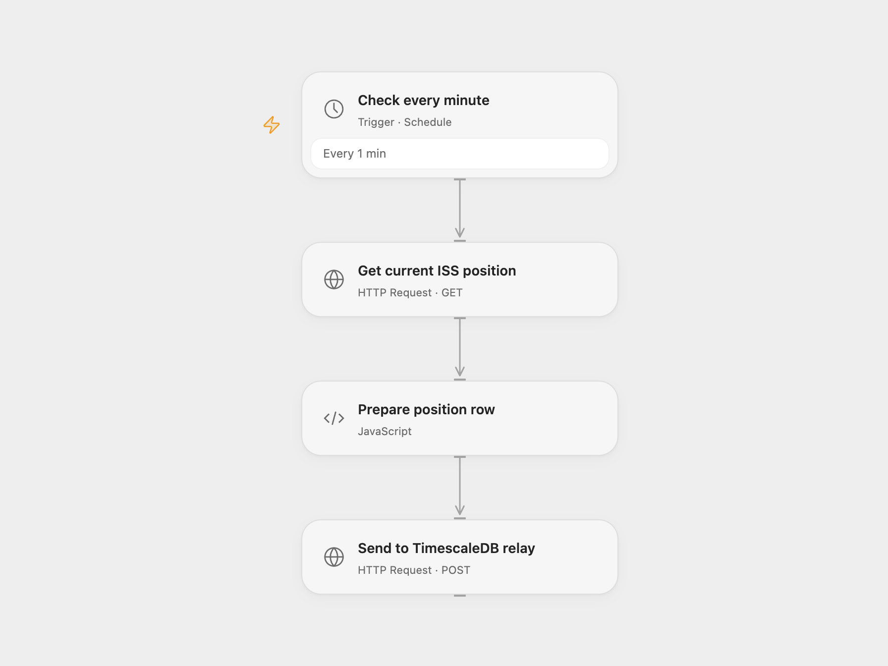

# Save ISS Position to TimescaleDB

Save the current International Space Station position to TimescaleDB every minute.

<picture>
  <source media="(prefers-color-scheme: dark)" srcset="preview-dark.png">
  
</picture>

[Open Flow JSON](templates/save-iss-position-to-timescaledb.openflow.json) · [n8n JSON](templates/save-iss-position-to-timescaledb.n8n.json)

## Setup and use

Create an iss table with latitude, longitude and timestamp columns compatible with the numeric values and Unix timestamp. Import the supplied n8n workflow and connect both TimescaleDB nodes to that database. For n8n mode enable **Cron** and disable **TimescaleDB relay webhook**. For Open Flow mode disable **Cron**, enable the relay webhook, activate n8n and enter its production URL in **Send to TimescaleDB relay**. Use one mode. The relay does not authenticate callers; restrict access to it.

## Behavior

Every minute, read the current ISS position and insert its latitude, longitude and Unix timestamp. In Open Flow mode the n8n relay responds after the insert completes; a database error returns an HTTP failure. If a response is lost, a row may already have been inserted.

Inspiration &amp; credits

## Changes to the source

- Request the current-position endpoint instead of passing a millisecond timestamp to the positions endpoint. Add an n8n webhook bridge to use the source TimescaleDB connection from Open Flow.

Adapted from [ISS position to TimescaleDB](https://github.com/Zie619/n8n-workflows/blob/ae8cf6dc5b873cbb4f74587aa9180ed3a9f70682/workflows/Http/1192_HTTP_Timescaledb_Automation_Scheduled.json) in [Zie619/n8n-workflows](https://github.com/Zie619/n8n-workflows). The source export does not identify a separate template author or license.

The collection’s [MIT notice](https://github.com/Zie619/n8n-workflows/blob/94007c1445d9258a7da116646b79473e7c7c3282/LICENSE) is pinned at a later revision. This is the collection notice at that revision; it does not establish a separate original template author's license. Our changes are listed above; see [repository licensing](../../README.md#licensing).

> MIT License
>
> Copyright (c) 2025 Zie619
>
> Permission is hereby granted, free of charge, to any person obtaining a copy
> of this software and associated documentation files (the "Software"), to deal
> in the Software without restriction, including without limitation the rights
> to use, copy, modify, merge, publish, distribute, sublicense, and/or sell
> copies of the Software, and to permit persons to whom the Software is
> furnished to do so, subject to the following conditions:
>
> The above copyright notice and this permission notice shall be included in all
> copies or substantial portions of the Software.
>
> THE SOFTWARE IS PROVIDED "AS IS", WITHOUT WARRANTY OF ANY KIND, EXPRESS OR
> IMPLIED, INCLUDING BUT NOT LIMITED TO THE WARRANTIES OF MERCHANTABILITY,
> FITNESS FOR A PARTICULAR PURPOSE AND NONINFRINGEMENT. IN NO EVENT SHALL THE
> AUTHORS OR COPYRIGHT HOLDERS BE LIABLE FOR ANY CLAIM, DAMAGES OR OTHER
> LIABILITY, WHETHER IN AN ACTION OF CONTRACT, TORT OR OTHERWISE, ARISING FROM,
> OUT OF OR IN CONNECTION WITH THE SOFTWARE OR THE USE OR OTHER DEALINGS IN THE
> SOFTWARE.

