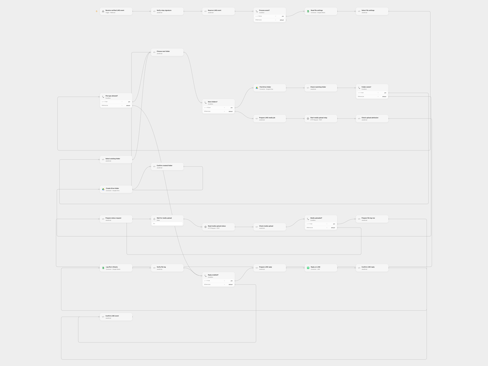

# Save LINE Files to Drive and Sheet

Save LINE media in Drive folders, log the file and optionally reply.

<!-- template-actions:start -->
 
<!-- template-actions:end -->

<picture>
  <source media="(prefers-color-scheme: dark)" srcset="preview-dark.png">
  
</picture>

## Setup and use

Create a LINE Messaging API channel, Google Drive folder and Google Sheet. In the sheet, put headers Parent Folder ID, Store by Date, Store by File Type, Allow File Types, CurrentDate and Reply Enabled in config!A1:H1 and values in row 2. Use TRUE or FALSE for switches and pipe-separated LINE types such as image|video|audio|file. CurrentDate can override the event's UTC date (YYYYMMDD). Add a fileList sheet with File Name, File Type, Date Uploaded and Google Drive URL headers.

Configure Google Drive and Sheets credentials and select the spreadsheet. Configure the LINE webhook URL and header authentication on the media job and status webhooks.

For Open Flow, change Configure processing mode to forward and set its destination to the Open Flow webhook. Set their URLs in Start media upload relay and Read media upload status, and connect LINE, Drive and Sheets. Enable persistent State.

## Behavior and recovery

Each supported LINE file event is checked against the allowed types, placed under the configured date and type folders when enabled, logged in Sheets and optionally replied to on LINE. LINE reply tokens are short lived and single use; a delayed upload can make a reply fail. Inspect the event, Drive, sheet and LINE before retrying. A pending checkpoint prevents an uncertain external write from being repeated automatically. In Open Flow, use the event's exact line-file:<webhookEventId> key and set the resolution to confirmed only after all required effects are verified complete, or absent only after confirming none occurred. Avoid overlapping runs for the same event.

In n8n

In n8n, provide LINE_CHANNEL_SECRET and LINE_RELAY_SECRET as environment variables and a LINE channel access token for the media and reply HTTP nodes. Use a self-hosted n8n with NODE_FUNCTION_ALLOW_BUILTIN=crypto and N8N_BLOCK_ENV_ACCESS_IN_NODE=false. Select a Data Table with text columns item_key, status, file_id, name, url, created and extension. The n8n workflow runs directly by default. Set LINE_RELAY_SECRET as an Open Flow Secret Variable with the same value as in n8n, and set LINE_MEDIA_RELAY_TOKEN to the header credential used by both n8n media webhooks. The n8n webhook verifies LINE's signature over the original request bytes; its signed relay preserves event identity. Native n8n downloads and uploads the file bytes so large attachments do not pass through the Open Flow Code response limit. In n8n, inspect and reconcile the corresponding Data Table rows before retrying.

Inspiration &amp; credits

Verify LINE signatures, keep per-event checkpoints and use a native binary relay for large attachments.

Adapted from [Line Save File to Google Drive and Log File’s URL](https://github.com/Zie619/n8n-workflows/blob/ae8cf6dc5b873cbb4f74587aa9180ed3a9f70682/workflows/Code/1924_Code_Webhook_Export_Webhook.json) in [Zie619/n8n-workflows](https://github.com/Zie619/n8n-workflows). Attribution: Zie619 / n8n-workflows.

The collection’s [MIT notice](https://github.com/Zie619/n8n-workflows/blob/94007c1445d9258a7da116646b79473e7c7c3282/LICENSE) is pinned at a later revision. This is the collection notice at that revision; it does not establish a separate original template author's license. Our changes are listed above; see [repository licensing](../../README.md#licensing).

> MIT License
>
> Copyright (c) 2025 Zie619
>
> Permission is hereby granted, free of charge, to any person obtaining a copy
> of this software and associated documentation files (the "Software"), to deal
> in the Software without restriction, including without limitation the rights
> to use, copy, modify, merge, publish, distribute, sublicense, and/or sell
> copies of the Software, and to permit persons to whom the Software is
> furnished to do so, subject to the following conditions:
>
> The above copyright notice and this permission notice shall be included in all
> copies or substantial portions of the Software.
>
> THE SOFTWARE IS PROVIDED "AS IS", WITHOUT WARRANTY OF ANY KIND, EXPRESS OR
> IMPLIED, INCLUDING BUT NOT LIMITED TO THE WARRANTIES OF MERCHANTABILITY,
> FITNESS FOR A PARTICULAR PURPOSE AND NONINFRINGEMENT. IN NO EVENT SHALL THE
> AUTHORS OR COPYRIGHT HOLDERS BE LIABLE FOR ANY CLAIM, DAMAGES OR OTHER
> LIABILITY, WHETHER IN AN ACTION OF CONTRACT, TORT OR OTHERWISE, ARISING FROM,
> OUT OF OR IN CONNECTION WITH THE SOFTWARE OR THE USE OR OTHER DEALINGS IN THE
> SOFTWARE.

