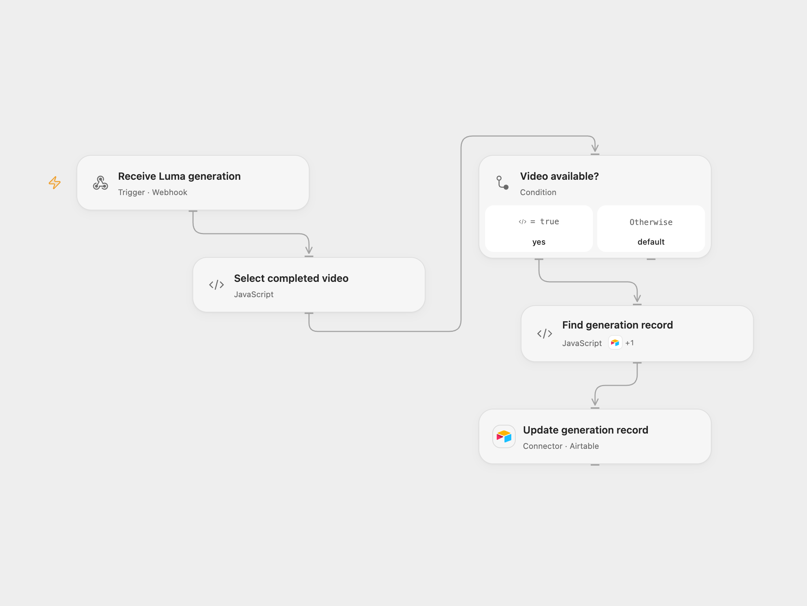

# Save Luma Video Callback to Airtable

Save completed Luma video and thumbnail URLs to the matching Airtable generation record.

<picture>
  <source media="(prefers-color-scheme: dark)" srcset="preview-dark.png">
  
</picture>

[Open Flow JSON](templates/save-luma-video-callback-to-airtable.openflow.json) · [n8n JSON](templates/save-luma-video-callback-to-airtable.n8n.json)

## Setup

Create an Airtable table with **Generation ID**, **Video URL**, **Thumb URL** and **Status** fields. Add the generation ID to an existing record when requesting the video; configure the Status field to accept **Done**. Connect Airtable and set the same base and table in **Find generation record** and **Update generation record**. Configure the deployed Open Flow webhook URL as Luma’s `callback_url`. In n8n connect Airtable, replace the base and table in **Global SETTINGS**, and use its webhook URL. Activate one format.

## Behavior

Luma sends generation updates as POST requests. When a video URL is present, the workflow looks up the first record with the same Generation ID and writes the video URL, thumbnail URL and **Done** status. Events without a video do not write. If no matching record exists, the run stops without a write. Use unique Generation IDs in the table. If the thumbnail is absent, the thumbnail field is set to an empty value.

The webhook acknowledges receipt before the Airtable update completes. Inspect execution history and the record if an update fails or its outcome is unknown. Earlier updates are not rolled back. The source webhook has no built-in authentication and can trigger writes; restrict access to trusted callers.

Inspiration &amp; credits

## Changes to the source

- Replace private Airtable identifiers and keep the generation ID with its own callback. Keep only fields needed for the update after the webhook.

Adapted from [Luma AI callback to Airtable](https://github.com/Zie619/n8n-workflows/blob/ae8cf6dc5b873cbb4f74587aa9180ed3a9f70682/workflows/Executiondata/1972_Executiondata_Stickynote_Automation_Webhook.json) in [Zie619/n8n-workflows](https://github.com/Zie619/n8n-workflows). The source export does not identify a separate template author or license.

The collection’s [MIT notice](https://github.com/Zie619/n8n-workflows/blob/94007c1445d9258a7da116646b79473e7c7c3282/LICENSE) is pinned at a later revision. This is the collection notice at that revision; it does not establish a separate original template author's license. Our changes are listed above; see [repository licensing](../../README.md#licensing).

> MIT License
>
> Copyright (c) 2025 Zie619
>
> Permission is hereby granted, free of charge, to any person obtaining a copy
> of this software and associated documentation files (the "Software"), to deal
> in the Software without restriction, including without limitation the rights
> to use, copy, modify, merge, publish, distribute, sublicense, and/or sell
> copies of the Software, and to permit persons to whom the Software is
> furnished to do so, subject to the following conditions:
>
> The above copyright notice and this permission notice shall be included in all
> copies or substantial portions of the Software.
>
> THE SOFTWARE IS PROVIDED "AS IS", WITHOUT WARRANTY OF ANY KIND, EXPRESS OR
> IMPLIED, INCLUDING BUT NOT LIMITED TO THE WARRANTIES OF MERCHANTABILITY,
> FITNESS FOR A PARTICULAR PURPOSE AND NONINFRINGEMENT. IN NO EVENT SHALL THE
> AUTHORS OR COPYRIGHT HOLDERS BE LIABLE FOR ANY CLAIM, DAMAGES OR OTHER
> LIABILITY, WHETHER IN AN ACTION OF CONTRACT, TORT OR OTHERWISE, ARISING FROM,
> OUT OF OR IN CONNECTION WITH THE SOFTWARE OR THE USE OR OTHER DEALINGS IN THE
> SOFTWARE.

