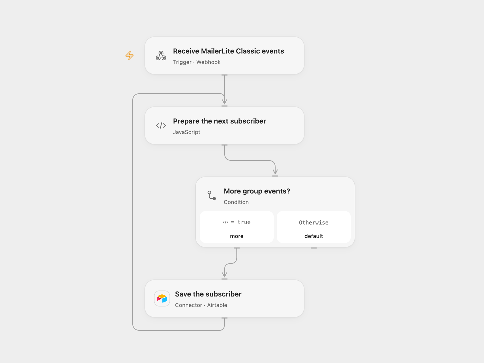

# Save MailerLite Classic Group Subscribers to Airtable

Save MailerLite Classic group subscriber names and emails to Airtable.

<picture>
  <source media="(prefers-color-scheme: dark)" srcset="preview-dark.png">
  
</picture>

[Open Flow JSON](templates/save-mailerlite-classic-group-subscribers-to-airtable.openflow.json) · [n8n JSON](templates/save-mailerlite-classic-group-subscribers-to-airtable.n8n.json)

## Setup

Use a MailerLite **Classic** account. This workflow uses Classic's `subscriber.add_to_group` event and payload; it does not accept the differently named event from current MailerLite accounts. Create an Airtable table with `Name` and `Email` fields and connect Airtable. Set the base ID and table name in the Airtable node.

In Open Flow, activate the webhook and register its URL with the [MailerLite Classic webhook API](https://developers-classic.mailerlite.com/docs/webhooks) for `subscriber.add_to_group`. In n8n, connect the MailerLite Classic credential to the trigger and Airtable to the append node; activation registers the trigger.

## Behavior

Each event contributes the subscriber's name and email to a new Airtable record. MailerLite can deliver several events together; Open Flow writes the matching events one at a time in delivery order. In n8n, Airtable V1 may send up to ten records in a request; in Open Flow each request contains one record. A failed or unknown write stops later writes. The workflow does not deduplicate or retry writes, so inspect Airtable before replaying a delivery.

The source's Classic trigger does not validate the MailerLite signature, and this Open Flow webhook likewise does not authenticate callers. Anyone with its URL can submit records. Use a deployment that restricts access if that is required for your Airtable. The webhook acknowledges admission before downstream writes finish.

Inspiration &amp; credits

## Changes to the source

- Replace the private Airtable base with configuration. Open Flow uses a manually registered Classic webhook; n8n retains the source's Classic trigger.

Adapted from [Receive updates when a subscriber is added to a group and strore the information in Airtable](https://github.com/Zie619/n8n-workflows/blob/ae8cf6dc5b873cbb4f74587aa9180ed3a9f70682/workflows/Manual/0776_Manual_Mailerlite_Create_Triggered.json) in [Zie619/n8n-workflows](https://github.com/Zie619/n8n-workflows). The source export does not identify a separate template author or license.

The collection’s [MIT notice](https://github.com/Zie619/n8n-workflows/blob/94007c1445d9258a7da116646b79473e7c7c3282/LICENSE) is pinned at a later revision. This is the collection notice at that revision; it does not establish a separate original template author's license. Our changes are listed above; see [repository licensing](../../README.md#licensing).

> MIT License
>
> Copyright (c) 2025 Zie619
>
> Permission is hereby granted, free of charge, to any person obtaining a copy
> of this software and associated documentation files (the "Software"), to deal
> in the Software without restriction, including without limitation the rights
> to use, copy, modify, merge, publish, distribute, sublicense, and/or sell
> copies of the Software, and to permit persons to whom the Software is
> furnished to do so, subject to the following conditions:
>
> The above copyright notice and this permission notice shall be included in all
> copies or substantial portions of the Software.
>
> THE SOFTWARE IS PROVIDED "AS IS", WITHOUT WARRANTY OF ANY KIND, EXPRESS OR
> IMPLIED, INCLUDING BUT NOT LIMITED TO THE WARRANTIES OF MERCHANTABILITY,
> FITNESS FOR A PARTICULAR PURPOSE AND NONINFRINGEMENT. IN NO EVENT SHALL THE
> AUTHORS OR COPYRIGHT HOLDERS BE LIABLE FOR ANY CLAIM, DAMAGES OR OTHER
> LIABILITY, WHETHER IN AN ACTION OF CONTRACT, TORT OR OTHERWISE, ARISING FROM,
> OUT OF OR IN CONNECTION WITH THE SOFTWARE OR THE USE OR OTHER DEALINGS IN THE
> SOFTWARE.

