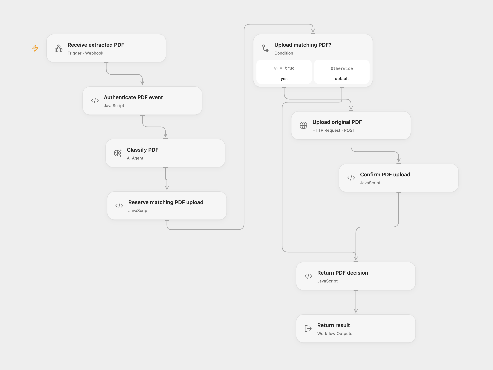

# Save Matching Gmail PDFs to Drive

Classify incoming PDF attachments and save matching originals to Google Drive.

<!-- template-actions:start -->
 
<!-- template-actions:end -->

<picture>
  <source media="(prefers-color-scheme: dark)" srcset="preview-dark.png">
  
</picture>

## Setup

Set the desired document type in Configure PDF matching. Use one mode only and prevent overlapping runs for the same message.

Every PDF attachment is examined separately. The text must be extractable and satisfy the source estimate of at most 15,800 characters; scanned PDFs need OCR. Non-PDF and over-limit attachments are skipped. The source used length() on a string; this version uses length. The classifier may be wrong, so review the results. PDF text and filename are sent to the model.

If upload is uncertain, inspect the destination before retrying. In Open Flow supply the pending key and confirmed or absent in Reserve matching PDF upload and replay the same attachment, then clear the recovery fields.

In n8n

Configure the n8n Gmail trigger and Gmail/Drive credentials, the destination folder ID, a private Data Table with item_key and status text columns and a model. Select direct mode for n8n processing. For Open Flow set relay mode, configure the Open Flow webhook and Header Auth, set PDF_EVENT_AUTH to the same Authorization header, configure the term in Authenticate PDF event, enable the authenticated Upload original PDF webhook and set its URL and bearer token in Open Flow; configure its Header Auth as Authorization: Bearer followed by that token. In n8n mark the pending Data Table row done if uploaded or delete it only after confirming no file exists; enable the authenticated Resume email webhook and POST a JSON object with messageId set to the original Gmail message ID to resume the original email.

Inspiration &amp; credits

Adapted from [Send specific PDF attachments from Gmail to Google Drive using OpenAI](https://github.com/Zie619/n8n-workflows/blob/ae8cf6dc5b873cbb4f74587aa9180ed3a9f70682/workflows/Code/0298_Code_Readpdf_Send_Triggered.json) in [Zie619/n8n-workflows](https://github.com/Zie619/n8n-workflows). The source export does not identify a separate template author or license.

The collection’s [MIT notice](https://github.com/Zie619/n8n-workflows/blob/94007c1445d9258a7da116646b79473e7c7c3282/LICENSE) is pinned at a later revision. This is the collection notice at that revision; it does not establish a separate original template author's license. Our changes are listed above; see [repository licensing](../../README.md#licensing).

> MIT License
>
> Copyright (c) 2025 Zie619
>
> Permission is hereby granted, free of charge, to any person obtaining a copy
> of this software and associated documentation files (the "Software"), to deal
> in the Software without restriction, including without limitation the rights
> to use, copy, modify, merge, publish, distribute, sublicense, and/or sell
> copies of the Software, and to permit persons to whom the Software is
> furnished to do so, subject to the following conditions:
>
> The above copyright notice and this permission notice shall be included in all
> copies or substantial portions of the Software.
>
> THE SOFTWARE IS PROVIDED "AS IS", WITHOUT WARRANTY OF ANY KIND, EXPRESS OR
> IMPLIED, INCLUDING BUT NOT LIMITED TO THE WARRANTIES OF MERCHANTABILITY,
> FITNESS FOR A PARTICULAR PURPOSE AND NONINFRINGEMENT. IN NO EVENT SHALL THE
> AUTHORS OR COPYRIGHT HOLDERS BE LIABLE FOR ANY CLAIM, DAMAGES OR OTHER
> LIABILITY, WHETHER IN AN ACTION OF CONTRACT, TORT OR OTHERWISE, ARISING FROM,
> OUT OF OR IN CONNECTION WITH THE SOFTWARE OR THE USE OR OTHER DEALINGS IN THE
> SOFTWARE.

