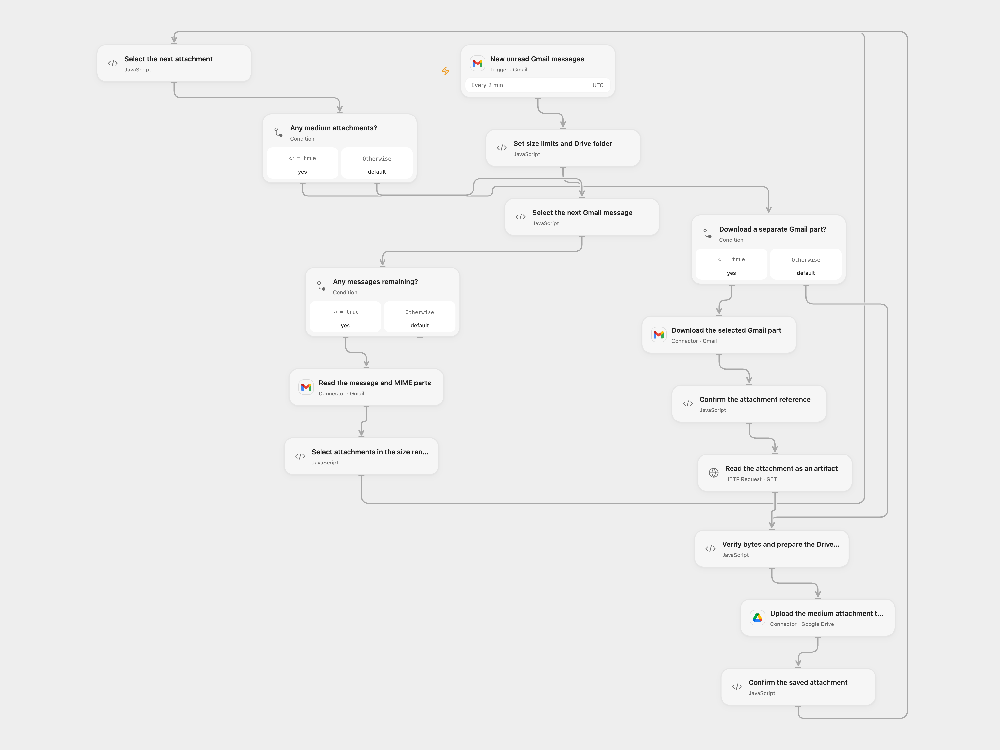

# Save Medium Gmail Attachments to Google Drive

Pick up new unread messages from a chosen sender and save each attachment that falls within your size limits.

<!-- template-actions:start -->
 
<!-- template-actions:end -->

<picture>
  <source media="(prefers-color-scheme: dark)" srcset="preview-dark.png">
  
</picture>

## Setup

1. Connect the same Gmail account to the trigger, message read, and attachment download nodes. Set **Sender** in **New unread Gmail messages**. Connector file transit must be available for separately stored attachments.
2. Connect Google Drive with permission to create files in your destination folder. Enter the **Folder ID** in **Set size limits and Drive folder**. The default byte limits are 10,000 and 300,000.
3. Deploy the workflow. Hosted Open Flow polls Gmail every two minutes. Its initial poll records the mailbox position, so it acts on new messages.

## Behavior

Each attachment above 10,000 and at or below 300,000 bytes is saved separately with its filename and MIME type. Files at or below 10,000 bytes and files above 300,000 bytes are skipped. Adjust the two thresholds together. The workflow reads Gmail's size and verifies the bytes of each selected file before uploading. It leaves the message unread and sends no notices.

An attachment read error stops the run. If Drive may have created a file without returning a receipt, check the destination before replaying the run. Earlier completed uploads remain in Drive, and a manual replay may create copies.

In n8n

Connect Gmail and set **Filters → Sender** in **New unread Gmail messages**. Keep unread filtering and attachment downloads enabled. Connect the Drive account and choose the destination folder in **Upload the medium attachment to Drive**. Edit the byte limits in **Measure each attachment**. The native Gmail trigger polls every minute and downloads the attachments before the size check. Activate when ready.

Inspiration &amp; credits

Adapted from [Upload multiple attachments from Gmail to Google Drive](https://github.com/Zie619/n8n-workflows/blob/ae8cf6dc5b873cbb4f74587aa9180ed3a9f70682/workflows/Splitout/0730_Splitout_Noop_Send_Triggered.json) in [Zie619/n8n-workflows](https://github.com/Zie619/n8n-workflows). Attribution: Hubschrauber (original workflow) / Zie619 (collection). See the [original n8n gallery template](https://n8n.io/workflows/2966-upload-multiple-attachments-from-gmail-to-google-drive-without-a-code-node/).

The collection’s [MIT notice](https://github.com/Zie619/n8n-workflows/blob/94007c1445d9258a7da116646b79473e7c7c3282/LICENSE) is pinned at a later revision. This is the collection notice at that revision; it does not establish a separate original template author's license. Our changes are listed above; see [repository licensing](../../README.md#licensing).

> MIT License
>
> Copyright (c) 2025 Zie619
>
> Permission is hereby granted, free of charge, to any person obtaining a copy
> of this software and associated documentation files (the "Software"), to deal
> in the Software without restriction, including without limitation the rights
> to use, copy, modify, merge, publish, distribute, sublicense, and/or sell
> copies of the Software, and to permit persons to whom the Software is
> furnished to do so, subject to the following conditions:
>
> The above copyright notice and this permission notice shall be included in all
> copies or substantial portions of the Software.
>
> THE SOFTWARE IS PROVIDED "AS IS", WITHOUT WARRANTY OF ANY KIND, EXPRESS OR
> IMPLIED, INCLUDING BUT NOT LIMITED TO THE WARRANTIES OF MERCHANTABILITY,
> FITNESS FOR A PARTICULAR PURPOSE AND NONINFRINGEMENT. IN NO EVENT SHALL THE
> AUTHORS OR COPYRIGHT HOLDERS BE LIABLE FOR ANY CLAIM, DAMAGES OR OTHER
> LIABILITY, WHETHER IN AN ACTION OF CONTRACT, TORT OR OTHERWISE, ARISING FROM,
> OUT OF OR IN CONNECTION WITH THE SOFTWARE OR THE USE OR OTHER DEALINGS IN THE
> SOFTWARE.

