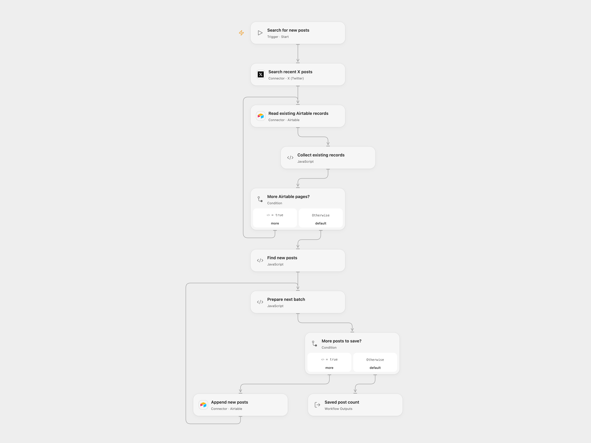

# Save New X Search Results to Airtable

Search recent X posts and append results whose IDs are absent from Airtable.

<picture>
  <source media="(prefers-color-scheme: dark)" srcset="preview-dark.png">
  
</picture>

[Open Flow JSON](templates/save-new-x-search-results-to-airtable.openflow.json) · [n8n JSON](templates/save-new-x-search-results-to-airtable.n8n.json)

## Setup

Connect X with recent-search access and Airtable with read and write access. Set the query in **Search recent X posts** and use the same base and table in both Airtable nodes. The table needs text fields `Tweet`, `Tweet_id`, `Tweet URL`, `Author` and `Time`, plus a numeric `Likes` field. Configure the same query, base, table and credentials in n8n. Run one format for each import.

## Behavior

The workflow requests up to 100 recent X search results and reads every page of existing Airtable records. It compares post IDs against `Tweet_id`, then appends unmatched posts in batches of up to 10. Existing records are not updated. Each new row contains the post text, ID, URL, like count and creation time. As in the source, `Author` refers to the user being replied to, when present; it is not the post author's name. Missing required expanded users stop the run before writing.

X recent search covers a limited time window and may require eligible API access. The original V1 mixed search is replaced with V2 recent search, so ranking and available results may differ. The workflow does not paginate past the first 100 X results. A failed or uncertain batch may already have created rows; earlier batches remain. Inspect the table before retrying, and avoid overlapping runs. Collected results and records must fit execution limits.

Inspiration &amp; credits

## Changes to the source

- Replace private Airtable identifiers and use current X recent search with user expansions. Read all Airtable pages and compare IDs before writing.
- Fix source cross-branch references that can fail when the number of existing records differs from search results.

Adapted from [New tweets](https://github.com/Zie619/n8n-workflows/blob/ae8cf6dc5b873cbb4f74587aa9180ed3a9f70682/workflows/Manual/0005_Manual_Twitter_Create_Triggered.json) in [Zie619/n8n-workflows](https://github.com/Zie619/n8n-workflows). The source export does not identify a separate template author or license.

The collection’s [MIT notice](https://github.com/Zie619/n8n-workflows/blob/94007c1445d9258a7da116646b79473e7c7c3282/LICENSE) is pinned at a later revision. This is the collection notice at that revision; it does not establish a separate original template author's license. Our changes are listed above; see [repository licensing](../../README.md#licensing).

> MIT License
>
> Copyright (c) 2025 Zie619
>
> Permission is hereby granted, free of charge, to any person obtaining a copy
> of this software and associated documentation files (the "Software"), to deal
> in the Software without restriction, including without limitation the rights
> to use, copy, modify, merge, publish, distribute, sublicense, and/or sell
> copies of the Software, and to permit persons to whom the Software is
> furnished to do so, subject to the following conditions:
>
> The above copyright notice and this permission notice shall be included in all
> copies or substantial portions of the Software.
>
> THE SOFTWARE IS PROVIDED "AS IS", WITHOUT WARRANTY OF ANY KIND, EXPRESS OR
> IMPLIED, INCLUDING BUT NOT LIMITED TO THE WARRANTIES OF MERCHANTABILITY,
> FITNESS FOR A PARTICULAR PURPOSE AND NONINFRINGEMENT. IN NO EVENT SHALL THE
> AUTHORS OR COPYRIGHT HOLDERS BE LIABLE FOR ANY CLAIM, DAMAGES OR OTHER
> LIABILITY, WHETHER IN AN ACTION OF CONTRACT, TORT OR OTHERWISE, ARISING FROM,
> OUT OF OR IN CONNECTION WITH THE SOFTWARE OR THE USE OR OTHER DEALINGS IN THE
> SOFTWARE.

