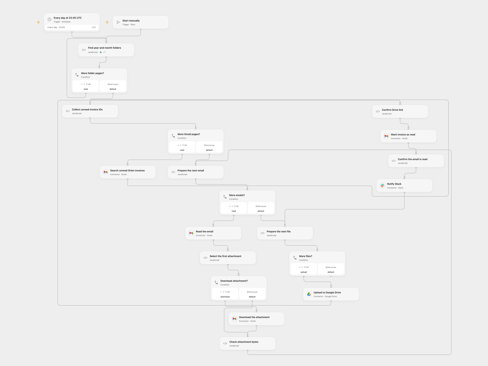

# Save Orlen Invoices to Drive

Archive unread Orlen invoice attachments in dated Google Drive folders and notify Slack.

<picture>
  <source media="(prefers-color-scheme: dark)" srcset="preview-dark.png">
  
</picture>

[Open Flow JSON](templates/save-orlen-invoices-to-drive.openflow.json) · [n8n JSON](templates/save-orlen-invoices-to-drive.n8n.json)

## Setup

Connect Gmail with read and modify access, Google Drive and Slack. Set the existing parent Drive folder in **Find year and month folders** and enable its Drive Action. Set a channel ID in **Notify Slack**. Configure Gmail file transit and its hostname in **Check attachment bytes**. In n8n, connect the same services and configure the parent folder in **Current date** and channel in **Slack**. Activate one format.

## Behavior

At 23:45 UTC or on manual start, find existing year and two-digit month folders under the configured parent and collect all unread messages from orlenpay@orlen.pl with attachments. Save the first attachment from each message, mark that message read and send a Slack notification. No matching messages causes no writes. Folders must already exist and names must be unique within their parent. Open Flow stops on repeated pages, more than 5,000 messages, or runtime limits before uploading; its file transit and Code size limits also apply. n8n stops if a folder search has another page and uses its own Gmail and MIME limits. Open Flow and n8n can select differently ordered attachments for unusual MIME messages.

An upload or label change may succeed even if the response is lost. Check Drive and Gmail before retrying; earlier files and label changes are not rolled back, and an unread message can be uploaded twice. Open Flow reads the message batch and stages available attachment bytes before uploading, then uploads, marks and notifies one message at a time. A missing attachment is reported when its message is processed, so earlier messages may already have been uploaded and marked read. n8n completes each node for its batch before running the next, so a later upload failure can leave earlier files while the messages remain unread. Its Drive node uploads file content before assigning the destination and filename, so a later failure can leave a file outside the intended folder. A Slack failure occurs after the message is marked read; review the execution to send a missing notification. Avoid overlapping runs and restrict access to execution data and attachment transit URLs.

## Changes to the source

- Connect the previously disconnected date/folder branch, scope folder searches to the configured parent, reject ambiguous matches and set UTC explicitly. n8n uses a fixed second within the minute; Open Flow starts at the minute boundary.
- Enable Gmail attachment download in n8n V2; the source Gmail V1 did not populate the binary consumed by Drive. Use the attachment filename for the saved file and preserve each message's association through the upload and mark-read steps.

Source and license

Adapted from [Orlen invoice archive](https://github.com/Zie619/n8n-workflows/blob/ae8cf6dc5b873cbb4f74587aa9180ed3a9f70682/workflows/Slack/0940_Slack_Manual_Automation_Scheduled.json) in [Zie619/n8n-workflows](https://github.com/Zie619/n8n-workflows). The source export does not identify a separate template author or license.

The collection’s [MIT notice](https://github.com/Zie619/n8n-workflows/blob/94007c1445d9258a7da116646b79473e7c7c3282/LICENSE) is pinned at a later revision. This is the collection notice at that revision; it does not establish a separate original template author's license. Our changes are listed above; see [repository licensing](../../README.md#licensing).

> MIT License
>
> Copyright (c) 2025 Zie619
>
> Permission is hereby granted, free of charge, to any person obtaining a copy
> of this software and associated documentation files (the "Software"), to deal
> in the Software without restriction, including without limitation the rights
> to use, copy, modify, merge, publish, distribute, sublicense, and/or sell
> copies of the Software, and to permit persons to whom the Software is
> furnished to do so, subject to the following conditions:
>
> The above copyright notice and this permission notice shall be included in all
> copies or substantial portions of the Software.
>
> THE SOFTWARE IS PROVIDED "AS IS", WITHOUT WARRANTY OF ANY KIND, EXPRESS OR
> IMPLIED, INCLUDING BUT NOT LIMITED TO THE WARRANTIES OF MERCHANTABILITY,
> FITNESS FOR A PARTICULAR PURPOSE AND NONINFRINGEMENT. IN NO EVENT SHALL THE
> AUTHORS OR COPYRIGHT HOLDERS BE LIABLE FOR ANY CLAIM, DAMAGES OR OTHER
> LIABILITY, WHETHER IN AN ACTION OF CONTRACT, TORT OR OTHERWISE, ARISING FROM,
> OUT OF OR IN CONNECTION WITH THE SOFTWARE OR THE USE OR OTHER DEALINGS IN THE
> SOFTWARE.

