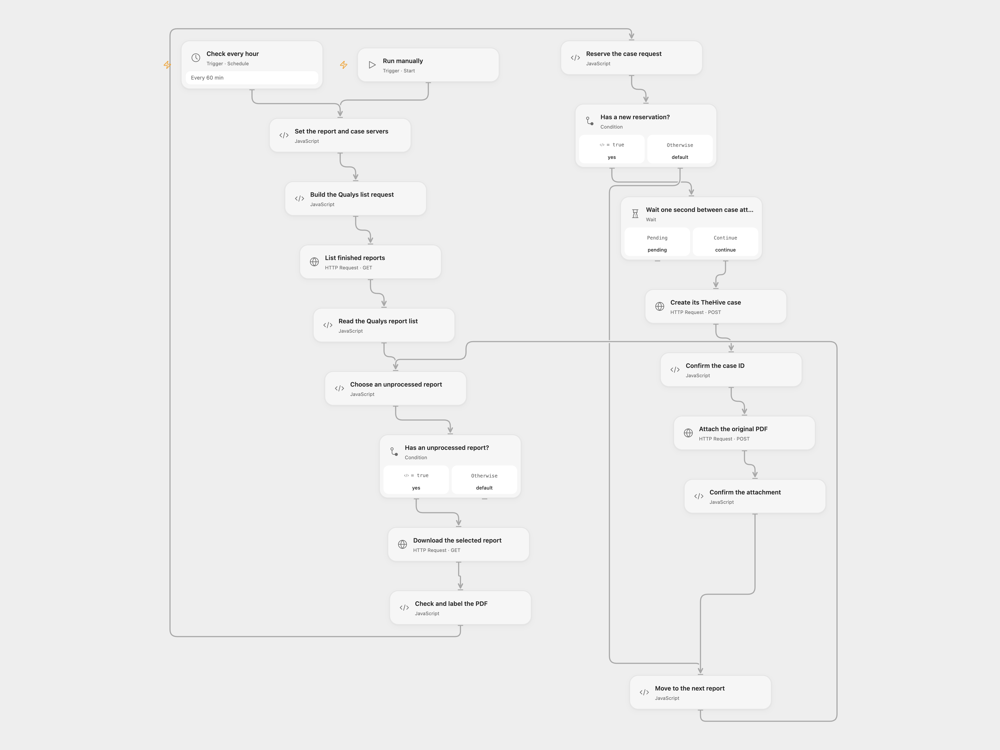

# Save Qualys Reports to TheHive

File each finished Qualys PDF report in its own TheHive case.

<!-- template-actions:start -->
 
<!-- template-actions:end -->

<picture>
  <source media="(prefers-color-scheme: dark)" srcset="preview-dark.png">
  
</picture>

## Setup

1. In **Set the report and case servers**, set the HTTPS origins of your Qualys platform API and TheHive 5 instance. Set an optional earliest launch date in UTC, for example `2026-01-01T00:00:00Z`. A blank date includes all finished PDF reports visible to your Qualys account.
2. Bind the Qualys credentials as secret Variables `QUALYS_USERNAME` and `QUALYS_PASSWORD`. Bind `THEHIVE_API_KEY` to a key for the destination organization with permission to create cases and add attachments.
3. Run manually to check the setup, or publish and enable the hourly trigger. Use a TheHive organization whose users are authorized to access the reports. [Qualys report list](https://docs.qualys.com/en/vm/qweb-all-api/mergedProjects/qapi-rep/reports/list_reports.htm) · [TheHive API](https://docs.strangebee.com/thehive/api-docs/)

## Behavior

The workflow lists saved finished PDF reports through the Qualys v3 API. For each new report it checks the PDF, creates a TLP Amber case with the report's details, and adds the PDF to that case. It waits one second before creating each case and records completion after TheHive confirms the attachment. Each Qualys report ID is tracked separately for the selected source and destination, including reports that finish after their launch date.

Both the scheduled and manual runs accept PDFs up to 10 MiB. A provider error, incomplete list, or invalid PDF can stop the current run. If a case or attachment may have been created, the reservation prevents the workflow from sending it again. Check TheHive for the report ID and file name before recovering that reservation. Use a separate workflow for each Qualys account and destination organization.

In n8n

Set the two HTTPS origins and optional launch date in **Set the report and case servers**. Bind the same Qualys API credential in **List finished reports** and **Download the selected report**. Bind a Header Auth credential named `Authorization` with value `Bearer YOUR_THEHIVE_API_KEY` in **Create its TheHive case** and **Attach the original PDF**.

Use a single production execution slot and a dedicated Data Table with text columns `report_key`, `status`, `case_id`, and `attachment_id`. Select it in **Skip earlier attempts**, **Reserve the case request**, **Reserve the attachment**, and **Record the attachment ID**. Check TheHive before clearing a pending report. Retrying directly at a write node bypasses the reservation.

Inspiration &amp; credits

Adapted from [Save Qualys Reports to TheHive](https://github.com/Zie619/n8n-workflows/blob/ae8cf6dc5b873cbb4f74587aa9180ed3a9f70682/workflows/Wait/0627_Wait_Splitout_Create_Scheduled.json) in [Zie619/n8n-workflows](https://github.com/Zie619/n8n-workflows). Attribution: Angel Menendez (original workflow) / Zie619 (collection).

The collection’s [MIT notice](https://github.com/Zie619/n8n-workflows/blob/94007c1445d9258a7da116646b79473e7c7c3282/LICENSE) is pinned at a later revision. This is the collection notice at that revision; it does not establish a separate original template author's license. Our changes are listed above; see [repository licensing](../../README.md#licensing).

> MIT License
>
> Copyright (c) 2025 Zie619
>
> Permission is hereby granted, free of charge, to any person obtaining a copy
> of this software and associated documentation files (the "Software"), to deal
> in the Software without restriction, including without limitation the rights
> to use, copy, modify, merge, publish, distribute, sublicense, and/or sell
> copies of the Software, and to permit persons to whom the Software is
> furnished to do so, subject to the following conditions:
>
> The above copyright notice and this permission notice shall be included in all
> copies or substantial portions of the Software.
>
> THE SOFTWARE IS PROVIDED "AS IS", WITHOUT WARRANTY OF ANY KIND, EXPRESS OR
> IMPLIED, INCLUDING BUT NOT LIMITED TO THE WARRANTIES OF MERCHANTABILITY,
> FITNESS FOR A PARTICULAR PURPOSE AND NONINFRINGEMENT. IN NO EVENT SHALL THE
> AUTHORS OR COPYRIGHT HOLDERS BE LIABLE FOR ANY CLAIM, DAMAGES OR OTHER
> LIABILITY, WHETHER IN AN ACTION OF CONTRACT, TORT OR OTHERWISE, ARISING FROM,
> OUT OF OR IN CONNECTION WITH THE SOFTWARE OR THE USE OR OTHER DEALINGS IN THE
> SOFTWARE.

[Original n8n workflow by Angel Menendez](https://n8n.io/workflows/2531-save-qualys-reports-to-thehive/). The adaptation uses Qualys v3, verifies the PDF before creating a case, and tracks successful attachments by report ID.

