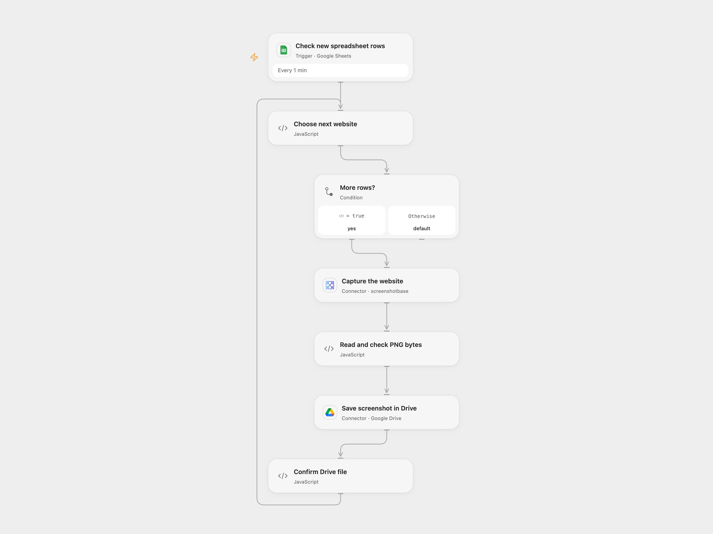

# Save Sheet Website Screenshots to Drive

Capture websites listed in newly added spreadsheet rows and save PNG files to Google Drive.

<picture>
  <source media="(prefers-color-scheme: dark)" srcset="preview-dark.png">
  
</picture>

[Open Flow JSON](templates/save-sheet-website-screenshots-to-drive.openflow.json) · [n8n JSON](templates/save-sheet-website-screenshots-to-drive.n8n.json)

## Setup

Create a Google Sheet with unique **Url** and **Title** headers. Connect Google Sheets and select the spreadsheet and sheet in **Check new spreadsheet rows**. Connect Screenshotbase and Google Drive, then set the destination folder ID in **Choose next website**. Use publicly accessible pages you are authorized to capture.

In n8n, install the CustomJS PDF Toolkit community node (tested with version 1.58.0) and configure its CustomJS credential in **Take a screenshot of a website**. Connect the Sheets trigger and Drive node, select the same sheet and a destination folder. Run one format.

## Behavior

Each newly added row supplies a URL and title; the workflow captures a PNG and saves it as the title plus .png in the configured Drive folder. Open Flow processes rows in order within each run; separate pages may run independently. Its trigger handles up to 100 rows per page and starts from a baseline. Missing fields, a failed capture or an incomplete image stops the current run. Previously saved files remain. An uncertain Drive upload may have succeeded; inspect the destination before retrying. No cross-run deduplication is added.

Open Flow uses Screenshotbase full-page capture at 1024 pixels wide and downloads the resulting PNG before upload. It stops if the PNG dimensions indicate the service's 20,000-pixel full-page limit, if the response is incomplete or if the image host is not Screenshotbase's CDN. The service visits the submitted page and stores a public image URL; anyone with that URL may be able to view the image. Image size and platform execution limits apply. n8n uses the source CustomJS screenshot node, whose rendering and limits may differ.

Inspiration &amp; credits

## Changes to the source

- Replace private spreadsheet and folder identifiers with configuration and process each row separately. Open Flow uses the formal Screenshotbase Action; n8n retains the original CustomJS community node.
- Check returned PNG bytes and dimensions in Open Flow before Drive upload.

Adapted from [Capture website screenshots via Google Sheets to Google Drive with CustomJS](https://github.com/Zie619/n8n-workflows/blob/ae8cf6dc5b873cbb4f74587aa9180ed3a9f70682/workflows/Googlesheets/0812_GoogleSheets_GoogleDrive_Automate_Triggered.json) in [Zie619/n8n-workflows](https://github.com/Zie619/n8n-workflows). The matching [n8n listing](https://n8n.io/workflows/3332-capture-website-screenshots-via-google-sheets-to-google-drive-with-customjs/) credits CustomJS. The original template does not state a separate license.

The collection’s [MIT notice](https://github.com/Zie619/n8n-workflows/blob/94007c1445d9258a7da116646b79473e7c7c3282/LICENSE) is pinned at a later revision. This is the collection notice at that revision; it does not establish a separate original template author's license. Our changes are listed above; see [repository licensing](../../README.md#licensing).

> MIT License
>
> Copyright (c) 2025 Zie619
>
> Permission is hereby granted, free of charge, to any person obtaining a copy
> of this software and associated documentation files (the "Software"), to deal
> in the Software without restriction, including without limitation the rights
> to use, copy, modify, merge, publish, distribute, sublicense, and/or sell
> copies of the Software, and to permit persons to whom the Software is
> furnished to do so, subject to the following conditions:
>
> The above copyright notice and this permission notice shall be included in all
> copies or substantial portions of the Software.
>
> THE SOFTWARE IS PROVIDED "AS IS", WITHOUT WARRANTY OF ANY KIND, EXPRESS OR
> IMPLIED, INCLUDING BUT NOT LIMITED TO THE WARRANTIES OF MERCHANTABILITY,
> FITNESS FOR A PARTICULAR PURPOSE AND NONINFRINGEMENT. IN NO EVENT SHALL THE
> AUTHORS OR COPYRIGHT HOLDERS BE LIABLE FOR ANY CLAIM, DAMAGES OR OTHER
> LIABILITY, WHETHER IN AN ACTION OF CONTRACT, TORT OR OTHERWISE, ARISING FROM,
> OUT OF OR IN CONNECTION WITH THE SOFTWARE OR THE USE OR OTHER DEALINGS IN THE
> SOFTWARE.

