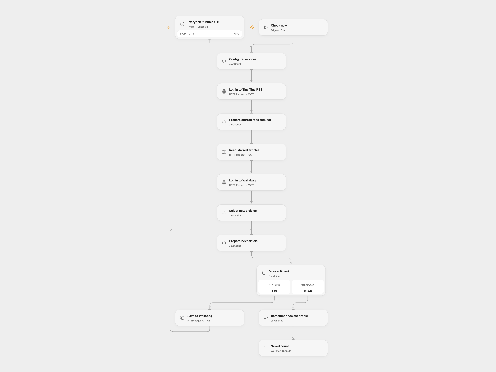

# Save Starred Tiny Tiny RSS Articles to Wallabag

Check starred Tiny Tiny RSS articles and save new URLs to Wallabag.

<picture>
  <source media="(prefers-color-scheme: dark)" srcset="preview-dark.png">
  
</picture>

[Open Flow JSON](templates/save-starred-ttrss-articles-to-wallabag.openflow.json) · [n8n JSON](templates/save-starred-ttrss-articles-to-wallabag.n8n.json)

## Setup

Enable the Tiny Tiny RSS API and create a Wallabag API client. In Open Flow configure both HTTPS service base URLs in **Configure services**. Set and bind the **Configure services** inputs to secret Variables `TTRSS_USER`, `TTRSS_PASSWORD`, `WALLABAG_CLIENT_ID`, `WALLABAG_CLIENT_SECRET`, `WALLABAG_USER` and `WALLABAG_PASSWORD`. Restrict access to execution data because authentication requests contain credentials and tokens. Keep workflow State persistent and prevent overlapping runs.

In n8n, enter HTTPS service URLs in the HTTP Request nodes and configure the six named n8n variables referenced by the login expressions; restrict access to those variables and execution data. Activate only one workflow format. The password grant must be enabled by the Wallabag instance.

## Behavior

Run manually or every ten minutes. The workflow requests the starred feed and saves article URLs until it reaches the last seen article ID. The first run saves the returned page. It does not paginate: older or reordered articles outside that page may be missed. Tags are not sent. Empty results save nothing.

Open Flow saves the newest ID to State only after all article requests succeed. n8n updates static data only after the save node completes successfully. A failed or uncertain write leaves the checkpoint unchanged, but some URLs may already be saved. Check Wallabag before retrying to avoid duplicates. A hard interruption or overlapping runs can still affect persistence. Overlapping runs can race. Manual n8n tests do not persist workflow static data, while Open Flow manual runs use persistent State. The schedule uses UTC; n8n's Cron V1 may run at a randomized second within the minute.

Inspiration &amp; credits

## Changes to the source

- Connect the otherwise disconnected Wallabag login and validate both API responses. Empty or unchanged feeds produce no write. Configure HTTPS endpoints instead of source placeholders.
- Open Flow saves the checkpoint only after all requests succeed and executes saves sequentially. n8n also moves the static-data update after the save node completes successfully.

Adapted from [post to wallabag](https://github.com/Zie619/n8n-workflows/blob/ae8cf6dc5b873cbb4f74587aa9180ed3a9f70682/workflows/Manual/0976_Manual_HTTP_Automation_Webhook.json) in [Zie619/n8n-workflows](https://github.com/Zie619/n8n-workflows). The source export does not identify a separate template author or license.

The collection’s [MIT notice](https://github.com/Zie619/n8n-workflows/blob/94007c1445d9258a7da116646b79473e7c7c3282/LICENSE) is pinned at a later revision. This is the collection notice at that revision; it does not establish a separate original template author's license. Our changes are listed above; see [repository licensing](../../README.md#licensing).

> MIT License
>
> Copyright (c) 2025 Zie619
>
> Permission is hereby granted, free of charge, to any person obtaining a copy
> of this software and associated documentation files (the "Software"), to deal
> in the Software without restriction, including without limitation the rights
> to use, copy, modify, merge, publish, distribute, sublicense, and/or sell
> copies of the Software, and to permit persons to whom the Software is
> furnished to do so, subject to the following conditions:
>
> The above copyright notice and this permission notice shall be included in all
> copies or substantial portions of the Software.
>
> THE SOFTWARE IS PROVIDED "AS IS", WITHOUT WARRANTY OF ANY KIND, EXPRESS OR
> IMPLIED, INCLUDING BUT NOT LIMITED TO THE WARRANTIES OF MERCHANTABILITY,
> FITNESS FOR A PARTICULAR PURPOSE AND NONINFRINGEMENT. IN NO EVENT SHALL THE
> AUTHORS OR COPYRIGHT HOLDERS BE LIABLE FOR ANY CLAIM, DAMAGES OR OTHER
> LIABILITY, WHETHER IN AN ACTION OF CONTRACT, TORT OR OTHERWISE, ARISING FROM,
> OUT OF OR IN CONNECTION WITH THE SOFTWARE OR THE USE OR OTHER DEALINGS IN THE
> SOFTWARE.

