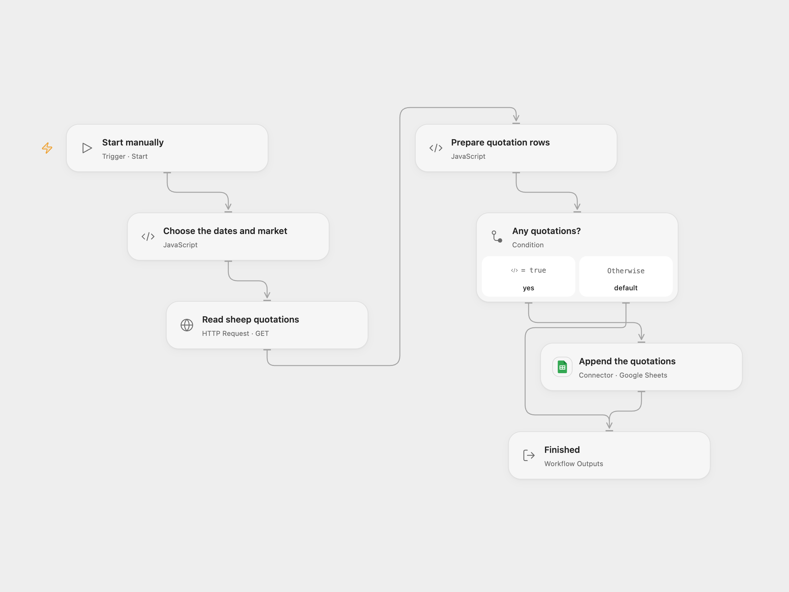

# Save Taiwan Sheep Prices to Google Sheets

Fetch Taiwan sheep market quotations for a date range and append them to Google Sheets.

<picture>
  <source media="(prefers-color-scheme: dark)" srcset="preview-dark.png">
  
</picture>

[Open Flow JSON](templates/save-taiwan-sheep-prices-to-sheets.openflow.json) · [n8n JSON](templates/save-taiwan-sheep-prices-to-sheets.n8n.json)

## Setup

Create a sheet with columns in this order: transDate, marketID, shortName, name, productID, productName, productTypeName, quantity, avgWeight, avgPrice, highestPrice, Record_ID. In **Choose the dates and market**, set dates as YYYY/MM/DD. Leave market empty for all markets or enter an exact market shortName. Connect Google Sheets and set the spreadsheet ID and A1 range in **Append the quotations**. In n8n set the same dates, market, spreadsheet ID and sheet name in **Choose the dates and market**, and connect its Google Sheets credential. Run either format manually.

## Behavior

The workflow reads Taiwan Ministry of Agriculture sheep quotations for the chosen dates, filters the returned records by market when specified, and appends their fields as raw cells. It appends nothing for an empty result. A failed request, incomplete response or sheet error stops the run. If the API indicates another page, the run stops before writing; choose a shorter date range. Open Flow applies HTTP response size and timeout limits.

Runs append rather than deduplicate. Check the sheet before retrying an uncertain write because it may already have succeeded. Repeated date ranges can add duplicate rows. The API may revise historical records.

Inspiration &amp; credits

## Changes to the source

- Replace the original crop column names with fields actually returned by the sheep endpoint. Use an optional exact market filter on returned shortName; the source's MarketName parameter was ignored by the endpoint in the checked response.
- Remove the embedded key and sheet identifiers. Add response validation, refuse incomplete pages and write raw cells. The endpoint was accessible without a key when checked.

Adapted from [Taiwan sheep market quotations](https://github.com/Zie619/n8n-workflows/blob/ae8cf6dc5b873cbb4f74587aa9180ed3a9f70682/workflows/Manual/2035_Manual_GoogleSheets_Automation_Webhook.json) in [Zie619/n8n-workflows](https://github.com/Zie619/n8n-workflows). The matching [n8n listing](https://n8n.io/workflows/2687-tw-request-agri-data-open-platform-daily-market-sheep-pricing/) credits darrell_tw. No separate original template license was found.

The collection’s [MIT notice](https://github.com/Zie619/n8n-workflows/blob/94007c1445d9258a7da116646b79473e7c7c3282/LICENSE) is pinned at a later revision. This is the collection notice at that revision; it does not establish a separate original template author's license. Our changes are listed above; see [repository licensing](../../README.md#licensing).

> MIT License
>
> Copyright (c) 2025 Zie619
>
> Permission is hereby granted, free of charge, to any person obtaining a copy
> of this software and associated documentation files (the "Software"), to deal
> in the Software without restriction, including without limitation the rights
> to use, copy, modify, merge, publish, distribute, sublicense, and/or sell
> copies of the Software, and to permit persons to whom the Software is
> furnished to do so, subject to the following conditions:
>
> The above copyright notice and this permission notice shall be included in all
> copies or substantial portions of the Software.
>
> THE SOFTWARE IS PROVIDED "AS IS", WITHOUT WARRANTY OF ANY KIND, EXPRESS OR
> IMPLIED, INCLUDING BUT NOT LIMITED TO THE WARRANTIES OF MERCHANTABILITY,
> FITNESS FOR A PARTICULAR PURPOSE AND NONINFRINGEMENT. IN NO EVENT SHALL THE
> AUTHORS OR COPYRIGHT HOLDERS BE LIABLE FOR ANY CLAIM, DAMAGES OR OTHER
> LIABILITY, WHETHER IN AN ACTION OF CONTRACT, TORT OR OTHERWISE, ARISING FROM,
> OUT OF OR IN CONNECTION WITH THE SOFTWARE OR THE USE OR OTHER DEALINGS IN THE
> SOFTWARE.

