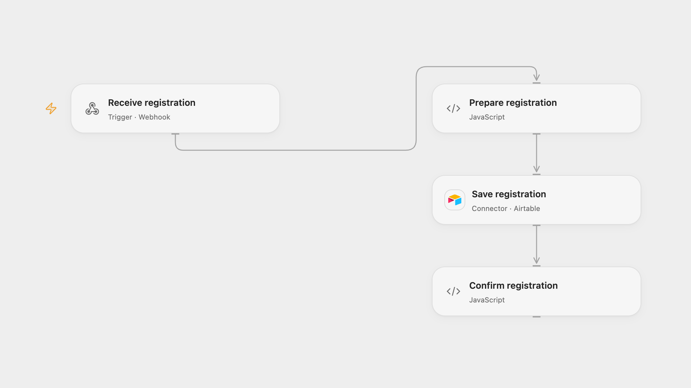

# Save User Registration to Airtable

Record a registration with contact details and subscription choice in Airtable.

<picture>
  <source media="(prefers-color-scheme: dark)" srcset="preview-dark.png">
  
</picture>

[Open Flow JSON](templates/save-user-registration-to-airtable.openflow.json) · [n8n JSON](templates/save-user-registration-to-airtable.n8n.json)

## Setup

Create an Airtable table with text fields **Name**, **Age**, **Email**, **Address**, **Subscription** and **Submitted**. In Open Flow connect Airtable and set the base and table in **Save registration**. Configure a form or client to POST JSON such as {"Name":"Alex","Age":30,"email":"alex@example.com","address":"","You have Subscription ?":"Yes"} to the webhook. In n8n connect Airtable, choose the base and table, and use the hosted form; change its path if it conflicts with another form. Activate one format.

## Behavior

Each submission creates one record with name, numeric age converted to text, email, optional address, Yes/No subscription choice and submission time. Open Flow records the processing time in UTC; n8n uses its form submission timestamp. An acknowledgment from the form or webhook does not guarantee the record was saved. Restrict access to the form, webhook and execution history because they contain personal information.

A failed or uncertain Airtable write may have succeeded; inspect the table before retrying. Repeated submissions create additional records. No automatic retry or deduplication is added.

Inspiration &amp; credits

## Changes to the source

- Open Flow uses a JSON webhook instead of the n8n hosted form. Configure a separate form client for Open Flow.
- Replace private Airtable configuration with editable IDs, store the numeric age as text and check the created record in Open Flow.

Adapted from [Automated Form Submission Data Storage in Airtable](https://github.com/Zie619/n8n-workflows/blob/ae8cf6dc5b873cbb4f74587aa9180ed3a9f70682/workflows/Form/1611_Form_Stickynote_Automate_Triggered.json) in [Zie619/n8n-workflows](https://github.com/Zie619/n8n-workflows). The source export does not identify a separate template author or license.

The collection’s [MIT notice](https://github.com/Zie619/n8n-workflows/blob/94007c1445d9258a7da116646b79473e7c7c3282/LICENSE) is pinned at a later revision. This is the collection notice at that revision; it does not establish a separate original template author's license. Our changes are listed above; see [repository licensing](../../README.md#licensing).

> MIT License
>
> Copyright (c) 2025 Zie619
>
> Permission is hereby granted, free of charge, to any person obtaining a copy
> of this software and associated documentation files (the "Software"), to deal
> in the Software without restriction, including without limitation the rights
> to use, copy, modify, merge, publish, distribute, sublicense, and/or sell
> copies of the Software, and to permit persons to whom the Software is
> furnished to do so, subject to the following conditions:
>
> The above copyright notice and this permission notice shall be included in all
> copies or substantial portions of the Software.
>
> THE SOFTWARE IS PROVIDED "AS IS", WITHOUT WARRANTY OF ANY KIND, EXPRESS OR
> IMPLIED, INCLUDING BUT NOT LIMITED TO THE WARRANTIES OF MERCHANTABILITY,
> FITNESS FOR A PARTICULAR PURPOSE AND NONINFRINGEMENT. IN NO EVENT SHALL THE
> AUTHORS OR COPYRIGHT HOLDERS BE LIABLE FOR ANY CLAIM, DAMAGES OR OTHER
> LIABILITY, WHETHER IN AN ACTION OF CONTRACT, TORT OR OTHERWISE, ARISING FROM,
> OUT OF OR IN CONNECTION WITH THE SOFTWARE OR THE USE OR OTHER DEALINGS IN THE
> SOFTWARE.

