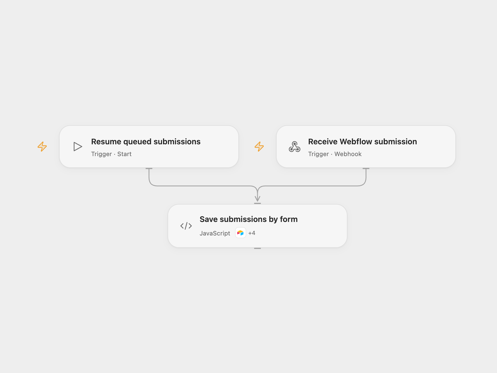

# Save Webflow Forms in Airtable Tables

Create an Airtable table per Webflow form and save each submission in its corresponding table.

<picture>
  <source media="(prefers-color-scheme: dark)" srcset="preview-dark.png">
  
</picture>

[Open Flow JSON](templates/save-webflow-forms-in-airtable-tables.openflow.json) · [n8n JSON](templates/save-webflow-forms-in-airtable-tables.n8n.json)

## Setup

Connect Airtable with schema read/write and record read/write access to the selected base. Set the base ID and Webflow site ID in **Save submissions by form**. Enable persistent State and prevent overlapping runs. Deploy the webhook and register its HTTPS URL as a `form_submission` webhook for the site using the [Webflow API](https://developers.webflow.com/data/reference/webhooks/create). The registration requires Webflow authorization with `forms:read`.

In n8n configure Airtable credentials, set the Airtable base ID in all Airtable and HTTP nodes, and set the same Webflow site ID in **Prepare submission**. Create a Data Table with text columns payload and status and select it in the queue nodes. Deploy the n8n webhook and register that URL in Webflow. Activate one format.

## Behavior

For each Webflow v2 form submission, the workflow finds or creates a **Form Index** table and an entry mapping the form ID to its own table. It creates the form table if needed, then saves the submission ID, form ID and name, timestamp, and JSON form data there. Duplicate index entries stop processing. Same-name form tables can conflict and require a distinct form name. Open Flow tracks submission IDs; n8n checks the target table before inserting. Restrict access to the queue and execution history because they contain form data.

The webhook is a public write entry point and does not verify Webflow signatures, matching the original trigger. Its acknowledgment does not confirm Airtable writes. A failed or uncertain write may have succeeded. Both formats retain later queued submissions and stop on the pending item. Inspect Airtable and repair any incomplete index or table. In Open Flow set **ackSubmissionId** to the pending submission ID and **ackResolution** to `completed` only after the submission is stored, or `retry` only after ensuring a retry will not duplicate a write; run **Resume queued submissions** and clear both fields. In n8n inspect the pending queue row and Airtable, mark it `done` if the submission is stored or `queued` after repairing state and ensuring retry is safe, then run **Resume queued submissions**. Remove completed queue rows periodically. If saving an incoming batch itself fails or has an unknown result, inspect and backfill missing submissions manually.

Inspiration &amp; credits

## Changes to the source

- Use the current Webflow v2 envelope and a manually registered webhook; the source's V1 trigger accepted unsigned bodies.
- Queue incoming submissions and preserve form ID → table ID association across table creation and record writes.

Adapted from [Dynamically create tables in Airtable for your Webflow form submissions](https://github.com/Zie619/n8n-workflows/blob/ae8cf6dc5b873cbb4f74587aa9180ed3a9f70682/workflows/Code/1514_Code_HTTP_Create_Webhook.json) in [Zie619/n8n-workflows](https://github.com/Zie619/n8n-workflows). The source export does not identify a separate template author or license.

The collection’s [MIT notice](https://github.com/Zie619/n8n-workflows/blob/94007c1445d9258a7da116646b79473e7c7c3282/LICENSE) is pinned at a later revision. This is the collection notice at that revision; it does not establish a separate original template author's license. Our changes are listed above; see [repository licensing](../../README.md#licensing).

> MIT License
>
> Copyright (c) 2025 Zie619
>
> Permission is hereby granted, free of charge, to any person obtaining a copy
> of this software and associated documentation files (the "Software"), to deal
> in the Software without restriction, including without limitation the rights
> to use, copy, modify, merge, publish, distribute, sublicense, and/or sell
> copies of the Software, and to permit persons to whom the Software is
> furnished to do so, subject to the following conditions:
>
> The above copyright notice and this permission notice shall be included in all
> copies or substantial portions of the Software.
>
> THE SOFTWARE IS PROVIDED "AS IS", WITHOUT WARRANTY OF ANY KIND, EXPRESS OR
> IMPLIED, INCLUDING BUT NOT LIMITED TO THE WARRANTIES OF MERCHANTABILITY,
> FITNESS FOR A PARTICULAR PURPOSE AND NONINFRINGEMENT. IN NO EVENT SHALL THE
> AUTHORS OR COPYRIGHT HOLDERS BE LIABLE FOR ANY CLAIM, DAMAGES OR OTHER
> LIABILITY, WHETHER IN AN ACTION OF CONTRACT, TORT OR OTHERWISE, ARISING FROM,
> OUT OF OR IN CONNECTION WITH THE SOFTWARE OR THE USE OR OTHER DEALINGS IN THE
> SOFTWARE.

The source links to its [tutorial](https://blog.kreonovo.co.za/create-tables-in-airtable-with-webflow-form-submissions/).

