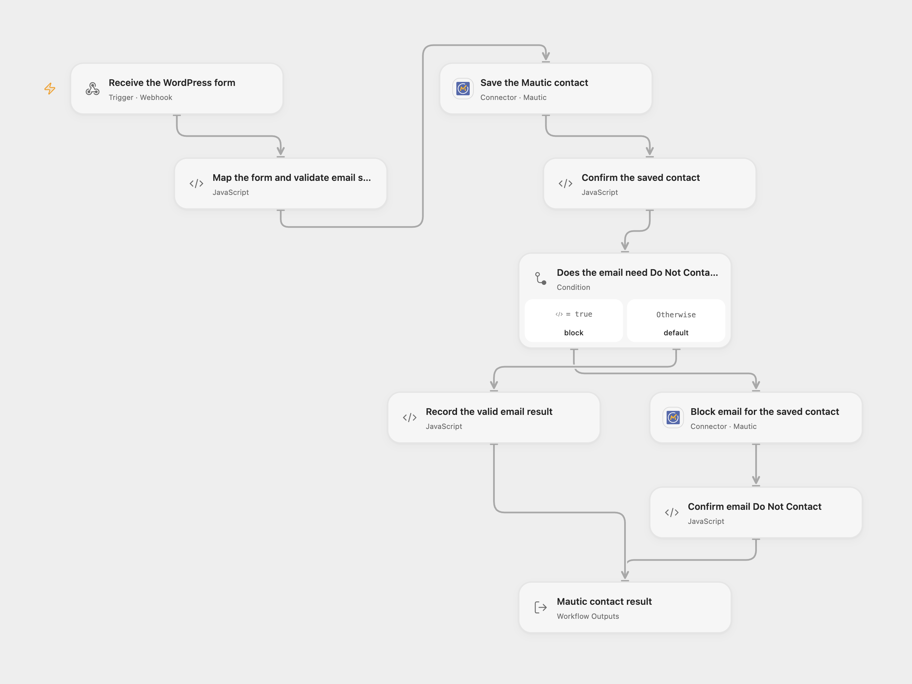

# Save WordPress Form Contacts to Mautic

Save contacts from a WordPress form and add an email Do Not Contact entry when the submitted address fails a basic syntax check.

<!-- template-actions:start -->
 
<!-- template-actions:end -->

<picture>
  <source media="(prefers-color-scheme: dark)" srcset="preview-dark.png">
  
</picture>

## Setup

1. Enable the Mautic API and HTTP Basic authentication on a publicly reachable HTTPS instance. Use the same Mautic connection in **Save the Mautic contact** and **Block email for the saved contact**. The API user needs contact creation and edit permissions.
2. Set the expected form ID in **Map the form and validate email syntax**. Create a secret variable named `WORDPRESS_FORM_KEY`. In **Receive the WordPress form**, set **Header** authentication to use the `X-WordPress-Form-Key` header and that secret. Publish with **Enable Writes** off. Test that requests without the secret return HTTP 401. A request with the correct secret acknowledges the run, which stops before Mautic writes.
3. Configure your WordPress form to send a server-side HTTPS POST with that header and `Content-Type: application/json`. Send a flat JSON object with the string fields `Nome`, `E-mail`, `WhatsApp`, and `form_id`. From Elementor Pro's [form submission hook](https://developers.elementor.com/docs/hooks/forms.html#form-new-record), filter for your form and send the values with `wp_remote_post` and `wp_json_encode`. Keep the secret on the WordPress server. [WordPress HTTP API](https://developer.wordpress.org/reference/functions/wp_remote_post/)
4. Turn on **Enable Writes** and publish.

## Behavior

The webhook acknowledges receipt before Mautic processes the request. It saves the title-cased name, lowercased email, and WhatsApp number as the contact's first name, email, and mobile. If the address fails the basic syntax check and Mautic accepts the contact, the workflow sets email **Do Not Contact** on the returned Contact ID using the manual reason. It preserves any existing unsubscribe. An address that passes the syntax check leaves contact preferences alone. This check only evaluates syntax.

The workflow reports the confirmed Contact ID and the outcome. If Mautic rejects the save, the workflow stops before changing contact preferences. If the write outcome is uncertain, look up the contact and its email preference before retrying the submission.

In n8n

Import the workflow and bind a **Header Auth** credential for `X-WordPress-Form-Key` to **Receive the WordPress form**. Configure the WordPress sender for that webhook URL. The endpoint also accepts the original URL-encoded form body with the same field names and header. Bind the same HTTPS Mautic credential to **Save the Mautic contact** and **Block email for the saved contact**. In **Map the form and validate email syntax**, set the expected form ID and keep `enableWrites` off while you verify authentication. Turn it on and activate the workflow after the test.

Inspiration &amp; credits

Adapted from [Wordpress Form to Mautic](https://github.com/Zie619/n8n-workflows/blob/ae8cf6dc5b873cbb4f74587aa9180ed3a9f70682/workflows/Noop/1892_Noop_Mautic_Automation_Webhook.json) in [Zie619/n8n-workflows](https://github.com/Zie619/n8n-workflows). Attribution: Zie619 / n8n-workflows.

The collection’s [MIT notice](https://github.com/Zie619/n8n-workflows/blob/94007c1445d9258a7da116646b79473e7c7c3282/LICENSE) is pinned at a later revision. This is the collection notice at that revision; it does not establish a separate original template author's license. Our changes are listed above; see [repository licensing](../../README.md#licensing).

> MIT License
>
> Copyright (c) 2025 Zie619
>
> Permission is hereby granted, free of charge, to any person obtaining a copy
> of this software and associated documentation files (the "Software"), to deal
> in the Software without restriction, including without limitation the rights
> to use, copy, modify, merge, publish, distribute, sublicense, and/or sell
> copies of the Software, and to permit persons to whom the Software is
> furnished to do so, subject to the following conditions:
>
> The above copyright notice and this permission notice shall be included in all
> copies or substantial portions of the Software.
>
> THE SOFTWARE IS PROVIDED "AS IS", WITHOUT WARRANTY OF ANY KIND, EXPRESS OR
> IMPLIED, INCLUDING BUT NOT LIMITED TO THE WARRANTIES OF MERCHANTABILITY,
> FITNESS FOR A PARTICULAR PURPOSE AND NONINFRINGEMENT. IN NO EVENT SHALL THE
> AUTHORS OR COPYRIGHT HOLDERS BE LIABLE FOR ANY CLAIM, DAMAGES OR OTHER
> LIABILITY, WHETHER IN AN ACTION OF CONTRACT, TORT OR OTHERWISE, ARISING FROM,
> OUT OF OR IN CONNECTION WITH THE SOFTWARE OR THE USE OR OTHER DEALINGS IN THE
> SOFTWARE.

