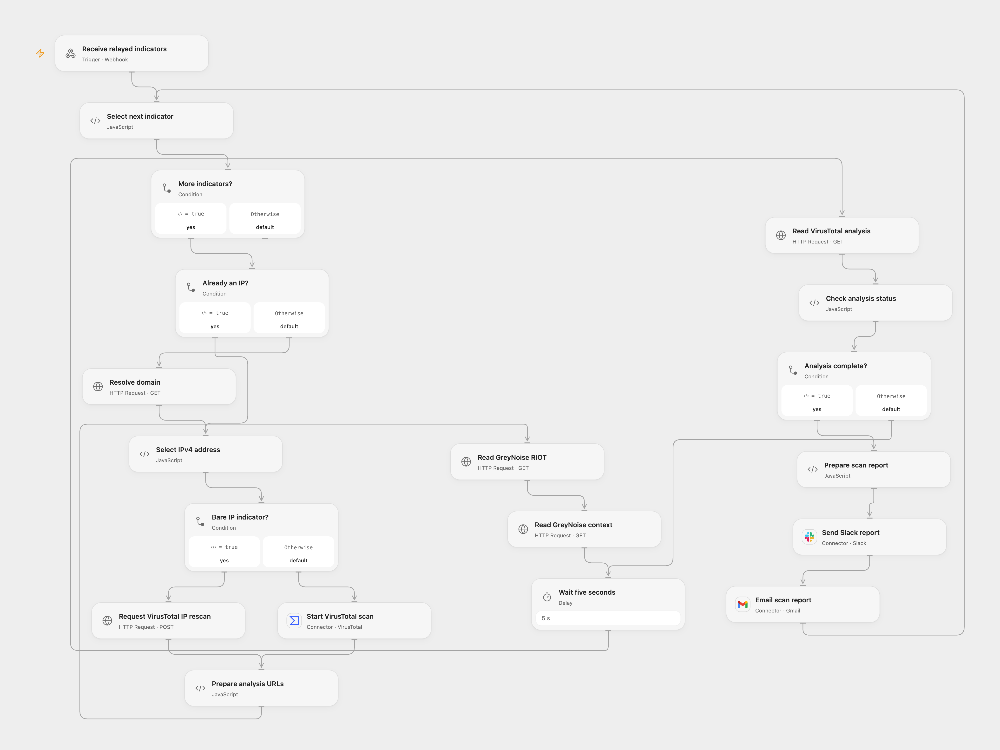

# Scan Indicators with VirusTotal and GreyNoise

Scan submitted URLs or IPs, enrich results with GreyNoise and send a report.

<picture>
  <source media="(prefers-color-scheme: dark)" srcset="preview-dark.png">
  
</picture>

[Open Flow JSON](templates/scan-indicators-with-virustotal-and-greynoise.openflow.json) · [n8n JSON](templates/scan-indicators-with-virustotal-and-greynoise.n8n.json)

## Setup and use

Import the n8n workflow and configure VirusTotal, Slack and Gmail connections and HTTP Header Auth with header name key and your GreyNoise API key. Set **Webhook execution mode** and **Form execution mode** to n8n or openflow. For Open Flow set both relay URLs to its webhook. Bind secret Variables VIRUSTOTAL_API_KEY and GREYNOISE_API_KEY, connect VirusTotal, Slack and Gmail, and set the Slack channel. Use one mode.

## Behavior

Each submission contains an email and one or more URL or IP indicators. For a domain the workflow uses Google DNS to select an IPv4 address. It submits URLs to VirusTotal's URL scan and bare IPs to its IP reanalysis endpoint, then polls every five seconds until completed, and queries GreyNoise RIOT and context. It reports VirusTotal counts, BlockList and OpenPhish verdicts and GreyNoise context to Slack and email. VirusTotal states submitted indicators become available to its community; do not submit confidential or personal data. Both entrances acknowledge before processing; restrict access and inspect execution history. If a scan or report write has an unknown result, inspect the service before retrying. A Slack report may have been sent before an email failure.

Inspiration &amp; credits

## Changes to the source

- Open Flow processes indicators sequentially, uses native HTTP for complete VirusTotal pending results, and relays the n8n form or webhook. Accept the documented ip field using VirusTotal IP reanalysis (the account must have access and the IP must already be in VirusTotal); normalize schemeless domain URLs to HTTPS; n8n processes indicators sequentially and polls until completed.

Adapted from [VirusTotal and GreyNoise indicator scan](https://github.com/Zie619/n8n-workflows/blob/ae8cf6dc5b873cbb4f74587aa9180ed3a9f70682/workflows/Wait/0330_Wait_Webhook_Send_Webhook.json) in [Zie619/n8n-workflows](https://github.com/Zie619/n8n-workflows). The source export does not identify a separate template author or license.

The collection’s [MIT notice](https://github.com/Zie619/n8n-workflows/blob/94007c1445d9258a7da116646b79473e7c7c3282/LICENSE) is pinned at a later revision. This is the collection notice at that revision; it does not establish a separate original template author's license. Our changes are listed above; see [repository licensing](../../README.md#licensing).

> MIT License
>
> Copyright (c) 2025 Zie619
>
> Permission is hereby granted, free of charge, to any person obtaining a copy
> of this software and associated documentation files (the "Software"), to deal
> in the Software without restriction, including without limitation the rights
> to use, copy, modify, merge, publish, distribute, sublicense, and/or sell
> copies of the Software, and to permit persons to whom the Software is
> furnished to do so, subject to the following conditions:
>
> The above copyright notice and this permission notice shall be included in all
> copies or substantial portions of the Software.
>
> THE SOFTWARE IS PROVIDED "AS IS", WITHOUT WARRANTY OF ANY KIND, EXPRESS OR
> IMPLIED, INCLUDING BUT NOT LIMITED TO THE WARRANTIES OF MERCHANTABILITY,
> FITNESS FOR A PARTICULAR PURPOSE AND NONINFRINGEMENT. IN NO EVENT SHALL THE
> AUTHORS OR COPYRIGHT HOLDERS BE LIABLE FOR ANY CLAIM, DAMAGES OR OTHER
> LIABILITY, WHETHER IN AN ACTION OF CONTRACT, TORT OR OTHERWISE, ARISING FROM,
> OUT OF OR IN CONNECTION WITH THE SOFTWARE OR THE USE OR OTHER DEALINGS IN THE
> SOFTWARE.

