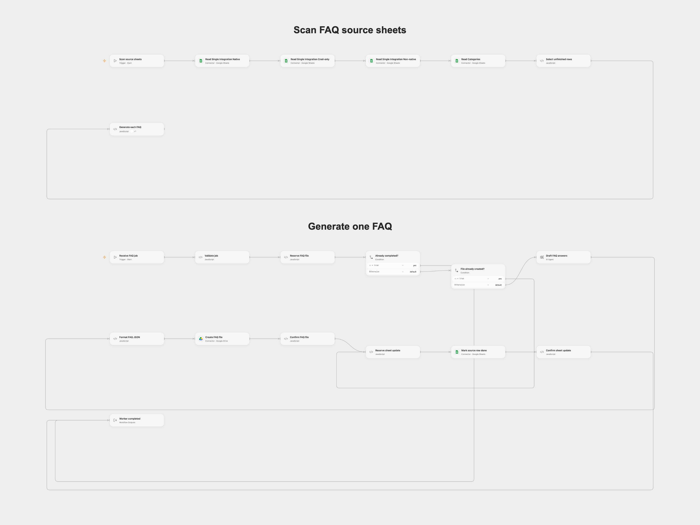

# Scan Integration Sheets and Generate FAQs

Scan four integration sheets and generate a FAQ JSON for each unfinished row.

<!-- template-actions:start -->
[](https://openflow.run/templates/scan-integration-sheets-and-generate-faq/) [](templates/scan-integration-sheets-and-generate-faq.n8n.json)
<!-- template-actions:end -->

<picture>
  <source media="(prefers-color-scheme: dark)" srcset="preview-dark.png">
  
</picture>

## Setup

Configure a spreadsheet containing four sheets named Single Integration Native, Single Integration Cred-only, Single Integration Non-native and Categories. Each needs a status column and a displayName column (or Category name for Categories). Supply the spreadsheet ID, four matching Drive folder IDs, and a reviewed current pricing answer. Connect Google Sheets and Drive and configure the AI model. Enable persistent State. Set the same reviewed pricing answer in all four Prepare nodes.

Import both bundled Open Flow workflows, **Scan FAQ source sheets** and **Generate one FAQ**. Publish the worker first, then refresh its interface in the scan workflow before running.

## Behavior

The manual scan selects rows whose status is blank, creates a job for each and calls the bundled FAQ worker. It writes a JSON file to the corresponding folder and marks the same sheet row done. Drafts need human review. Run only one scan at a time; inspect Drive and Sheets before clearing any pending checkpoint after an uncertain write.

<details>
<summary>In n8n</summary>

In n8n configure the same spreadsheet, each folder and each status column letter in its Prepare node, the Data Table, and the workflow self-call.

</details>

<details>
<summary>Inspiration &amp; credits</summary>

Adapted from [Enrich FAQ sections on your website pages at scale with AI](https://github.com/enescingoz/awesome-n8n-templates/blob/827110332c21cbe000ab13f6d292d5adb1f1f8db/OpenAI_and_LLMs/Enrich%20FAQ%20sections%20on%20your%20website%20pages%20at%20scale%20with%20AI.json) in [enescingoz/awesome-n8n-templates](https://github.com/enescingoz/awesome-n8n-templates).

Source collection notice: © 2024–2026 Enes Cingoz, [CC BY 4.0](https://github.com/enescingoz/awesome-n8n-templates/blob/827110332c21cbe000ab13f6d292d5adb1f1f8db/LICENSE). The source export does not identify a separate template author or license. See [repository licensing](../../README.md#licensing) for the scope of OOMOL contributions and third-party material.


Changes from source: Restore the four-sheet scanning entry point and bundle the callable FAQ worker, replace stale pricing figures with a user-supplied answer, and add write checkpoints.

Collection license notice:

```text
Creative Commons Attribution 4.0 International License

Copyright (c) 2024-2026 Enes Cingoz

You are free to:

  Share - copy and redistribute the material in any medium or format
  Adapt - remix, transform, and build upon the material for any purpose,
  even commercially.

Under the following terms:

  Attribution - You must give appropriate credit, provide a link to the
  license, and indicate if changes were made. You may do so in any
  reasonable manner, but not in any way that suggests the licensor
  endorses you or your use.

  No additional restrictions - You may not apply legal terms or
  technological measures that legally restrict others from doing
  anything the license permits.

Notices:

  You do not have to comply with the license for elements of the
  material in the public domain or where your use is permitted by an
  applicable exception or limitation.

  No warranties are given. The license may not give you all of the
  permissions necessary for your intended use. For example, other rights
  such as publicity, privacy, or moral rights may limit how you use the
  material.

For the full license text, see:
https://creativecommons.org/licenses/by/4.0/legalcode

```

</details>
