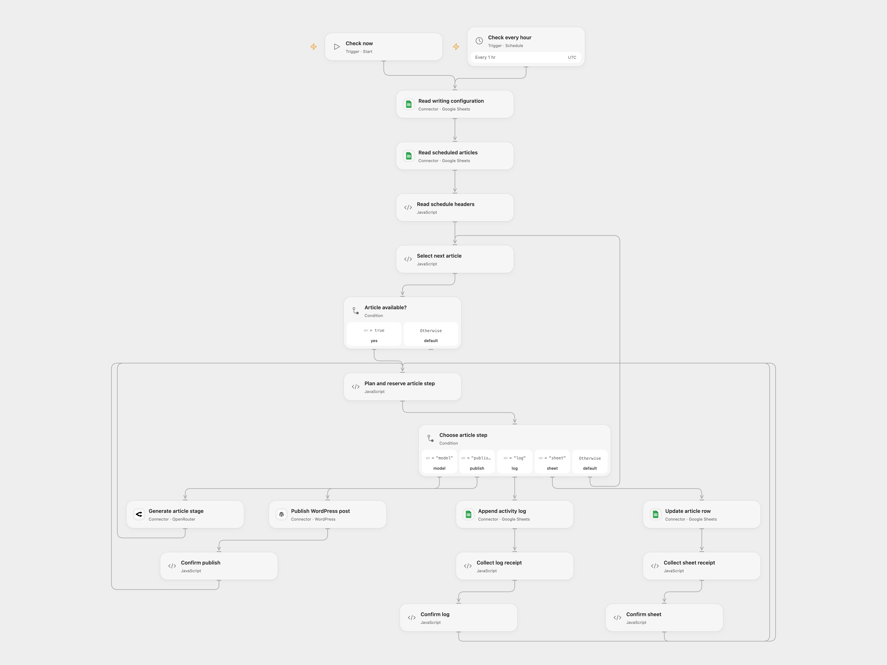

# Schedule Blog Writing and WordPress Publication

Use a Google Sheet to generate blog content by stage and publish scheduled posts to WordPress.

<picture>
  <source media="(prefers-color-scheme: dark)" srcset="preview-dark.png">
  
</picture>

[Open Flow JSON](templates/schedule-blog-writing-and-wordpress-publication.openflow.json) · [n8n JSON](templates/schedule-blog-writing-and-wordpress-publication.n8n.json)

## Setup

Connect Google Sheets, OpenRouter and WordPress. Configure the same spreadsheet ID in the read and write nodes and enable persistent State. Use Schedule, Config and Log worksheets. Schedule needs unique ID, Action, Status, Scheduled, Title and final headers; set Scheduled to UTC in YYYY-MM-DD HH:mm:ss format. Config contains Key and Value columns with prompt_<action> and prompt_<action>_model entries. Placeholders can refer to Schedule columns or Config keys. Supply prompts that request a JSON object; generated fields that match Schedule headers are merged into the row.

In n8n configure the three worksheet names, Sheets credentials and an OpenAI-compatible OpenRouter credential for the model node, plus WordPress credentials. Select a Data Table with text columns `item_key` and `status` in all checkpoint nodes. If a checkpoint remains, inspect WordPress and both sheet writes, complete or repair the row and log manually, and remove the checkpoint only when safe.

## Behavior

Every hour or on manual start, rows with different Action and Status are processed. An authoring action uses its configured prompt and model; a due publish action creates a published WordPress post. The workflow logs the operation and updates the original row. Avoid overlapping runs or editing rows while a run is in progress.

Before each external write the workflow records a pending checkpoint. If a result is uncertain, inspect the destination, enter the pending key and confirmed or absent in **Plan and reserve article step**, and run again with the original row unchanged. Clear those fields after recovery.

Inspiration &amp; credits

Use UTC scheduling, current service connections, per-row association and write checkpoints.

Adapted from [Blog Automation TEMPLATE](https://github.com/Zie619/n8n-workflows/blob/ae8cf6dc5b873cbb4f74587aa9180ed3a9f70682/workflows/Code/1809_Code_Schedule_Automate_Webhook.json) in [Zie619/n8n-workflows](https://github.com/Zie619/n8n-workflows). Attribution: Zie619 / n8n-workflows.

The collection’s [MIT notice](https://github.com/Zie619/n8n-workflows/blob/94007c1445d9258a7da116646b79473e7c7c3282/LICENSE) is pinned at a later revision. This is the collection notice at that revision; it does not establish a separate original template author's license. Our changes are listed above; see [repository licensing](../../README.md#licensing).

> MIT License
>
> Copyright (c) 2025 Zie619
>
> Permission is hereby granted, free of charge, to any person obtaining a copy
> of this software and associated documentation files (the "Software"), to deal
> in the Software without restriction, including without limitation the rights
> to use, copy, modify, merge, publish, distribute, sublicense, and/or sell
> copies of the Software, and to permit persons to whom the Software is
> furnished to do so, subject to the following conditions:
>
> The above copyright notice and this permission notice shall be included in all
> copies or substantial portions of the Software.
>
> THE SOFTWARE IS PROVIDED "AS IS", WITHOUT WARRANTY OF ANY KIND, EXPRESS OR
> IMPLIED, INCLUDING BUT NOT LIMITED TO THE WARRANTIES OF MERCHANTABILITY,
> FITNESS FOR A PARTICULAR PURPOSE AND NONINFRINGEMENT. IN NO EVENT SHALL THE
> AUTHORS OR COPYRIGHT HOLDERS BE LIABLE FOR ANY CLAIM, DAMAGES OR OTHER
> LIABILITY, WHETHER IN AN ACTION OF CONTRACT, TORT OR OTHERWISE, ARISING FROM,
> OUT OF OR IN CONNECTION WITH THE SOFTWARE OR THE USE OR OTHER DEALINGS IN THE
> SOFTWARE.

