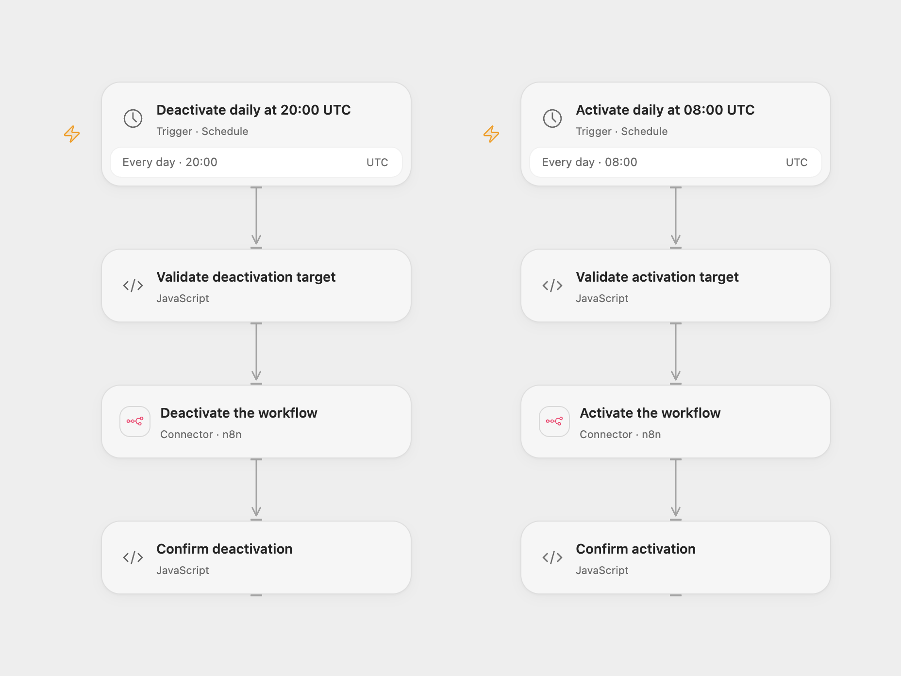

# Schedule n8n Workflow Activity

Activate an n8n workflow each morning and deactivate it each evening.

<picture>
  <source media="(prefers-color-scheme: dark)" srcset="preview-dark.png">
  
</picture>

[Open Flow JSON](templates/schedule-n8n-workflow-activity.openflow.json) · [n8n JSON](templates/schedule-n8n-workflow-activity.n8n.json)

## Setup

Connect n8n with permission to activate and deactivate the target workflow. In Open Flow, create a Variable named `N8N_TARGET_WORKFLOW_ID` containing its workflow ID and bind it to both **Validate activation target** and **Validate deactivation target**. In n8n, set the target ID in **Workflow ID** and connect the n8n credential to both action nodes. The target must be a different workflow from this scheduler, or deactivation would stop the scheduler itself. Activate one format.

## Behavior

The workflow activates the selected n8n workflow daily at 08:00 UTC and deactivates it daily at 20:00 UTC. Open Flow runs at the minute boundary; n8n uses a fixed second within that minute selected at registration. Adjust both schedules and time zones to your operating hours. Both actions check the returned workflow ID and active state. In n8n 2.x, these API operations publish and unpublish a workflow. Review the target draft and version before enabling this schedule. Access to the n8n public API and permission for the target are required; availability depends on the n8n plan and instance configuration.

A failed or lost response may still mean the requested status change occurred. Check the target in n8n before retrying. This schedule controls activation; it does not stop executions already running or guarantee that scheduled jobs were processed while the target was inactive.

## Changes to the source

- Replace the private target ID, use UTC as the starting time zone and verify the returned target and status. The source inherited the instance time zone.
- n8n checks that the target is not the scheduler itself.

Source and license

Adapted from [Schedule workflow activity time](https://github.com/Zie619/n8n-workflows/blob/ae8cf6dc5b873cbb4f74587aa9180ed3a9f70682/workflows/Schedule/1820_Schedule_N8N_Automate_Scheduled.json) in [Zie619/n8n-workflows](https://github.com/Zie619/n8n-workflows). The matching [n8n community listing](https://n8n.io/workflows/3229-activate-and-deactivate-workflows-on-schedule-using-native-n8n-api/) credits Olek. The original template does not state a separate license.

The collection’s [MIT notice](https://github.com/Zie619/n8n-workflows/blob/94007c1445d9258a7da116646b79473e7c7c3282/LICENSE) is pinned at a later revision. This is the collection notice at that revision; it does not establish a separate original template author's license. Our changes are listed above; see [repository licensing](../../README.md#licensing).

> MIT License
>
> Copyright (c) 2025 Zie619
>
> Permission is hereby granted, free of charge, to any person obtaining a copy
> of this software and associated documentation files (the "Software"), to deal
> in the Software without restriction, including without limitation the rights
> to use, copy, modify, merge, publish, distribute, sublicense, and/or sell
> copies of the Software, and to permit persons to whom the Software is
> furnished to do so, subject to the following conditions:
>
> The above copyright notice and this permission notice shall be included in all
> copies or substantial portions of the Software.
>
> THE SOFTWARE IS PROVIDED "AS IS", WITHOUT WARRANTY OF ANY KIND, EXPRESS OR
> IMPLIED, INCLUDING BUT NOT LIMITED TO THE WARRANTIES OF MERCHANTABILITY,
> FITNESS FOR A PARTICULAR PURPOSE AND NONINFRINGEMENT. IN NO EVENT SHALL THE
> AUTHORS OR COPYRIGHT HOLDERS BE LIABLE FOR ANY CLAIM, DAMAGES OR OTHER
> LIABILITY, WHETHER IN AN ACTION OF CONTRACT, TORT OR OTHERWISE, ARISING FROM,
> OUT OF OR IN CONNECTION WITH THE SOFTWARE OR THE USE OR OTHER DEALINGS IN THE
> SOFTWARE.

