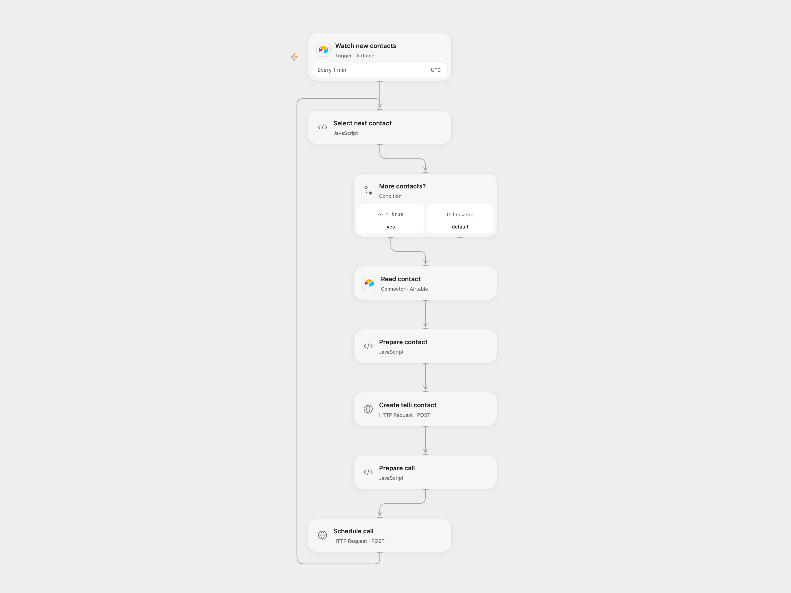

# Schedule telli Calls from Airtable

Create telli contacts and schedule voice-agent calls for new Airtable records.

<picture>
  <source media="(prefers-color-scheme: dark)" srcset="preview-dark.png">
  
</picture>

[Open Flow JSON](templates/schedule-telli-calls-from-airtable.openflow.json) · [n8n JSON](templates/schedule-telli-calls-from-airtable.n8n.json)

## Setup

Connect Airtable and configure the same base and table in **Watch new contacts** and **Read contact**. The table needs a created-time field named Created Time and first_name, last_name and phone_number fields. Optional fields are email, salutation, timezone, external_url and contact_details. Bind the secret Variable TELLI_API_KEY and set your telli agent ID in **Prepare call**. Connect Airtable in n8n, set its table and use Header Auth with Bearer followed by the telli API key on both requests. Set your agent ID in **Schedule Calls Request**.

Activate one format. Open Flow establishes a baseline on the first Airtable poll; add records after that poll completes. Records created during the baseline query may be absorbed into it.

## Behavior

New records are processed sequentially: the Airtable record ID and contact fields create a telli contact, then the returned contact_id and configured agent ID schedule a call. Contact information is sent to telli. The add-contact endpoint is deprecated but remains operational alongside telli's current contacts API. If either write fails or its result is unknown, inspect telli before retrying; earlier contacts or calls are not rolled back and retries can duplicate them.

Inspiration &amp; credits

## Changes to the source

- Map contact fields explicitly and supply an agent ID; the source leaves contact mapping empty.

Adapted from [Connect Airtable contacts to telli for automated AI voice call scheduling](https://github.com/Zie619/n8n-workflows/blob/ae8cf6dc5b873cbb4f74587aa9180ed3a9f70682/workflows/Http/1852_HTTP_Stickynote_Automate_Webhook.json) in [Zie619/n8n-workflows](https://github.com/Zie619/n8n-workflows). The source template is attributed to Paulo Ramirez; no separate template license is identified.

The collection’s [MIT notice](https://github.com/Zie619/n8n-workflows/blob/94007c1445d9258a7da116646b79473e7c7c3282/LICENSE) is pinned at a later revision. This is the collection notice at that revision; it does not establish a separate original template author's license. Our changes are listed above; see [repository licensing](../../README.md#licensing).

> MIT License
>
> Copyright (c) 2025 Zie619
>
> Permission is hereby granted, free of charge, to any person obtaining a copy
> of this software and associated documentation files (the "Software"), to deal
> in the Software without restriction, including without limitation the rights
> to use, copy, modify, merge, publish, distribute, sublicense, and/or sell
> copies of the Software, and to permit persons to whom the Software is
> furnished to do so, subject to the following conditions:
>
> The above copyright notice and this permission notice shall be included in all
> copies or substantial portions of the Software.
>
> THE SOFTWARE IS PROVIDED "AS IS", WITHOUT WARRANTY OF ANY KIND, EXPRESS OR
> IMPLIED, INCLUDING BUT NOT LIMITED TO THE WARRANTIES OF MERCHANTABILITY,
> FITNESS FOR A PARTICULAR PURPOSE AND NONINFRINGEMENT. IN NO EVENT SHALL THE
> AUTHORS OR COPYRIGHT HOLDERS BE LIABLE FOR ANY CLAIM, DAMAGES OR OTHER
> LIABILITY, WHETHER IN AN ACTION OF CONTRACT, TORT OR OTHERWISE, ARISING FROM,
> OUT OF OR IN CONNECTION WITH THE SOFTWARE OR THE USE OR OTHER DEALINGS IN THE
> SOFTWARE.

