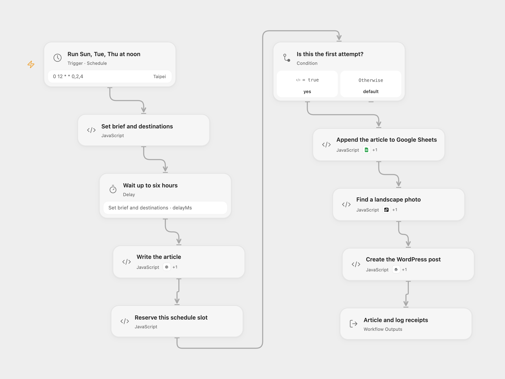

# Schedule WordPress Articles with Pexels Photos

Generate articles on a schedule, log them in Google Sheets, and publish them to WordPress with credited Pexels photos.

<!-- template-actions:start -->
 
<!-- template-actions:end -->

<picture>
  <source media="(prefers-color-scheme: dark)" srcset="preview-dark.png">
  
</picture>

## Setup

1. In **Set brief and destinations**, enter an editorial brief, the spreadsheet ID, and the sheet tab. Put `title`, `content`, and `Image search keyword` in columns A through C. Bind OpenAI in **Write the article** and Google Sheets in **Append the article to Google Sheets**.
2. Connect a Pexels API key in **Find a landscape photo** and the destination WordPress site in **Create the WordPress post**. Use an HTTPS WordPress site and an application password for a user with permission to create and publish posts.
3. The default WordPress status is **publish**. Set `postStatus` to `draft` to review a test run before publishing. Publish and enable the workflow when you are ready. It runs Sunday, Tuesday, and Thursday at 12:00 in the Asia/Taipei time zone.

## Behavior

Each scheduled run waits a random interval of up to six hours before asking OpenAI for a full article and three to five image keywords. It formats the text as HTML and appends the title, body, and search keywords as raw values in Google Sheets. Then it searches Pexels, embeds the first landscape result in the same article, credits the photographer with a link to the photo, and creates the WordPress post. The image is hosted by Pexels. Setting a WordPress featured image requires separate site configuration.

The sheet row logs the generated article before image search and publication. If Pexels returns no usable photo, the row remains for review. A successful run returns the WordPress post ID, status, slug, and the range written in Google Sheets. After an interrupted or unconfirmed write, check the sheet row and WordPress slug before recovering the slot. The workflow reserves each scheduled minute before the first write so replaying that slot cannot automatically create another article.

In n8n

Set the same brief, spreadsheet, publication status, and your WordPress HTTPS site URL in **Set brief and destinations**. Attach an OpenAI credential to **Write the article**, a Google Sheets OAuth credential to **Append the article to Google Sheets**, Header Auth with the Pexels API key in the `Authorization` header to **Find a landscape photo**, and Basic Auth with your WordPress application password to **Create the WordPress post**.

Create a dedicated Data Table with text columns `request_key`, `status`, and `receipt`. Select it in **Check this schedule slot**, **Reserve this schedule slot**, **Record the sheet receipt**, and **Record the confirmed post**. Use one production execution slot to serialize attempts. For an unconfirmed write, check the external services before resuming. Retrying directly at the failed write node skips the reservation check.

Inspiration &amp; credits

Adapted from [Automated Content Generation & Publishing - Wordpress](https://github.com/Zie619/n8n-workflows/blob/ae8cf6dc5b873cbb4f74587aa9180ed3a9f70682/workflows/Wait/1771_Wait_Code_Automate_Webhook.json) in [Zie619/n8n-workflows](https://github.com/Zie619/n8n-workflows). Attribution: Sunny (original workflow) / Zie619 / n8n-workflows (collection).

[Original n8n workflow by Sunny](https://n8n.io/workflows/3018-automated-content-generation-and-publishing-wordpress/).

## Changes to the source

Use the connected weekly trigger and set the random wait unit explicitly. Keep the original publication status, preserve the Sheets-first sequence, add the photo credit, and reserve one write attempt per scheduled minute.

The collection’s [MIT notice](https://github.com/Zie619/n8n-workflows/blob/94007c1445d9258a7da116646b79473e7c7c3282/LICENSE) is pinned at a later revision. This is the collection notice at that revision; it does not establish a separate original template author's license. Our changes are listed above; see [repository licensing](../../README.md#licensing).

> MIT License
>
> Copyright (c) 2025 Zie619
>
> Permission is hereby granted, free of charge, to any person obtaining a copy
> of this software and associated documentation files (the "Software"), to deal
> in the Software without restriction, including without limitation the rights
> to use, copy, modify, merge, publish, distribute, sublicense, and/or sell
> copies of the Software, and to permit persons to whom the Software is
> furnished to do so, subject to the following conditions:
>
> The above copyright notice and this permission notice shall be included in all
> copies or substantial portions of the Software.
>
> THE SOFTWARE IS PROVIDED "AS IS", WITHOUT WARRANTY OF ANY KIND, EXPRESS OR
> IMPLIED, INCLUDING BUT NOT LIMITED TO THE WARRANTIES OF MERCHANTABILITY,
> FITNESS FOR A PARTICULAR PURPOSE AND NONINFRINGEMENT. IN NO EVENT SHALL THE
> AUTHORS OR COPYRIGHT HOLDERS BE LIABLE FOR ANY CLAIM, DAMAGES OR OTHER
> LIABILITY, WHETHER IN AN ACTION OF CONTRACT, TORT OR OTHERWISE, ARISING FROM,
> OUT OF OR IN CONNECTION WITH THE SOFTWARE OR THE USE OR OTHER DEALINGS IN THE
> SOFTWARE.

